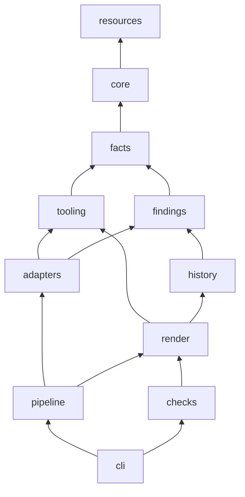

# dossier developer guide

## Contents

- [Overview](#overview)
- [Getting started](#getting-started)
- [Repository layout](#repository-layout)
- [Architecture](#architecture)
- [How to make changes](#how-to-make-changes)
- [Testing](#testing)
- [Code conventions](#code-conventions)
- [Configuration and environment](#configuration-and-environment)
- [Build, release and deploy](#build-release-and-deploy)
- [Debugging and troubleshooting](#debugging-and-troubleshooting)
- [Gotchas](#gotchas)
- [LLM prompts](#llm-prompts)

## Overview

dossier is a Claude Code skill. A Python package (`src/dossier/`, started by the launcher `scripts/dossier.py`) measures a git repository at one pinned commit, runs language tools over it and renders a single HTML page; Claude reads the code and writes the cards that need judgement. The standard library plus Pygments is all the CLI imports at run time; every other tool is started through `uv` or `npm` with pinned versions.

Stack: Python 3.11+ run by `uv`, as a `src/`-layout project (`pyproject.toml`, `uv.lock`; ruff, ty and pytest in the `dev` group). The Python, TypeScript and Semgrep workers keep `>=3.10` because they run under the analysed repository's own Python and import nothing newer. Tools: tree-sitter, Semgrep, grimp, vulture and import-linter for Python, scip-python, dependency-cruiser, knip and scip-typescript for JS and TS, scip-dotnet for C#, Mermaid in the page. Linux and macOS. The page works in current Chromium, Firefox and Safari; the page check needs Playwright's Chromium.

What to build is decided in [plans/004-v1-spec.md](plans/004-v1-spec.md). How milestones are planned and reviewed is in [plans/015-process.md](plans/015-process.md). The backlog is [plans/016-post-v1.md](plans/016-post-v1.md). The package layout was set by [plans/014-package-refactor-plan.md](plans/014-package-refactor-plan.md). The user-visible behaviour is in the [user guide](user-guide.md).

## Getting started

Prerequisites: `git`, `uv`, Node 22.13 or later (for the JS tests) and the .NET SDK (for the C# tests).

```sh
git clone https://github.com/1npo/dossier
cd dossier
uv sync
uv run pytest -q
```

`uv sync` creates `.venv/` in the clone with the `dev` group. Expected: **3108 passed, 305 skipped**, no failures, in about 80 seconds. The skips are the slow tests; the count can differ by a skip that depends on the tools installed.

The slow tests run the real tools, need the network and a browser, and take about 25 minutes. Run them alone, with nothing else building beside them:

```sh
DOSSIER_SLOW=1 uv run pytest -q --basetemp=$HOME/.cache/dossier-slow
rm -rf $HOME/.cache/dossier-slow
```

Always set `--basetemp` to a folder under your home: `/tmp` is small and the tools fill it. Two tests fail by design today and are not regressions: `test_overlapping_paragraphs_are_reported` and `test_each_browser_mutation_makes_a_fail[chart-text-small-chart text]`. The one slow-run skip is `tests/unit/dossier/checks/test_browser_secret.py`, which needs Playwright in the test environment.

Lint and types, both of which must exit 0:

```sh
uv run ruff check
uv run ty check
```

To try the skill, copy or link the folder to `~/.claude/skills/dossier` and type `/dossier doctor` in Claude Code, or run the CLI directly with a scratch home:

```sh
export DOSSIER_HOME=$HOME/.cache/dossier-try DOSSIER_CONFIG=$HOME/.cache/dossier-try/config.json DOSSIER_CACHE=$HOME/.cache/dossier-try/cache
uv run scripts/dossier.py version
uv run scripts/dossier.py doctor .
```

`version` prints `dossier <VERSION>`; `doctor` ends with `skill: <commit> (clean)` on a clean clone. `uv run scripts/dossier.py` runs the launcher in uv's cached script environment, not in `.venv/`, exactly as Claude does.

## Repository layout

```
SKILL.md                  Claude's instructions for /dossier (frontmatter: name, arguments, allowed tools)
README.md                 what dossier is, install, usage, map of the repository
LICENSE  VERSION          VERSION is the one source of the version
pyproject.toml  uv.lock   the Python project: dependencies, ruff, ty, pytest
.claude-plugin/           marketplace.json and plugin.json (the repository is its own marketplace)
.github/workflows/        release.yaml: lint, types, tests, then tag and zip on a version bump
scripts/                  what Claude runs: two launchers, nothing else
  dossier.py                the CLI launcher (PEP 723: pygments)
  check_page.py             the browser check launcher (PEP 723: playwright)
prompts/                  what Claude reads while it builds: method.md, reports.md, verify.md
src/dossier/              the Python package (subpackages under Architecture)
  data/                   package data, read only through dossier.resources (data/README.md lists every group)
tests/                    unit/, integration/, content/, support/, fixtures/ (tests/README.md)
tools/                    maintainer scripts, not part of /dossier (tools/README.md)
docs/
  user-guide.md  developer-guide.md  images/
  plans/                  every plan, priming prompt, handoff, the process note and the backlog, numbered
```

`docs/plans/` is the project's history: plans `000` to `014`, the process note, the backlog and the priming prompts that started each milestone. Every file there starts with a three-digit number (the `claude-planning-docs` convention), so the folder has no README; this paragraph describes it instead. Old plans keep the paths of their time and are not edited.

## Architecture

### The build

```
/dossier build
  prepare ──> build.json, facts.json, extract/*.json, a clean checkout of the pinned commit
     │
  Claude reads and writes reports/*.json (cards that code does not draw)
     │
  render ──> dossier-<repo>.html, summary.json     (V1 to V8, V10, V11 run here)
     │
  check ──> opens the page in a browser            (V12)
     │
  [--verify] verify-sample ──> subagents ──> verify-record ──> render
```

`build.json` records ten steps in order (`core/buildlog.py`, `STEPS`): `pin`, `tools`, `copy`, `measure`, `extract`, `read`, `write`, `check`, `gaps`, `render`. Only the code writes it (`buildlog.WRITERS`); Claude never edits it.

### Subpackages and the dependency rule

| Subpackage | Holds | May import (besides itself and the standard library) |
|---|---|---|
| `dossier.resources` (module) | paths to package data, the skill root, the version | nothing |
| `core` | leaf utilities with no domain knowledge: config file, build log, graph helpers, card schema loader, SCIP reader | `resources` |
| `facts` | deterministic facts about the repository at the pin: files, languages, manifests, dependencies, environment reads, markers | `resources`, `core` |
| `tooling` | running things on the host: which tools exist, the safe runner, the locked-worker clients, the .NET SDK check | `resources`, `core`, `facts` |
| `findings` | the component model, candidate findings with stable ids, people figures, open items and decisions | `resources`, `core`, `facts` |
| `history` | the whole git history folded once: per-file, per-pair, per-person figures, ownership, approvals, workflow | `resources`, `core`, `facts`, `findings` |
| `adapters` | turning one language's code into the standard outputs | `resources`, `core`, `facts`, `tooling`, `findings` |
| `render` | the page: citations and markup, measured cards, the process card, viewer, portfolio, `summary.json` | `resources`, `core`, `facts`, `tooling`, `findings`, `history` |
| `checks` | V2 to V7 and V11 to V12, and `--verify` sampling | `resources`, `core`, `facts`, `findings`, `render` |
| `pipeline` | the `prepare` stages: work area, restore, the extract runner, incremental planning | `resources`, `core`, `facts`, `tooling`, `findings`, `adapters`, `render` |
| `cli` | argument parsing and one module per command group | everything |



Arrows point from importer to imported; transitive edges are allowed and omitted. Rules inside subpackages: `render.markup` imports nothing from `dossier.render`; `render.measured.*` never imports `render.page`; `adapters.base` imports no language adapter; `adapters.python`, `adapters.js` and `adapters.csharp` never import one another. Every `__init__.py` holds a docstring naming its modules and an `__all__` of them, and imports nothing at module level: `scripts/check_page.py` imports `dossier.render.viewer` in an environment that has Playwright and not Pygments, so an eager `__init__` would break it. Each subpackage's `__init__.py` docstring gives the one-line role of every module in it.

`tests/content/test_layers.py` enforces all of this with an `ast` walk over `src/dossier`, including imports inside functions.

**Two import cycles were removed** when the code became a package. They had been hidden by imports inside functions:

- *adapters*: the adapter interface imported the five adapters to register them, and each adapter imported the interface. Now `adapters/base.py` holds the interface (`Adapter`, `Context`, `OUTPUTS`) and imports no adapter, `adapters/registry.py` imports the five adapters at the top, and the extract stage lives in `pipeline/extract.py`.
- *render*: the page module and thirteen modules (every measured card, `process`, `candidates`, `candidates_history`, `history`) imported each other through `import render` inside functions. The HTML primitives they shared (`E`, `path_code`, `render_table`, `source_cell`, `badge`, ...) moved to `render/markup.py`, which every card imports at the top. People figures that `findings` needed (`names_of`, `component_stats`, `bus_factor`) moved from the people card to `findings/people.py`.

A few imports inside functions remain: `cli/__init__.py`'s `main()` imports the parser there (so `import dossier.cli` loads nothing else), and `findings/candidates.py` and `render/process.py` import a module of their own or a lower layer. None of them forms a cycle, and `test_layers.py` checks them like the top-level ones.

### How the package is run

`SKILL.md` runs `uv run ${CLAUDE_SKILL_DIR}/scripts/dossier.py <command>`. `scripts/dossier.py` is a PEP 723 launcher: its header lists `pygments` and `requires-python >=3.11`, uv builds a cached environment from it under `~/.cache/uv/`, and the file replaces `sys.path[0]` (its own folder) with `../src`, then calls `dossier.cli.main`. Nothing is installed into the skill folder. `scripts/check_page.py` is the same shape with `playwright` (unpinned, so it matches the Chromium the user installed) and calls `dossier.checks.browser.main`.

Why a launcher and not `uv run --project ${CLAUDE_SKILL_DIR} dossier`: `--project` writes `.venv/` into the installed copy (a plugin cache folder or a clone the user pulls), installs the `dev` group unless every call says `--no-dev`, needs hatchling from the network on first use, and fails under `--locked` when `uv.lock` is stale on a user's machine. `uvx --from` was rejected too: it caches a built wheel and does not rebuild on every edit, so a developer can run stale code. The launcher keeps every documented command, the `Bash(uv run *)` permission and the plugin and zip installs as they were.

The launcher's header and `pyproject.toml`'s `[project]` must name the same dependencies and Python floor; `tests/content/test_launcher.py` checks that. `python -m dossier` (`src/dossier/__main__.py`) runs the same CLI inside `.venv/` for development.

### Package data

Every file the code reads by path (card schemas, the summary schema, Semgrep rules, page assets, vendored bundles, workers, Node helper projects, `tools.json`, `eol.json`) lives under `src/dossier/data/` and is reached only through `dossier.resources`:

- `resources.data(*parts)` is the path of a file or folder under `dossier/data/`. It is a real path, so it can be handed to semgrep, uv or npm.
- `resources.skill_root()` is the folder holding `SKILL.md`, `VERSION`, `scripts/` and `src/`; it raises if `SKILL.md` is missing.
- `resources.version()` is `VERSION`'s text.

No other module in the package builds a path from `__file__` (`test_layers.py` checks it). The one allowed attribute use is `render.page.gatherer_source`, which reads another module's `__file__` on purpose (see [Gotchas](#gotchas)). What stays outside the package, and why: `prompts/` (Claude reads it by path from `SKILL.md`), `VERSION` (CI and the plugin manifest check read it at the root), `SKILL.md` and `.claude-plugin/` (the install contract). [src/dossier/data/README.md](../src/dossier/data/README.md) lists every group and its reader.

The three workers (`data/workers/{py,ts,semgrep}_worker.py`) are not imported by the package. They run under the analysed repository's Python as `uv run --locked --script`, and uv finds each lock as `<script>.lock` beside it, so a worker and its lock always move together. The Node helpers (`data/node/js-tools/`, `data/node/scip-python/`) are copied into `<cache>/.dossier-tools/node/<name>-<lock sha>` and installed with `npm ci --ignore-scripts`; a byte change to a lock forces a reinstall.

### Adapters

An adapter turns one language's code into the standard outputs: entry points, import graph, symbols, I/O candidates, models, tests, dead code and blind spots (`adapters/base.py`, `OUTPUTS`). The shipped adapters are `CSharpAdapter`, `JsAdapter`, `PythonAdapter`, `RepoAdapter` (Dockerfiles, compose files, CI) and `TierBAdapter` (top-level definitions for Shell, Rust, Go, Ruby and Java), listed in `adapters/registry.py`'s `REGISTERED`. That order decides the order of build-log rows; do not change it. An adapter's `version` is part of the extract cache key: change what it outputs and the version goes up by one. Every repository code run goes through `sandbox.run` with the `restricted` profile and a scrubbed environment.

The protocol is `Adapter` (class attributes `name`, `version`, `languages`, `tools`, `rules`, `loads_repo_code`, `expected_untracked`, `blind_spots`; method `extract(ctx) -> dict[str, list[dict]]`) and `Context`. `Context` gives every adapter the same helpers: `ctx.read(path)` (the checkout's file as UTF-8, `None` if missing or not text), and `ctx.tool_ok(tool)`, `ctx.tool_skipped(tool, reason)`, `ctx.tool_failed(tool, reason)` for the tool status rows, with `base.failure_reason(e)` for an exception's reason.

Deliberately not abstracted: the per-language `project`, `queries`, `semgrep`, `api` and `entries` modules share file names but not contracts (`python.project.projects` returns a list, `csharp.project.projects` a dict, and each `queries` module exposes different functions), and the tool clients (`Grimp`, `Vulture`, `TsFacts`, `DepCruiser`, `Knip`, `ScipDotnet`) each wrap a different tool. Their shared part (`_call`, `check_result`) is in `tooling/shared_tools.py`. A shared protocol for them would have one implementation per method.

### Candidates, cards and checks

**Candidates.** `findings/candidates.py` lists every tool finding a report must account for. A report keeps, merges or dismisses each one; `dossier candidates --report ID --open` prints what is left. `candidates.FEEDS` says which extractor outputs feed which report, and `pipeline/incremental.py` uses it to decide which reports a change makes stale.

**Cards and schema.** `src/dossier/data/schemas/cards/<report>.json` defines each report's cards: id, title, tier (`M`, `A`, `R`, `M+A`), shape (`blocks`, `flows`, `entries`, `computed`) and slots. [Its README](../src/dossier/data/schemas/cards/README.md) describes the format. A report file written by Claude names card ids only.

**Measured cards.** Cards with tier `M` or shape `computed` are drawn by `render/measured/*.py` from the extract files, never written by Claude. `render/measured/cards.py` dispatches through each module's `DRAWN` table.

| Check | What it asserts | Where |
|---|---|---|
| V1 | Every citation resolves | `render/page.py` |
| V2 | The cited code contains the span a claim quotes (warning) | `checks/reports.py` |
| V3 | Every flow arrow has an import or a call behind it (warning) | `checks/v3.py` |
| V4, V5 | Every file is in a component; every tool finding has a decision; people and components are not left out | `checks/reports.py`, `checks/people.py` |
| V6 | Each report matches its card schema | `core/schema.py` |
| V7 | Blind-spot hits are recorded in Gaps (never fails) | `checks/v7.py` |
| V8 | `summary.json` matches `data/schemas/summary.schema.json` | `render/summary_check.py` |
| V9 | The path filter kept only expected paths (info) | `render/process.py` |
| V10 | Every build step has a record, and a skipped or failed one says why; a verifier sample needs recorded results | `render/process.py` |
| V11 | The page draws every row, column and entry of its sources | `checks/page_audit.py` |
| V12 | A browser: diagrams draw, text is readable, nothing overlaps, the viewer works | `checks/browser.py`, `checks/layout.py` |

**Staleness.** `cli/commands/prepare.py`'s `update_plan` compares the pinned commit with the last render and the skill's `major.minor` with the saved one. A new major or minor version plans a full rebuild.

**Freshness.** `pipeline/workarea.freshness` runs `git ls-remote` through `sandbox.run`, falls back to the remote-tracking branch, and `stage_pin` stores the result in the pin record of `build.json`. `render/page.py` draws it as the first tile of the `dossier.about` card.

### Windows, UTF-8 and paths

Adapters on Windows report backslash paths. `pipeline.extract.filter_paths` turns them into `/` paths and ends with an assertion that every kept path is tracked and has no `\`. `resources.ensure_utf8()` (called by the launchers' `main`) makes stdout and stderr UTF-8 and sets `PYTHONUTF8` for child processes; every `subprocess` call with `text=True` and every `read_text`/`write_text` names `encoding="utf-8"`.

### Prepare reports what it lost

`core.buildlog.tools_not_run` builds the list of tools that did not run; `prepare` prints it as `tool_report`, `render` and `check` repeat it. `pipeline.stages.stage_extract` stops with exit 4 when the dropped share is above `MAX_DROPPED_SHARE` (2%). `facts.gather.noise_reason` returns `test-report` for coverage and test-result files and `facts.files.ignored_reports` names them. A full build archives `reports/*.json` with `pipeline.incremental.archive_reports`. `scip-python` stays gated on a trusted ref: it starts the repository's Python interpreter.

### Checks V13 and resource findings

`checks/v13.py` holds the coverage check for five hand-written cards (card entries may carry `not_applicable`). `facts/resources.py` groups non-code files by (folder, extension) and finds the code that reads them; `pipeline.extract.write_resources` writes `extract/resources.json` (ids `rs-`, group `rsg-`, home card `io.inputs`).

### Page components added in 1.13

`render.markup.empty_table(tid, columns, message)` draws a table with no data: its headers and one centred `.none-found` row. Use it wherever a table or chart would otherwise be left out; `checks/layout.py` fails a measured card that draws nothing. `render.page.callout(body, variant, label)` is the alert box (note, tip, important, warning) used for standalone `text` blocks (the optional `variant` field) and for the components a card does not cover. A card that tool findings were fed to (`ctx["fed"]`) is drawn by `render_card` with a `#` column (`render_table(findings=True)`), `data-kind` on its rows and entries, the All/Kept/Dismissed/Added toggle (`cand_toggle`, wired by `data-cand-set` in `dossier.js`) and a hidden dismissed-findings table. `render.process.PARTIAL_ACTIONS` maps each reason a card can be partial to the action that clears it; a reason with no entry shows "See the reason" and becomes a Gaps item. `checks/v14.py` requires a citation for every backticked name in a component's Public surface. On Windows, `tooling.sandbox.run` resolves `npm` to `npm.cmd` with the child's PATH, and `adapters.python.scip.ensure_installed` patches the 0.6.x scip-python bundle, whose `new RegExp(path.sep, "g")` is invalid on Windows (`patch_windows_bundle`, original kept as `.orig`).

### Embedded modules

The page ships the source of three modules, `facts/gather.py`, `facts/deps.py` and `history/scan.py`, under the names `dossier-gatherer/*.py`, so the code viewer can show how a measured fact was counted (`render.page.gatherer_source`), and `data-a`/`data-b` attributes point at line numbers inside them. Any edit to those files changes every page, and moving a function can break a `FACT_INFO` line range (two end on `^def noise_reason\(`). Treat them as output: change them only when you mean to change the page, and never reformat them.

## How to make changes

Every recipe starts with a failing test. Run it, see it fail, then make it pass.

**Add a module.** Put it in the lowest subpackage whose "Holds" row fits and whose "May import" row covers what it imports (table under [Architecture](#subpackages-and-the-dependency-rule)). Give it a docstring (what it holds, what it reads, what it never does), an `__all__` after the import block listing the names other modules use, and annotations on those names. Add it to its subpackage's `__init__.py` docstring and `__all__`. Its unit tests go in `tests/unit/dossier/<subpackage>/test_<module>.py`. Run `uv run pytest -q tests/content/test_layers.py`.

**Add a Semgrep rule.**

1. Add the rule to `src/dossier/data/rules/<scope>/<family>.yml` with an id `dossier.<scope>.<family>.<name>` and `metadata.category` (see [the rules README](../src/dossier/data/rules/README.md) for the categories and blind-spot ids).
2. Add `ruleid:` and `ok:` lines to the test file of the same name under `tests/fixtures/semgrep/<scope>/`.
3. Run `DOSSIER_SLOW=1 uv run pytest -q tests/integration/dossier/tooling/test_shared_tools_rules.py`.
4. A new blind-spot id needs fixed wording in `checks/v7.py`'s `BLIND_SPOTS`: the wording is part of Gaps item ids, so never reword it.
5. Bump the adapter's `version`.

**Add or change a card field.**

1. Edit `src/dossier/data/schemas/cards/<report>.json`. Run `uv run pytest -q tests/unit/dossier/core/test_schema.py tests/content/test_schema_files.py`.
2. For a card code draws, change its function in `render/measured/`; for a written card, change `prompts/reports.md` and the example in `prompts/method.md` (`tests/content/test_prompts.py` validates the examples against the schema).
3. If the card shows measured numbers, add the V11 count to `checks/page_audit.py` and a mutation to `tests/support/broken_pages.py`.

**Add an adapter.**

1. Create `src/dossier/adapters/<lang>/` with an `__init__.py` (docstring and `__all__` only) and `adapter.py` holding a class that subclasses `adapters.base.Adapter` and fills the standard outputs (copy the shape of `adapters/repo.py`, the smallest). Give it a `version`. It may import `resources`, `core`, `facts`, `tooling`, `findings` and `adapters.base`, never another language's subpackage.
2. Add it to `REGISTERED` in `src/dossier/adapters/registry.py` (at the end, so existing build-log rows keep their order).
3. Add its tools to `src/dossier/data/tools.json` with `scope`, `min` and `install` text, so `doctor` knows them.
4. Add a fixture repository under `tests/fixtures/` and `test_adapter_slow.py` under `tests/integration/dossier/adapters/<lang>/`.
5. A language is Tier A in `tooling/toolcheck.py` only when it has an import graph; otherwise it stays Tier B and the cards badge it `no static graph`.

**Add a Tier B language.** Add a row to `LANGUAGES` in `src/dossier/adapters/tier_b.py` (grammar name, extensions, a query anchored at the root so only top-level definitions match, one capture name per kind), a fixture file in `tests/fixtures/tierb/` and an expected row in `tests/integration/dossier/adapters/test_tier_b_slow.py`. The symbols have kind `decl`, not `def`.

**Add a CLI subcommand or flag.**

1. Add the parser entry in `src/dossier/cli/parser.py` (`build_parser`, with `set_defaults(fn=<module>.cmd_<name>)`) and the `cmd_<name>` function in the fitting `src/dossier/cli/commands/<group>.py`. Shared helpers come from `dossier.cli.common`; call them as `common.<name>(...)` so a test's `monkeypatch.setattr(common, ...)` reaches every caller.
2. Name it in `docs/user-guide.md` and, if a user passes it, in `SKILL.md`'s `argument-hint`. `tests/content/test_docs.py` fails until you do.

**Add a check with a mutation.**

1. Write the check as a pure function in `src/dossier/checks/` that returns error lines.
2. Add a broken page to `tests/support/broken_pages.py` that the check must reject, and list the line it must produce. A check with no mutation is not accepted.

**Change the end-of-life snapshot.** Run `python3 tools/refresh_eol.py` (needs the network) and commit `src/dossier/data/eol.json`. The `.NET` data is fetched from Microsoft's `releases-index.json` once, by `prepare` (5 second timeout), and pinned with its date in `<out>/refdata.json`; `cmd_render` loads it into `facts["refdata"]` and the card never touches the network, so a render is a function of the build. `render --refresh-refdata` refetches (a failed fetch keeps the old pin). With no pin, the `dotnet` list in the snapshot, also from that index, is used, and the card's note says which was used. `DOSSIER_OFFLINE=1` turns the fetch off (the test suite sets it).

**Change code without changing output.** For a refactor, prove the page did not change: `tools/golden.py` captures the output of two copies of the skill (a worktree of `main` and your branch) on the fixture repositories and compares them under a fixed list of masks (times, the skill's own commit and folder, the embedded module bodies). Its docstring lists the masks; plan 014, section 8, block GF has the commands.

**Update the docs.** Any change to behaviour, options, setup or architecture updates `README.md`, `docs/user-guide.md` and this guide in the same change. `tests/content/test_docs.py` catches the drift it can: a missing command or flag, report names that no longer exist and broken links. `tests/content/test_paths.py` fails when a file names a path the package no longer has.

## Testing

[tests/README.md](../tests/README.md) has the tree. In short:

- **Unit tests** (`tests/unit/dossier/<subpackage>/test_<module>.py`) mirror `src/dossier/`. They are fast, use `tmp_path`, and never touch the network or the real home folder. One class per unit, `Test<Unit>`, with methods named `test_<scenario>_<expected result>`. Tests of `tools/` are in `tests/unit/tools/`.
- **Integration tests** (`tests/integration/dossier/...`) run real tools or real git and mirror the package the same way. Files named `*_slow.py` (and three others) carry a `skipif` on `DOSSIER_SLOW` and skip unless it is `1`.
- **Content tests** (`tests/content/`) test the repository's own files: docs drift, prompts, rules, schemas, release metadata, the launchers, fixture repositories, the dependency rule (`test_layers.py`), the test tree, the top-level layout and stale paths (`test_paths.py`).
- **Support** (`tests/support/`) holds what tests import: repository builders (`repos.py`), paths (`paths.py`: `SKILL_ROOT`, `FIXTURES`, `LAUNCHER`, `CHECK_PAGE`), fakes, `contexts.make_context`, the worker loader (`workers.py`), the page builders `m3_page.py` to `m6_page.py`, `broken_pages.py` and the browser probes. `tests/conftest.py` holds only fixtures.
- **Import mode.** pytest runs with `--import-mode=importlib` and `pythonpath = ["src", "tests/support", "tools"]`, so mirrored trees may repeat basenames (`test_adapter.py`) without `__init__.py` files. A test imports `from repos import build_py_repo`; a test module never imports another test module and never computes a path from `__file__`.
- **Fixtures** are small made-up repositories (`pyrepo`, `jsrepo`, `csrepo`, `pylib`, ...) and expected outputs. Never commit code from a public repository.
- **Test pages.** `m3_page.py` to `m6_page.py` build large synthetic dossiers for the V11 and V12 checks. `uv run python tests/support/m6_page.py` builds one in a temporary folder and prints the page's path.
- **Mutation tests.** `tests/support/broken_pages.py` damages a good page in one way per check; the check must then fail with a known line. They run through `tests/integration/dossier/checks/test_browser_slow.py`.
- **Ground truth.** `tools/ground_truth.py` scores a dossier against a hand-made truth for a public repository.
- **Before you finish,** run the whole default suite and report the result.

To test the skill by hand, build a small repository: set the three `DOSSIER_*` variables to a scratch folder, run `prepare`, write or copy reports, then `render` and `check`.

## Code conventions

- Python 3.11+ (3.10+ in the three worker scripts), `from __future__ import annotations`, standard library only in anything the CLI imports (plus Pygments).
- `uv run ruff check` and `uv run ty check` must exit 0; CI runs both. Ruff uses `E F UP B SIM I` at line length 120 with `E501` off; the other ignored codes in `pyproject.toml` are the lint baseline of the code before the package refactor, each with its count. Formatting is not enforced. ty runs on `src/dossier`; the modules in `pyproject.toml`'s `[[tool.ty.overrides]]` list still fail it and have every rule ignored. Fix a module and remove it from the list; never add a new module to it.
- Every module has a docstring and an `__all__` after its imports; names in `__all__` carry annotations (except in the [embedded modules](#embedded-modules)).
- Import package modules by their full name and keep the bound name the code uses: `from dossier.render import page as render`, `from dossier.adapters.python import api as py_api`. Many modules still use the flat names they had before the package existed; follow the file you are in.
- No `__file__` outside `dossier/resources.py` and the two launchers: read data with `resources.data(...)`, the skill folder with `resources.skill_root()`.
- Prefer small modules split by purpose; `render/page.py`, `facts/gather.py` and `facts/deps.py` are the known large ones.
- Every child process goes through `sandbox.run` or `ctx.run`. No shell strings.
- Nothing is dropped silently: no `[:N]` on data that feeds a card. A diagram view may hide links only through the stated filter, and says so on the page.
- Gaps and badge wording is fixed so item ids stay stable. Never reword it.
- Plain language in everything a dossier user reads. Measured values are never written by Claude.
- Commits are one task each, `type(dossier): subject`, made as Claude with the `Co-Authored-By` trailer; branch, merge and push follow the user's `git-workflow` skill.

## Configuration and environment

| Variable | Meaning |
|---|---|
| `DOSSIER_HOME` | Overrides the `home` config key. |
| `DOSSIER_CONFIG` | Path of the config file (default `~/.config/dossier/config.json`). |
| `DOSSIER_CACHE` | Overrides `cache_dir` (default `~/.local/cache/dossier`). |
| `DOSSIER_SLOW` | `1` runs the slow tests. |
| `DOSSIER_OFFLINE` | `1` turns off the reference-data fetch (the test suite sets it). |

The config keys are in the [user guide](user-guide.md#configuration). Commands that render or build set all three path variables to a fresh folder under `~/.cache`, so a test run never touches your real dossiers. Secrets: dossier never prints a secret value; files that match secret patterns are never embedded in the page.

## Build, release and deploy

The version lives in `VERSION` and `.claude-plugin/plugin.json`; `pyproject.toml` reads it from `VERSION` (`[tool.hatch.version]`). `python3 tools/bump_version.py {major|minor|patch}` sets both files and prints the new version.

A release:

1. Finish the work on a branch and merge it to `main`.
2. `git switch -c chore/release-X.Y.Z`.
3. `python3 tools/bump_version.py patch` (or `minor`, `major`), then `uv lock` and commit `uv.lock` too if it changed.
4. `uv run pytest -q tests/content/test_release_metadata.py`.
5. Commit as `Bump version to X.Y.Z`, merge to `main` with `git merge --no-ff`, push `main`.

The workflow `.github/workflows/release.yaml` runs when a push to `main` changes `VERSION`, or by hand from the Actions tab (checks only). Its `test` job sets up uv, Node 22 and .NET 10, then runs `uv run --locked ruff check`, `uv run --locked ty check` and `uv run --locked pytest -q` against the committed `uv.lock`, and validates the plugin and marketplace manifests. The `release` job then checks that `VERSION` and `plugin.json` agree, tags `vX.Y.Z` if the tag is new, and makes a GitHub release with a `git archive` zip of the repository. Nobody tags by hand. The repository is its own plugin marketplace (`.claude-plugin/marketplace.json`, `"source": "./"`), so pushing to `main` is what publishes it. Set `PUBLISH_RELEASES` to `'false'` in the workflow to stop releases.

A new minor or major version makes `update_plan` rebuild every dossier in full the next time it is built, so a change that does not alter output is a patch. `summary.json` carries its own `schema_version`, which changes only when a field is added or removed.

To install a released version, see the README. In the author's setup it is installed through the plugin marketplace (`1npo-tools`). Never edit the installed copy; change this repository.

## Debugging and troubleshooting

| Problem | Cause and fix |
|---|---|
| `uv` cannot find a Playwright browser | The browser build must match the Playwright version `uv` picked. Run `uv run --with playwright python -m playwright install chromium`. |
| Slow tests fill `/tmp` | Run with `--basetemp=$HOME/.cache/dossier-slow` and delete the folder afterwards. |
| A module cannot be imported, or `test_layers.py` fails | An import breaks the dependency order. Check the module's row in the [subpackage table](#subpackages-and-the-dependency-rule): move the code down a layer, or move the shared helper into a lower subpackage. Do not hide the import inside a function. |
| `import dossier` loads the launcher | `scripts/` is on `sys.path` before `src/`. Remove it; see [Gotchas](#gotchas). |
| A build step looks wrong | Open `build.json` in the dossier folder: each step has a status, counts and details. |
| A card is empty | Look in `extract/*.json` for the adapter output, then `candidates --report ID`. |
| `render` refuses to write | Read the `V*` lines; fix the reports. `--allow-errors` is for debugging only. |
| The page differs from yesterday's | Compare `build.json` with `build.prev.json`; the skill's commit is on the process card. |
| A page check fails in one theme only | Open `.check-shots/` in the dossier folder: it keeps screenshots from the last check (one per diagram, and others by page). |
| Every build says `skill: ... (dirty)` | An untracked file in the skill folder. `.venv/`, `__pycache__/` and `.ruff_cache/` are ignored; commit `uv.lock`. |

Useful commands: `uv run scripts/dossier.py doctor <repo> --json`, `uv run scripts/dossier.py candidates <repo> --report ID --json`, `uv run tests/support/layout_probe.py PAGE.html --width 400 --scheme dark` (prints, as JSON, the V12 layout problems of one page at one width in one theme).

## Gotchas

- **Embedded modules.** `facts/gather.py`, `facts/deps.py` and `history/scan.py` are shipped inside every page ([Embedded modules](#embedded-modules)). An edit there, even a docstring, changes every page; they have no annotations on purpose.
- **`scripts/` must never come before `src/` on `sys.path`.** `scripts/dossier.py` would then shadow the `dossier` package. The launchers replace their own `sys.path[0]` for this reason; never add `scripts/` to a path list.
- **`__init__.py` files import nothing.** An eager import would pull Pygments into the Playwright-only `check_page` environment.
- **Patch where the name is looked up.** A `monkeypatch.setattr` on a module that no longer reads the name passes and tests nothing. CLI helpers are read as `common.<name>`, so patch `dossier.cli.common`.
- **`adapters` code digest.** The extract cache key hashes every `*.py` under `src/dossier/` and the launchers, plus `data/tools.json` and `VERSION`: any code change re-runs every saved extract once on the next `prepare`.
- **`~/.claude/skills/dossier` may be a clone or a vendored copy.** Never edit the installed copy; edit this repository.
- **`/tmp` is small.** Put every scratch folder under `~/.cache`.
- **Report 02's layout** (the git, contributors and dependency panels) is checked by the V11 and V12 page checks only; the old byte-for-byte report 02 golden was retired in plan 013.
- **Name clashes.** Two Python projects in one repository may each have a package with the same name. Graph items keep their paths, so the graphs are right; name-based checks (V2, V3) may match the wrong one.
- **Rule ids are in Gaps item ids.** Renaming a rule or rewording its Gaps statement changes every saved decision's id.
- **The barrel rule** (`from x import *` in an `__init__.py`) is a regex over every file; the Python adapter keeps only the hits in `__init__.py`.
- **A verifier verdict is keyed by claim.** If a report's wording of a claim without an `id` changes, a saved verdict stops matching and its Gaps item disappears at the next render.
- **Freshness ages.** It is computed at `prepare`, not at render.

## LLM prompts

Each prompt assumes a fresh session in a clone of this repository. Replace the part in angle brackets.

**A failing test or build.**

> Read `docs/developer-guide.md` (Testing and Gotchas) and the failing test. Run only that test file with `uv run pytest <file> -q`. Find the cause before changing anything. Fix the code, not the test, unless the test is wrong, and say which. Run `uv run pytest -q`, `uv run ruff check` and `uv run ty check` at the end and report the results.

**Add a feature in the project's style.**

> Read `docs/developer-guide.md` (Architecture, How to make changes, Code conventions) and the recipe that fits. Put new code in the subpackage the dependency table allows. Write a failing test first and show it failing. Make the smallest change that passes. If the change alters output, bump the adapter's `version` and say what changed before and after. Update `docs/user-guide.md` and this guide if behaviour changed. Commit once per task.

**Review a change.**

> Read `docs/developer-guide.md` (Architecture, Code conventions and Gotchas) and the diff of `<branch>` against `main`. Check: tests first, the dependency order kept, no `__file__` outside `resources`, the embedded modules untouched unless intended, no data dropped silently, fixed wording not reworded, every child process through `sandbox.run`, docs updated. List findings by severity with file and line.

**Update the docs after a change.**

> Read the diff of `<branch>` and `docs/user-guide.md`, `docs/developer-guide.md` and `README.md`. List every user-visible or workflow change the diff makes, update the docs for each, and run `uv run pytest -q tests/content/test_docs.py tests/content/test_paths.py`. Run any command you document.

**Investigate a bug in a dossier.**

> Read `docs/developer-guide.md` (Debugging and troubleshooting). For the dossier at `<folder>`, open `build.json`, then the `extract/*.json` file for the adapter involved. Say which stage produced the wrong value before proposing a fix. Reproduce it in a test on a small fixture.
