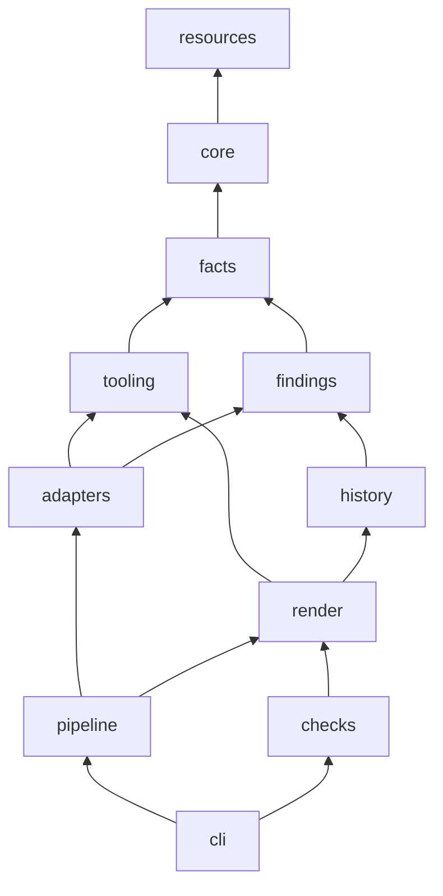

# Plan 014: the package refactor

Status: written by Opus 5.5 on 2026-11-11 from `docs/prompts/plan-package-refactor.md`. No open question blocks Phase A: every judgement call has a default (section 9). Phase A can start.

Written from: the code at `9936b78` (version 1.10.2, `main`), with two uncommitted moves in the working tree that are the author's (`docs/process.md` to `docs/plans/process.md`, `docs/post-v1.md` to `docs/prompts/post-v1.md`); `docs/plans/process.md`, plans 012 and 013 in full (shared rules, sections 7 to 9, Results), plan 011 block P and plan 010 block E; every module in `scripts/` (docstrings, imports, `__file__` uses, lazy imports), every test file's imports and path handling; the `py-projects`, `py-unit-tests`, `docs-project`, `docs-readme`, `docs-user-guide`, `docs-dev-guide`, `git-workflow`, `git-release` and `claude-planning-docs` skills. The import graph, cycle analysis and inventory numbers come from throwaway scripts run outside the repository (they parse with `ast`; nothing was imported from the skill). One prototype, also outside the repository, checked how `uv` runs a PEP 723 launcher next to a `pyproject.toml` (D1).

This is a refactor. **Dossier output does not change** (D14 defines exactly what "the same" means and how it is proven). Anything that would change output is in section 11, "Left out".

---

## Contents

1. [Summary](#1-summary)
2. [Shared rules (every phase reads this first)](#2-shared-rules-every-phase-reads-this-first)
3. [Baselines](#3-baselines)
4. [Decisions](#4-decisions)
5. [Inventory](#5-inventory)
6. [Hard-coded paths](#6-hard-coded-paths)
7. Phases: [A](#phase-a-packaging-launcher-and-goldens) · [B](#phase-b-package-data) · [C](#phase-c-module-moves) · [D](#phase-d-the-cli-split) · [E](#phase-e-the-tests-tree) · [F](#phase-f-abstractions-that-change-code) · [G](#phase-g-top-level-and-docs-layout) · [H](#phase-h-documentation-ci-and-release)
8. [Verification blocks](#8-verification-blocks)
9. [Risks and open questions](#9-risks-and-open-questions)
10. [Spec issues](#10-spec-issues)
11. [Left out](#11-left-out)
12. [Release](#12-release)

---

## 1. Summary

- **Package.** `src/dossier/`, ten subpackages in a strict dependency order (D4): `core`, `facts`, `tooling`, `findings`, `history`, `adapters`, `render`, `checks`, `pipeline`, `cli`. Prefix families become subpackages: `py_*` to `adapters/python/`, `js_*` to `adapters/js/`, `cs_*` to `adapters/csharp/`, `measured_*` to `render/measured/`, `checks_*` to `checks/`.
- **How it runs.** `SKILL.md` keeps `uv run ${CLAUDE_SKILL_DIR}/scripts/dossier.py`. `scripts/` shrinks to two thin PEP 723 launchers (`dossier.py`, `check_page.py`) that put `src/` on `sys.path` and call the package. Nothing is installed into the skill folder; no `pip install` step (D1).
- **Data.** Everything the code reads (card schemas, the summary schema, Semgrep rules, page assets, vendored bundles, `tools.json`, `eol.json`, the three locked workers with their `.lock` files, the two Node helper projects) moves to `src/dossier/data/` and is reached only through `dossier.resources.data(...)` (D7). `prompts/method.md`, `reports.md` and `verify.md` stay at the root: Claude reads them by path.
- **Cycles.** Two import cycles exist today, hidden by lazy imports: `adapters` with the five language adapters, and `render` with 13 modules (every `measured_*`, `process`, `candidates`, `candidates_history`, `history`). Splitting `adapters.py` into base, registry and extract runner, and lifting render's HTML primitives into `render/markup.py`, removes both (verified on the graph, D5).
- **Adapter abstraction.** The `Adapter` base class and `Context` already exist; the plan adds only what the code repeats: a file reader and tool-status helpers on `Context` (D6). It deliberately does not invent a protocol for the per-language `project`, `queries`, `semgrep` or `api` modules (their signatures differ).
- **Tests.** `tests/unit/dossier/...` and `tests/integration/dossier/...` mirror the package; helpers move to `tests/support/`; repository-content tests go to `tests/content/`; maintainer scripts go to a root `tools/` folder (D10).
- **Docs.** All planning material (plans, prompts, process, backlog, scratch, reference) ends up numbered under `docs/plans/`; `README.md` gains a map of the repository; the developer guide gets an architecture section with a dependency diagram (D12, Phase H).
- **Release.** Patch, **1.10.3**: nothing a user sees or types changes, and a minor bump would force every existing dossier into a full rebuild for no output change (section 12).
- **Size.** 8 phases, 38 tasks: **8 need Opus judgement, 30 are mechanical for Sonnet**. Sessions: Opus runs Phases A, F and H; Sonnet runs B, C (two sessions), D, E and G.

---

## 2. Shared rules (every phase reads this first)

- **Repository.** `SKILL` = `/home/nick/dev/projects/dossier` (`github.com/1npo/dossier`). The repository root is the skill root. Work only here. Never read or edit `~/.claude/skills`, `~/.claude/plugins` or `~/.local/share/encamp`.
- **Skills to load at the start of every phase:** `git-commit`, `git-workflow`, `py-projects`, `py-unit-tests`, `claude-planning-docs`. Phase G also loads `docs-project`. Phase H also loads `docs-project`, `docs-readme`, `docs-user-guide`, `docs-dev-guide` and `git-release`.
- **Branches.** One branch per phase, from an up-to-date `main`: `refactor/package-a-packaging`, `refactor/package-b-data`, `refactor/package-c-moves`, `refactor/package-d-cli`, `refactor/package-e-tests`, `refactor/package-f-abstractions`, `refactor/package-g-layout`, `docs/package-h-architecture`, then `chore/release-1.10.3`. One commit per task on the branch. At the end of the phase, merge to `main` with `git merge --no-ff`, push `main`, delete the branch (`git-workflow`). **The merge commit is the phase's one reviewable unit**: `git diff main^1 main` shows the whole phase.
- **Commits.** Follow `git-commit`. Subjects match the history: `refactor(dossier): ...`, `test(dossier): ...`, `docs(dossier): ...`, `chore(dossier): ...`. Each body ends with the `Co-Authored-By` trailer. Tick the task's checkbox in this plan in the same commit.
- **Moves use `git mv`**, never copy and delete, so `git log --follow` keeps history. A task that moves a file and edits it does the move first in the same commit (git detects the rename while the content is mostly unchanged).
- **Behaviour does not change.** No task changes what dossier prints, writes or draws. The proof is section 8: the default suite after every task, blocks GF and P after every phase, block GX at the end of Phases C, F and H, the slow suite at the end of Phases C, E, F and H. **If a golden comparison shows a difference, the task is wrong**: fix the code, never the comparison. The only differences allowed are D14's masks.
- **Embedded modules.** `facts/gather.py`, `facts/deps.py` and `history/scan.py` (today `gather.py`, `deps.py`, `history.py`) are shipped inside every page (the code viewer shows how a measured fact was counted, `render.gatherer_source`). In this refactor their text may change **only** in the import block and by one `__all__` line after it. No docstring, annotation, rename or reflow anywhere else in those three files (D14, R3).
- **Tests.** Default suite from `SKILL`: until task A2 lands, `uv run --with pytest --with pygments python -m pytest tests -q`; from A2 on, `uv run pytest -q` (the dev group holds pytest). The slow suite: `DOSSIER_SLOW=1 uv run pytest -q --basetemp=$HOME/.cache/dossier-refactor-slow`, run alone (no build beside it), then `rm -rf "$HOME/.cache/dossier-refactor-slow"`. **Never `/tmp`.** Counts must equal the baseline (section 3) plus the new tests the tasks name; a changed skip count is a failure (it means a test file lost its `skipif` or its collection).
- **Do not weaken or delete a test** to make it pass. Moving a test or rewriting its import or path line is allowed; changing an assertion is not, unless a task names it. Say so in Results if you think a test is wrong, and stop.
- **Scratch.** `SCR=$HOME/.cache/dossier-refactor` (fixed; keep it across phases; never under `/tmp`). Every command that prepares or renders sets `DOSSIER_HOME`, `DOSSIER_CONFIG` and `DOSSIER_CACHE` under `$SCR` (section 8 sets them). Never build a dossier of the author's repositories (`~/dev/projects/*` other than `SKILL`, `~/dev/dossiers/`); the goldens use the fixture repositories and the three public pinned clones of block S.
- **No new runtime dependencies.** The CLI imports the standard library plus `pygments`, as today. Dev-only tools (`ruff`, `mypy`, `pytest`) live in the `dev` dependency group.
- **If the code contradicts this plan, stop** and write what you found under the phase's Results. Do not design around it.
- **Start of every phase.** Read this section, section 4, the phase section, `git log --oneline -20`, and the Results of every earlier phase (pick up anything an earlier phase cut or recorded as a deviation). Check `git status` is clean.
- **Context.** Keep tool output short (`tail`, `-q`). Never print a whole page, a whole `extract/*.json` or a whole golden diff; print counts and the first lines.
- **One writer per file.** Never run two sessions at once: every phase writes this plan.
- **Hand-off at the end of every session.** The last lines of the session's final reply are the next session's model and its start string, in a code block, exactly as the table below gives them (the author asked for this; it overrides `claude-planning-docs`' "never hand the user a prompt"). If the session stopped early (a cut, or a stop to report), the string names the first unticked task instead, for example `Continue Phase C from task C4 in docs/plans/014-package-refactor-plan.md`, with the model of that phase. After Phase H, say that the plan is finished instead.

  | Session just finished | Next model | Next start string |
  |---|---|---|
  | (none: the first session) | Opus | `Start Phase A in docs/plans/014-package-refactor-plan.md` |
  | Phase A | Sonnet | `Start Phase B in docs/plans/014-package-refactor-plan.md` |
  | Phase B | Sonnet | `Start Phase C in docs/plans/014-package-refactor-plan.md` |
  | Phase C, session 1 (C1 to C5) | Sonnet | `Continue Phase C from task C6 in docs/plans/014-package-refactor-plan.md` |
  | Phase C, session 2 (C6 to C11) | Sonnet | `Start Phase D in docs/plans/014-package-refactor-plan.md` |
  | Phase D | Sonnet | `Start Phase E in docs/plans/014-package-refactor-plan.md` |
  | Phase E | Opus | `Start Phase F in docs/plans/014-package-refactor-plan.md` |
  | Phase F | Sonnet | `Start Phase G in docs/plans/014-package-refactor-plan.md` |
  | Phase G | Opus | `Start Phase H in docs/plans/014-package-refactor-plan.md` |
  | Phase H | none | the plan is finished |

---

## 3. Baselines

Recorded 2026-11-11 at `9936b78` (the two uncommitted doc moves do not touch code or tests).

```text
$ git log --oneline -15
9936b78 Merge chore/release-1.10.2
4b96c60 Merge fix/contents-lists-summary
a9f86d7 Bump version to 1.10.2
2650ea7 List the Executive summary in the Contents card
38caec6 Merge chore/release-1.10.1
3bd1672 Merge fix/contents-first
e6959f0 Bump version to 1.10.1
0e9e71f Put the Contents card before the Executive summary
fb8b88d Merge chore/release-1.9.0
ef389ff Bump version to 1.9.0
d0f482e Merge chore/release-1.9.0
c1ec6fe Merge feat/project-summary-card
44a1f9a Bump version to 1.9.0
91dc677 Add Project summary card, drop Executive summary from two reports, even out portfolio card spacing
d6252dc Merge chore/release-1.8.2

$ git status --short
 D docs/post-v1.md
 D docs/process.md
?? docs/plans/process.md
?? docs/prompts/plan-package-refactor.md
?? docs/prompts/post-v1.md
```

| Suite | Command | Result | Wall time |
|---|---|---|---|
| Default | `uv run --with pytest --with pygments python -m pytest tests -q` | **2994 passed, 305 skipped**, 0 failed | 71 s (72 s with `uv` start) |
| Slow | `DOSSIER_SLOW=1 uv run --with pytest --with pygments python -m pytest tests -q --basetemp=$HOME/.cache/dossier-refactor-plan-slow` | **2 failed, 3296 passed, 1 skipped**, 4 warnings | 1525 s (25 min 25 s) |

Known failures on `main` (slow suite only; the same two that plans 012 and 013 list as failing by design): `tests/integration/scripts/test_check_page_slow.py::TestLayoutChecks::test_overlapping_paragraphs_are_reported` and `tests/integration/scripts/test_check_page_slow.py::TestNewCardsOnTheM3Page::test_each_browser_mutation_makes_a_fail[chart-text-small-chart text]`. The one slow-run skip is `tests/unit/scripts/test_check_page_secret.py` ("could not import 'playwright'": the test environment has no Playwright; it is skipped in both suites). The default suite has no failures. 2994 + 305 = 3299 = 3296 + 2 + 1, so every default skip is a slow test.

Machine: Python 3.13.5, pytest 9.2.0, uv 0.11.19, Node 26.13.0, .NET SDK 10.0.403. Not installed: `ruff`, `mypy` (A2 adds them to the dev group).

---

## 4. Decisions

### D1. How the package is found and run

Today `SKILL.md` says `uv run ${CLAUDE_SKILL_DIR}/scripts/dossier.py`. `uv` reads the PEP 723 header (`requires-python >=3.11`, `dependencies = ["pygments"]`), builds a cached environment under `~/.cache/uv/environments-v2/`, and runs the file; line 37 puts `scripts/` on `sys.path` so the 80 flat modules import by bare name. The three workers run as `uv run --locked --python <tools.json python> --script scripts/<worker>.py`, and `uv` finds the lockfile by the convention `<script>.lock` beside the script. `check_page.py` runs as `uv run scripts/check_page.py` with its own header (`playwright`, unpinned) and imports `buildlog`, `check_layout` and `viewer` from its own folder. The Node helpers are copied by `js_tools.ensure_installed` and `scip_tool.ensure_installed` from `scripts/node/<name>/` into `<cache>/.dossier-tools/node/<name>-<lock sha>` and installed with `npm ci --ignore-scripts`.

Options compared:

| Option | How Claude runs it | Writes into the skill folder | First run | Verdict |
|---|---|---|---|---|
| **1. Thin PEP 723 launcher** | `uv run ${CLAUDE_SKILL_DIR}/scripts/dossier.py` (unchanged) | nothing (env cached under `~/.cache/uv`) | ~270 ms cold, ~110 ms warm (prototype) | **Chosen** |
| 2. `uv run --project` | `uv run --project ${CLAUDE_SKILL_DIR} --no-dev --frozen dossier ...` | `.venv/` and, without a committed lock, `uv.lock` (prototype) | ~860 ms cold (hatchling build), ~100 ms warm | Rejected |
| 3. `uvx --from ${CLAUDE_SKILL_DIR} dossier` | a built wheel in uv's tool cache | nothing | a wheel build per change | Rejected |

Reasons:

- Option 1 keeps every documented command, the `Bash(uv run *)` permission in `SKILL.md` and the plugin and zip installs exactly as they are. Dependency resolution is the same as today (one header, `pygments`), so output cannot change through a different environment.
- Option 2 writes `.venv/` into the installed copy (a plugin cache folder or a clone the user pulls), installs the `dev` group unless every call says `--no-dev`, needs hatchling from the network on first use, and fails with `--frozen`/`--locked` if `uv.lock` is stale on a user's machine. `check_page` would need an extra for Playwright, which would pin Playwright and break users' installed Chromium builds (R7).
- Option 3 caches a built wheel keyed on the source path; uv does not rebuild on every source edit by default, so a developer can run stale code without noticing.

The prototype (outside the repository) confirmed for option 1: run from inside a folder that has a `pyproject.toml`, uv still uses the script's own environment and creates no `.venv/`; `importlib.resources.files("dossier")` is a `pathlib.PosixPath` when the package is imported from `src/`.

**The launcher** (`scripts/dossier.py` from task A4 on; C11 deletes the line marked TRANSITION):

```python
#!/usr/bin/env python3
# /// script
# requires-python = ">=3.11"
# dependencies = ["pygments"]
# ///
"""Run the dossier command line from the skill folder: `uv run scripts/dossier.py <command>`.

uv reads the header above and runs this file in a cached environment of its own; nothing is installed
into the skill folder. The code is the `dossier` package in ../src; this file only puts that folder
first on sys.path (replacing this file's own folder, so `import dossier` cannot find this file).
"""
import sys
from pathlib import Path

sys.path[0] = str(Path(__file__).resolve().parent.parent / "src")
sys.path.append(str(Path(__file__).resolve().parent))  # TRANSITION: flat modules not moved yet; removed in C11

from dossier.cli import main  # noqa: E402

if __name__ == "__main__":
    main()
```

`scripts/check_page.py` (task C10) is the same shape with the header `requires-python = ">=3.11"`, `dependencies = ["playwright"]` (unpinned, as today) and `from dossier.checks.browser import main`.

**What happens to each moving part:**

| Part | Today | After |
|---|---|---|
| `SKILL.md` command | `uv run ${CLAUDE_SKILL_DIR}/scripts/dossier.py` | unchanged |
| CLI code | `scripts/dossier.py` (795 lines) | `src/dossier/cli/` (D8); the launcher calls `dossier.cli.main` |
| PEP 723 header of the CLI | in `scripts/dossier.py` | in the launcher, same text; `pyproject.toml` `[project].dependencies` must list the same packages (content test, A4) |
| Workers and `.lock` files | `scripts/{py,ts,semgrep}_worker.py` + `.lock` | `src/dossier/data/workers/`, each lock still beside its script; `shared_tools._call` builds the path with `resources.data("workers", name)` |
| `check_page.py` | a PEP 723 script importing flat siblings | code in `src/dossier/checks/browser.py`; `scripts/check_page.py` is a launcher with the Playwright header |
| Node helpers | `scripts/node/{js-tools,scip-python}/` | `src/dossier/data/node/...`; bytes unchanged, so the lock sha and the cache folder name stay the same and existing installs are reused |
| `VERSION` | read as `ROOT / "VERSION"` in `dossier.py`; hashed by `adapters.code_hash` | stays at the root; read through `resources.version()` |
| `skill:` line in `doctor` | `buildlog.skill_state(ROOT)`, `ROOT = scripts/..` | `buildlog.skill_state(resources.skill_root())`, same folder |
| Tests and dev tools | `uv run --with pytest --with pygments python -m pytest tests` | `uv run pytest` against `pyproject.toml` (editable install into `.venv/` of the development clone only) |

### D2. Package name, layout and `pyproject.toml`

- Distribution and import name: **`dossier`**. `src/` layout. Build backend hatchling (as the `py-projects` template). The package is never published (section 11).
- `requires-python = ">=3.11"` (the CLI's floor today). The workers keep `>=3.10` in their own headers: they run under the analysed repository's Python.
- **Version.** `py-projects` puts the version in `_version.py` and bumps with Hatch. This repository's version lives in `VERSION` and `.claude-plugin/plugin.json`, read by CI and the CLI and kept in step by `bump_version.py`. **Default: keep `VERSION` as the one source.** `pyproject.toml` uses `dynamic = ["version"]` with `[tool.hatch.version] path = "VERSION"` and `pattern = "^(?P<version>[^\\s]+)\\s*$"`. If A2 finds that Hatch rejects that pattern, fall back to a static `version = "1.10.2"` that `bump_version.py` also rewrites, and add that file to `test_release_metadata.py`'s equality check. Record which in Results (spec issue S5).
- `pyproject.toml` (task A2; numbers in angle brackets are filled from what A2 measures):

```toml
[project]
name = "dossier"
dynamic = ["version"]
description = "Build a cited, commit-pinned HTML dossier that explains a git repository."
readme = "README.md"
license = "MIT"
license-files = ["LICENSE"]
authors = [{ name = "Nick OMalley", email = "nickpeteromalley@gmail.com" }]
requires-python = ">=3.11"
dependencies = ["pygments"]

[build-system]
requires = ["hatchling"]
build-backend = "hatchling.build"

[tool.hatch.version]
path = "VERSION"
pattern = "^(?P<version>[^\\s]+)\\s*$"

[tool.hatch.build.targets.wheel]
packages = ["src/dossier"]

[dependency-groups]
dev = ["pytest>=9.2", "ruff==<A2 pins the current release>", "mypy==<A2 pins the current release>"]

[tool.pytest.ini_options]
testpaths = ["tests"]
pythonpath = ["src", "scripts"]          # "scripts" is the transition entry, removed in C11; E1 adds "tests/support" and "tools"

[tool.ruff]
line-length = 120
target-version = "py311"
src = ["src", "tests", "tools"]
extend-exclude = ["tests/fixtures", "src/dossier/data/vendor", "src/dossier/data/node"]

[tool.ruff.lint]
select = ["E", "F", "UP", "B", "SIM", "I"]
ignore = ["E501", <A2: every rule that fails on today's code, with its count in Results>]

[tool.ruff.lint.per-file-ignores]
"src/dossier/data/workers/*" = ["UP"]    # they target Python 3.10

[tool.ruff.format]
quote-style = "double"                   # the code's style; formatting is not enforced (section 11)

[tool.mypy]
python_version = "3.11"
files = ["src/dossier"]
exclude = ["src/dossier/data/"]
ignore_missing_imports = true
no_implicit_optional = true
warn_unused_ignores = true
check_untyped_defs = false
```

- **Ruff.** The template's rule set (`E F UP B SIM I`), line length 120 with `E501` ignored: the code has 3,523 lines over 90 characters and 297 over 160 (longest 828) in `scripts/` alone, and a format pass would rewrite every line of the three embedded modules. **`ruff check` must pass after A2 with no code change**: A2 runs it once and adds each failing rule code to `ignore` with its count. Lint debt is section 11. `ruff format` is out of scope.
- **Type check: mypy**, default (non-strict) mode, on `src/dossier` only. It becomes a gate in F6: modules that still fail get a per-module `ignore_errors = true` override listed in F6's Results with their error counts. New and small modules (`resources`, `core/*`, `cli/*`, `adapters/base`, `adapters/registry`, `pipeline/extract`, `render/markup`, `findings/people`) may not have an override. Strict mode is section 11.

### D3. The target tree

```text
SKILL.md                    Claude's instructions for /dossier (frontmatter: name, arguments, allowed tools)
README.md                   what dossier is, install, usage, map of the repository
LICENSE  VERSION
pyproject.toml  uv.lock     the Python project: dependencies, ruff, mypy, pytest
.claude-plugin/             marketplace.json and plugin.json (the repository is its own marketplace)
.github/workflows/          release.yaml: tests, lint, types, then tag and zip on a version bump
scripts/                    what Claude runs: two launchers, nothing else
  dossier.py                  the CLI launcher (PEP 723: pygments)
  check_page.py               the browser check launcher (PEP 723: playwright)
prompts/                    what Claude reads while it builds a dossier
  README.md  method.md  reports.md  verify.md
src/dossier/                the Python package
  __init__.py  __main__.py  resources.py
  core/        config  buildlog  graphs  schema  scip_read
  facts/       gather  deps  env_scan  markers
  tooling/     toolcheck  sandbox  shared_tools  dotnet_sdk
  findings/    components  candidates  candidates_history  people  resolve
  history/     scan  ownership  github_owners  workflow
  adapters/    base  registry  repo  tier_b
    python/      adapter  api  depends  packages  project  queries  scip  tools
    js/          adapter  api  entries  prisma  project  queries  reduce  semgrep  tools
    csharp/      adapter  api  entries  graph  models  project  queries  scip  semgrep  testsuite
  render/      markup  page  viewer  process  portfolio  summary  summary_check
    measured/    cards  blast  change  cs  env  er  graph  js  people  tables  upgrade
  checks/      reports  people  v3  v7  page_audit  layout  browser  verify
  pipeline/    workarea  extract  restore  stages  incremental
  cli/         __init__ (main)  parser  common
    commands/    basics  prepare  render  check  candidates  verify  decisions
  data/        package data, read only through dossier.resources (README.md lists every group and its reader)
    README.md  tools.json  eol.json
    schemas/     cards/<report>.json (17)  cards/README.md  summary.schema.json
    rules/       all/  python/  js/  csharp/  README.md
    assets/      template.html  dossier.css  dossier.js
    vendor/      basecoat.min.css  basecoat.min.js  mermaid.min.js  LICENSE.md  LICENSE-mermaid
    workers/     py_worker.py(.lock)  ts_worker.py(.lock)  semgrep_worker.py(.lock)
    node/        js-tools/  scip-python/
tests/                      README.md, conftest.py (fixtures only)
  support/                  helpers shared by test kinds: repos, paths, workers, fakes, page builders, browser probes
  fixtures/                 small made-up repositories and golden files (unchanged)
  unit/dossier/...          one folder per subpackage, test_<module>.py
  unit/tools/               tests of the maintainer scripts
  integration/dossier/...   tests that run real tools; *_slow.py need DOSSIER_SLOW=1
  content/                  tests of the repository's own files: docs, prompts, rules, manifests, layers, paths
tools/                      maintainer scripts, not part of the skill's behaviour (README.md names the owner)
  bump_version.py  refresh_eol.py  ground_truth.py  skeleton.py  report_section.py  golden.py  move_modules.py
docs/
  user-guide.md  developer-guide.md  images/
  plans/                    every plan, prompt, handoff, the process note and the backlog, numbered (history)
```

### D4. Subpackages and the dependency rule

| Subpackage | Holds | May import (besides itself and the standard library) |
|---|---|---|
| `dossier.resources` (module) | paths to package data, the skill root, the version | nothing |
| `core` | leaf utilities with no domain knowledge: config file, build log, graph helpers, card schema loader, SCIP reader | `resources` |
| `facts` | deterministic facts about the repository at the pin: files, languages, manifests, dependencies, environment reads, markers | `resources`, `core` |
| `tooling` | running things on the host: which tools exist, the safe runner, the locked-worker clients, the .NET SDK check | `resources`, `core`, `facts` |
| `findings` | the component model, candidate findings with stable ids, people figures, open items and decisions | `resources`, `core`, `facts` |
| `history` | the whole git history folded once: per-file, per-pair, per-person figures, ownership, approvals, workflow | `resources`, `core`, `facts`, `findings` |
| `adapters` | turning one language's code into the standard outputs | `resources`, `core`, `facts`, `tooling`, `findings` |
| `render` | the page: citations and markup, measured cards, the process card, viewer, portfolio, `summary.json` | `resources`, `core`, `facts`, `tooling`, `findings`, `history` |
| `checks` | V2 to V7 and V11 to V12, and `--verify` sampling | `resources`, `core`, `facts`, `findings`, `render` |
| `pipeline` | the `prepare` stages: work area, restore, the extract runner, incremental planning | `resources`, `core`, `facts`, `tooling`, `findings`, `adapters`, `render` |
| `cli` | argument parsing and one module per command group | everything |

Rules inside subpackages: `render.markup` imports nothing from `dossier.render`; `render.measured.*` never imports `render.page`; `adapters.base` imports no language adapter; language subpackages (`adapters.python`, `adapters.js`, `adapters.csharp`) never import one another. Every `__init__.py` holds a docstring and `__all__` only, and imports nothing: `scripts/check_page.py` imports `dossier.render.viewer` in an environment that has Playwright and not Pygments, so an eager `__init__` would break it.



(Arrows point from importer to imported; transitive edges are allowed and omitted.)

**Cycles today**, found by strongly-connected components over all imports including the ones inside functions:

| Cycle | Members | Hidden by | Broken by |
|---|---|---|---|
| C-adapters | `adapters`, `cs_adapter`, `js_adapter`, `py_adapter`, `repo_adapter`, `tier_b` | the import inside `adapters._registered()` | F1: `adapters/base.py` (the interface, no language imports), `adapters/registry.py` (imports the five adapters at the top), `pipeline/extract.py` (the extract stage and path filter) |
| C-render | `render`, `process`, `measured` and all ten `measured_*`, `candidates`, `candidates_history`, `history` | `import render` inside functions in 11 `measured*` modules and `process` | F2: `render/markup.py` takes the HTML primitives those modules use (`E`, `path_code`, `render_table`, `source_cell`, `EXPAND_ICONS`, `badge`, `stats_html` and their helpers); the measured cards and `process` import `markup` at the top. The `candidates` and `history` members fall out of the cycle with it (their only way back to `candidates` ran through `measured_people -> render`). |

After F1 and F2 the graph has no cycle (checked on the import graph with those edges replaced). The lazy imports in `page_audit`, `summary` and `candidates -> graphs` are not cycles; F2 makes them top-level.

**Upward edges that are not cycles but break the layer order**, and their fixes:

| Edge | Uses | Fix (task) |
|---|---|---|
| `toolcheck -> cs_sdk` | `requirements`, `apply`, `list_sdks` | `cs_sdk` becomes `tooling/dotnet_sdk.py` (C3): it is a host-tool check used by `doctor`, `restore` and the C# adapter |
| `candidates_history -> measured_people` | `names_of`, `component_stats` | F3 moves `names_of`, `component_stats` and `bus_factor` (pure data, 45 lines, no HTML) to `findings/people.py`; `render.measured.people` and `render.summary` import them from there |
| `js_tools -> scip_tool` | `_check` | F3 moves `_check` to `tooling/shared_tools.py` as `check_result` |
| `adapters -> workarea` | `workarea.verify` in `run_extract` | F1: `run_extract` moves to `pipeline/extract.py` |

**Chose not to fix:** `history -> candidates` (for `assign_ids`) is downward in this order (history sits above findings), so it stays. `gather` is imported by 24 modules only for its path classifier (`lang_of`, `noise_reason`, `TEST_RE`, `VENDOR_SEG`, ...). Moving the classifier out of `gather.py` would be the right shape, but `gather.py`'s text is shipped in every page and two `FACT_INFO` ranges end on `^def noise_reason\(`: it would change output (section 11).

The rule is enforced by `tests/content/test_layers.py` (F5), an `ast` walk over `src/dossier` with the table above; no new dependency (import-linter would be one).

### D5. Module moves and names

- A module keeps its name unless the subpackage now carries its old prefix (`py_api` becomes `adapters/python/api.py`, `measured_er` becomes `render/measured/er.py`, `checks_v3` becomes `checks/v3.py`), or the old name stutters or misleads in its new home: `history` becomes `history/scan.py`, `render` becomes `render/page.py`, `measured` becomes `render/measured/cards.py`, `checks` becomes `checks/reports.py`, `check_page` becomes `checks/browser.py`, `check_layout` becomes `checks/layout.py`, `cs_sdk` becomes `tooling/dotnet_sdk.py`, `cs_tests` becomes `adapters/csharp/testsuite.py` (not `tests.py`: too easy to confuse with the test tree), `scip_tool` becomes `adapters/python/scip.py`, `repo_adapter` becomes `adapters/repo.py`, `dossier` becomes `cli/app.py` (then split, D8).
- Every import is rewritten by `tools/move_modules.py` (A3) so the **bound name stays the same**: `import render` becomes `from dossier.render import page as render`, `import py_api` becomes `from dossier.adapters.python import api as py_api`. Every `render.x` and `py_api.x` in the code and the tests keeps working, and no string literal is touched (rule ids such as `dossier.python.entry.*` and card ids such as `dossier.about` are strings). Renaming the bound names to the new module names is not done (it would touch thousands of lines for no behaviour; section 11).
- Inventory tables in section 5 give the destination and the Phase C task of every module.

### D6. The adapter abstraction

What the five adapters actually share, from reading them:

- **Already shared and kept:** `Adapter` (class attributes `name`, `version`, `languages`, `tools`, `rules`, `loads_repo_code`, `expected_untracked`, `blind_spots`; method `extract(ctx) -> dict`), `Context` (checkout, sha, tree, files, area, restored, run, `treesitter`, `semgrep`, tool versions, trust, repo name, `tool_status`, `details`), `OUTPUTS`, the registry function and the extract runner. These are the protocol; F1 gives them type annotations (`ClassVar` for the class attributes, `dict[str, list[dict]]` for `extract`), moves them to `adapters/base.py` and `adapters/registry.py`, and makes `REGISTERED` a module-level tuple in the order used today (`CSharpAdapter, JsAdapter, PythonAdapter, RepoAdapter, TierBAdapter`; the order decides the order of build-log rows and must not change).
- **Repeated, so F4 abstracts it:**
  - the file reader: `JsAdapter._reader` and `CSharpAdapter._reader` are byte-for-byte the same closure (read `ctx.checkout / path` as UTF-8, `None` on `OSError` or `UnicodeDecodeError`). It becomes `Context.read(path) -> str | None`.
  - tool-status bookkeeping: every adapter writes `ctx.tool_status[tool] = {"status": "ok"|"skipped"|"failed", "reason": ...}` by hand (Python `_step`/`_skip`, JS `_skip`/`_each`, C# `_failed`/`_skipped`/`_fallback`, repo and Tier B inline), and five places compute the failure reason as `(str(e).splitlines() or [type(e).__name__])[0]`. These become `Context.tool_ok(tool)`, `Context.tool_skipped(tool, reason)`, `Context.tool_failed(tool, reason)` and the function `adapters.base.failure_reason(e)`. They must build exactly the same dicts (same key order: `status`, then `reason`).
- **Not abstracted, and why:**
  - the per-language `project`, `queries`, `semgrep`, `api` and `entries` modules: same file names, different contracts (`py_project.projects(tree, read=None) -> list`, `cs_project.projects(tree, read) -> dict`, `js_project.projects(tree, read) -> list[dict]`; query modules expose different functions per language). The three `complexity(ts, files) -> dict` functions share a signature but have one caller each, so a protocol buys nothing.
  - the tool clients (`Grimp`, `Vulture`, `TsFacts`, `DepCruiser`, `Knip`, `ScipDotnet`): each wraps a different tool and output; their shared part (`_call`, and after F3 `check_result`) already lives in `tooling/shared_tools.py`.
  - `run_extract`'s own failure reason, `((str(e).splitlines() or [""])[0] or type(e).__name__)`: it differs from the adapters' formula when the first line is empty, so unifying them would change a build-log reason (section 11).
  - the `measured_*` and `checks_*` families: `measured.py` already dispatches through per-module `DRAWN` tables and `checks.py` already orchestrates the V-checks; their new subpackages make the family visible without a new base class.

### D7. Package data and how it is loaded

One module, `src/dossier/resources.py` (task A4), is the only code in the package that builds a path from `__file__`:

```python
"""Where the package finds its files: the data shipped inside it and the skill folder around it.

Every file the code reads by path (card schemas, rules, page assets, vendored bundles, workers,
Node helper projects, tools.json, eol.json) comes from `data()`. No other module in the package
builds a path from `__file__`; tests/content/test_layers.py enforces that.
"""
from __future__ import annotations

from importlib.resources import files
from pathlib import Path

__all__ = ["data", "skill_root", "version"]


def data(*parts: str) -> Path:
    """The path of a file or folder under `dossier/data/`.

    The package is always a folder on disk (a clone, a plugin copy or an editable install), so the
    result is a real path that can be handed to semgrep, uv or npm.
    """
    root = files("dossier").joinpath("data", *parts)
    if not isinstance(root, Path):
        raise RuntimeError(f"dossier: package data is not on disk ({root!r}); run dossier from a clone")
    return root


def skill_root() -> Path:
    """The skill folder: the one holding SKILL.md, VERSION, scripts/ and src/."""
    root = Path(__file__).resolve().parents[2]
    if not (root / "SKILL.md").is_file():
        raise RuntimeError(f"dossier: no SKILL.md in {root}; run dossier from a clone of the skill")
    return root


def version() -> str:
    """The skill's version, from VERSION at the skill root."""
    return (skill_root() / "VERSION").read_text().strip()
```

`importlib.resources.as_file` is not used: it accepts folders only from Python 3.12, the CLI supports 3.11, and the package is never zipped. A4's tests cover a missing `SKILL.md` and the `isinstance` guard.

Classification of every group:

| Group | Primary reader | Claude reads it by path? | Decision | Reason |
|---|---|---|---|---|
| `prompts/method.md`, `prompts/reports.md` | Claude (SKILL.md step 3) | yes | **stay at the root** | Python reads them only in `test_prompts.py` (it validates the examples against the card schemas) |
| `prompts/verify.md` | Claude (SKILL.md step 7a) | yes | **stay** | Python only prints its path (`verify-sample`'s `prompt` field), built from `resources.skill_root()` |
| `prompts/schema/*.json` (17) and `README.md` | `schema.py`, `candidates.py`, `render`, V6 | yes, through `method.md` ("named in `prompts/schema/<report>.json`") | **package data** `data/schemas/cards/` | the renderer and V6 depend on them; `method.md` and `reports.md` are updated to `${CLAUDE_SKILL_DIR}/src/dossier/data/schemas/cards/<report>.json` in the same task (B1) |
| `prompts/summary.schema.json` | `summary_check.py` (V8) | no | **package data** `data/schemas/summary.schema.json` | the user guide documents `summary.json`'s fields; it does not link the schema file (checked) |
| `rules/{all,python,js,csharp}/*.yml` (29) and `README.md` | the four adapters' `rules`, `rules_hash` | no | **package data** `data/rules/` | only code reads them; the README stays with them |
| `assets/template.html`, `dossier.css`, `dossier.js` | `render.page`, `render.portfolio` (inlined into the page) | no | **package data** `data/assets/` | inlined byte for byte; no path appears in the HTML (checked) |
| `vendor/` (Basecoat, Mermaid, two licences) | the same, inlined | no | **package data** `data/vendor/` | licences travel with the bundles; README's licence line updated (H1) |
| `scripts/tools.json` | `toolcheck.load_tools` | no | **package data** `data/tools.json` | |
| `scripts/eol.json` | `measured_upgrade.SNAPSHOT` | no | **package data** `data/eol.json` | `tools/refresh_eol.py` writes it |
| `scripts/*_worker.py` + `.lock` | `shared_tools`, `py_tools` (run by `uv run --script`) | no | **package data** `data/workers/` | they are not imported by the package: they run in their own locked environments under another Python. They stay plain scripts with no `__init__.py` beside them |
| `scripts/node/js-tools/`, `scripts/node/scip-python/` | `js_tools`, `scip_tool` (copied, then `npm ci`) | no | **package data** `data/node/` | |
| `VERSION` | CLI, CI, `bump_version.py` | no | **stays at the root** | CI and the plugin manifest check read it there |
| `SKILL.md`, `.claude-plugin/*` | Claude Code | yes | **stay** | the install contract |

### D8. The CLI split

`cli/app.py` (moved whole in A4) becomes, in D1:

| Module | Functions and globals (from `dossier.py` today) |
|---|---|
| `cli/__init__.py` | `main()` only: `from dossier.cli.parser import build_parser` inside the function, then `a = build_parser().parse_args(); a.fn(a)` |
| `cli/common.py` | `ROOT` (now `resources.skill_root()`), `VERSION` (`resources.version()`), `CONFIG`, `die`, `now`, `load`, `save`, `load_state`, `save_state`, `get_home`, `toplevel`, `root_commit`, `out_dir` |
| `cli/parser.py` | `build_parser` (each `set_defaults(fn=...)` names `module.cmd_x`) |
| `cli/commands/basics.py` | `cmd_version`, `cmd_portfolio`, `cmd_home`, `skill_line`, `cmd_doctor`, `cmd_clean` |
| `cli/commands/prepare.py` | `update_plan`, `_cited_path`, `cmd_prepare` |
| `cli/commands/render.py` | `change_summary`, `cmd_render` |
| `cli/commands/check.py` | `browser_check_line`, `run_browser_check`, `cmd_check` |
| `cli/commands/candidates.py` | `cmd_candidates` |
| `cli/commands/verify.py` | `_verify_inputs`, `cmd_verify_sample`, `cmd_verify_record` |
| `cli/commands/decisions.py` | `cmd_correct`, `short`, `cmd_confirm` |

The cross-module calls this creates (from an `ast` walk of `dossier.py`): every command uses helpers from `common`; `cmd_render` uses `browser_check_line` from `check`. Commands import `from dossier.cli import common` and call `common.toplevel(...)`, never `from dossier.cli.common import toplevel`, so a test's `monkeypatch.setattr(common, "toplevel", ...)` reaches every caller. Function bodies do not change except for those `common.` prefixes. `argparse` takes `prog` from `sys.argv[0]`, which is still `dossier.py`, so `--help` output is unchanged. `src/dossier/__main__.py` (`from dossier.cli import main; main()`) gives `python -m dossier` for development.

### D9. Public API, docstrings, type hints

- **Docstrings.** Every module has one today and keeps it (in the three embedded modules, unchanged). New modules get one in the style of the existing ones (what it holds, what it reads, what it never does). Every subpackage `__init__.py` gets a docstring that names what is inside, who may import it (D4's row) and the one-line role of each module.
- **`__all__`.** Each subpackage's `__init__.py` lists its public modules as strings (it imports nothing). Each module lists the names other `dossier` modules use from it, computed in F6 from the `ast` of the package (references as `mod.name` or `from mod import name` from another module; tests do not count, so private helpers that only tests use stay out of `__all__`).
- **Type hints.** F6 annotates every name in a module's `__all__` (parameters and return), except in the three embedded modules (D14). Bodies are not annotated. mypy runs as D2 says.

### D10. The tests tree

- `tests/unit/dossier/<subpackage>/test_<module>.py` mirrors `src/dossier/` (`py-unit-tests`: mirror from inside `tests/unit/`). Extra files for one module keep a suffix (`test_gather_env.py` beside `test_gather.py`). Integration tests mirror the same way under `tests/integration/dossier/`. The slow split stays exactly as it is: per-file `pytestmark = pytest.mark.skipif(os.environ.get("DOSSIER_SLOW") != "1", ...)` in the files named `*_slow.py` and three others; file contents do not change, only paths.
- Scaffolding goes to the `tests/` root, outside `tests/unit/` (`py-unit-tests`): `tests/conftest.py` keeps only fixtures; its builders (`FakeRepo`, `line_of`, `key_line`, `_commit_fixture`, the `build_*_repo` functions, `INSTALL_SH`, `SLEEPER_SH`) move to `tests/support/repos.py`. `tests/support/paths.py` holds `SKILL_ROOT`, `FIXTURES`, `LAUNCHER` and `CHECK_PAGE` so no test computes `Path(__file__).parents[n]` (that breaks the moment a file moves deeper). `tests/support/workers.py` loads a worker script from `resources.data("workers")` for the tests that import one. Helpers that tests import from other test files (seven cases, E1) move into `tests/support/`.
- Pytest config: `--import-mode=importlib` (mirrored trees repeat basenames such as `test_adapter.py`, which the default import mode rejects without `__init__.py` files), `pythonpath = ["src", "tests/support", "tools"]`.
- `tests/content/` holds tests of the repository's files rather than of a module: docs drift, prompts, rules, release metadata, Python 3.11 syntax, schema files, fixture repositories, layers (F5), stale paths (H3).
- `tests/tools/` is emptied (E4):

| File | Lines | Used by | Decision |
|---|---|---|---|
| `broken_pages.py` | 235 | `test_check_page_slow`, `test_page_audit` | `tests/support/` (test scaffolding) |
| `m3_page.py` to `m6_page.py` | 126, 91, 87, 139 | `test_check_page_slow`, each other, `tools/golden.py`, the dev guide | `tests/support/` |
| `layout_probe.py`, `diagram_text.py`, `table_fit.py` | 45, 57, 46 | `test_check_page_slow` (PEP 723, Playwright) | `tests/support/`; their `sys.path` line points at `src` |
| `ground_truth.py` | 126 | `test_ground_truth`, plan verification block T | `tools/` (maintainer tool) |
| `refresh_eol.py` | 48 | the dev guide recipe, by hand | `tools/` |
| `report_section.py` | 66 | `test_render_cards`, `test_report_section`, block P2 of plan 012 | `tools/` |
| `skeleton.py` | 58 | `test_skeleton`, block X of plan 012 | `tools/` |

  Nothing is deleted: every file has a user. `tools/` is owned by the author (1npo) and holds scripts a maintainer runs by hand or that plan verification blocks run; none is part of what `/dossier` does. Its tests live in `tests/unit/tools/`.

### D11. Ruff, mypy and what is out of scope

See D2 for the settings. In scope: a lint gate that passes from A2 on, a type gate from F6 on, both in CI from H4. Out of scope (section 11): reformatting, fixing the baseline lint ignores, strict typing, annotations in the three embedded modules.

### D12. Non-code content and the docs

- The root holds only what a reader needs to place the project: the skill contract (`SKILL.md`, `.claude-plugin/`), the front door (`README.md`, `LICENSE`, `VERSION`), the Python project (`pyproject.toml`, `uv.lock`, `src/`, `tests/`), what Claude runs and reads (`scripts/`, `prompts/`), maintainer tools (`tools/`), docs (`docs/`) and CI (`.github/`). One home each: prompts in `prompts/`, rules in `src/dossier/data/rules/`, assets in `src/dossier/data/assets/` and `vendor/` beside them.
- `docs/` keeps the two guides and `images/`. **All planning and history material moves into `docs/plans/`, numbered** (`claude-planning-docs`: everything Claude writes for itself or the next session lives there, numbered): `docs/plans/process.md` (the author's move), the nine `docs/prompts/*.md` prompts, `docs/prompts/post-v1.md` (the author's move; the backlog), `docs/scratch/000-fixed-cards.md` (an input to the M0 plan) and `docs/reference/dependency-card.html` (the reference page of plan 002). They take the next free numbers in G1, contents unchanged (renames only; `post-v1.md` is never edited by this plan). `docs/prompts/`, `docs/scratch/` and `docs/reference/` disappear. Plans 000 to 013 are records and are not edited, even where their links go stale (S9).
- **Folder READMEs** (G2): `prompts/README.md`, `src/dossier/data/README.md`, `tools/README.md`, `tests/README.md`; `src/dossier/data/rules/README.md` and `data/schemas/cards/README.md` already exist and move with their folders. Every Python folder gets its docstring in `__init__.py` instead (D9). `docs/plans/` gets no README: `claude-planning-docs` requires every file there to carry a number, so the developer guide's Repository layout describes the folder instead (S8).
- **Map of the repository** for the README (H1), below the Install section and above Goals and status:

```markdown
## Map of the repository

| Path | What it is | Who reads it |
|---|---|---|
| `SKILL.md` | the steps of `/dossier build` and the other commands | Claude |
| `prompts/` | how to read a repository and write each report | Claude, while building |
| `scripts/` | the two commands Claude runs (`dossier.py`, `check_page.py`) | Claude, through `uv run` |
| `src/dossier/` | the Python package that measures, renders and checks | the scripts |
| `src/dossier/data/` | card schemas, Semgrep rules, page assets, pinned tool lockfiles | the package |
| `tests/` | unit, integration and content tests, fixtures | maintainers |
| `tools/` | release and maintenance scripts | maintainers |
| `docs/` | the user guide, the developer guide, and `plans/`, the project's history | people |
```

### D13. Version and release

Patch, `1.10.3`, in Phase H (section 12). Every phase before it merges to `main` without a bump; CI does not run on those pushes (`release.yaml` runs on `VERSION` changes), so the verification blocks are the gate.

### D14. What "the same output" means, and how it is proven

"Byte-identical before and after for the same input" cannot hold literally, for three reasons found in the code:

1. The page embeds the skill's own `gather.py`, `deps.py` and `history.py` under the fixed names `dossier-gatherer/*.py` (`render.gatherer_source` reads `module.__file__`), and `data-a`/`data-b` attributes point at line numbers inside them. Rewriting their import blocks changes those bytes and can shift those numbers.
2. `build.json` and the process card carry the skill's folder, commit and dirty flag, which differ between the base and the branch by construction.
3. Times: `render` stamps the build time (`render.py:2022`), `build.json` stamps every step, `summary.json` has `generated_at`, freshness has `checked_at`.

So **"the same" is: equal bytes after a fixed list of masks**, and nothing else may differ. `tools/golden.py` (A1) owns the list. Its starting set, which A1 confirms or extends only from a determinism run (the base captured twice and compared with itself):

| Mask | Where | Reason |
|---|---|---|
| `started`, `ended`, `seconds`, `date`, `generated_at`, `checked_at` values | JSON files | times (3) |
| the build-time stamp and any `local_stamp` text | HTML | times (3) |
| `skill` objects (`path`, `commit`, `dirty`, `unmerged`) and the process card's skill line | `build.json`, HTML | (2) |
| the `code` key of each adapter section | `extract/*.json` | the skill code digest (by design it changes with any code change) |
| the skill folder's path (`$SCR/base` or `SKILL`) | everywhere | the two sides run from different folders; everything else (repositories, `DOSSIER_HOME`, `DOSSIER_CONFIG`, `DOSSIER_CACHE`, page build folders) runs in the same fixed folders under `$SCR/run/` on both sides, wiped before each case, so no other path differs |
| the three embedded `dossier-gatherer/*` file bodies and the `data-a`/`data-b` attributes on elements whose `data-view` starts with `dossier-gatherer/` | HTML | (1); `golden.py` writes the unmasked diff of these bodies to a review file, and it must show only import lines and `__all__` |

Adding a mask needs a line in A1's Results saying which nondeterminism the determinism run showed. A mask is never added to make a refactor diff disappear.

**The cases** (section 8 has the commands):

- **Fast set (block GF), after every phase.** The fixture repositories built once into `$SCR/repos/` with fixed commit dates (`pyrepo`, `jsrepo`, `csrepo`, `pylib`, `pyfastapi`, `cscake`, `mixedsub`): `prepare --full --no-restore --allow-missing`, then `render --allow-errors` with no authored reports (every measured card draws). Compared: `facts.json`, every `extract/*.json` (items per adapter, exactly), `build.json` (step, status, counts, reason), `summary.json`, the HTML. Plus the four synthetic pages `m3_page`, `m4_page`, `m5_page`, `m6_page` (`make` and `make_small`) built by each side's own builders with `GIT_AUTHOR_DATE`/`GIT_COMMITTER_DATE` fixed so their commits get the same hash.
- **Full set (block GX), at the end of Phases C, F and H.** The public pinned clones of block S, one per language: Python `TO` (`hukkin/tomli` at `a2a578949199336ebc3884eeba4aede87da41ef2`, MIT), TS/JS `BP` (`alan2207/bulletproof-react` at `9506629ed003a561c6627735480cce4994244bb4`, MIT), C# `RW` (`realworld-apps/aspnetcore-realworld-example-app` at `9345f18abf36b778abe2f290467ba432bf1f7e5c`, MIT), as plans 012 and 013 used them. `prepare --full --no-restore`, `render --allow-errors`. Both sides are captured in the same run (minutes apart), because freshness asks the remote.
- **Existing golden tests** keep running in the slow suite: `test_py_root_unchanged_slow.py` compares the Python adapter's output on `PYFIX` with `tests/fixtures/py_snapshot/`; the JS and C# adapter slow tests assert their expected rows.
- The base side is always a worktree of `BASE_SHA`, the `main` commit Phase A starts from (A1 records it), run with its own `scripts/dossier.py`.

---

## 5. Inventory

### 5.1 The repository root

| Path | Role | Size | Read by | Destination | Task |
|---|---|---|---|---|---|
| `SKILL.md` | Claude's instructions and frontmatter | 97 lines | Claude Code | stays; H3 updates step 7's "never edit" list to name `src/` | H3 |
| `README.md` | front door | 77 lines | people | stays; gains the map (D12) and the `vendor/` licence path | H1 |
| `LICENSE` | MIT | 21 lines | people | stays | - |
| `VERSION` | `1.10.2` | 1 line | CLI, CI, bump tool, `code_hash` | stays; read through `resources.version()` | A4 |
| `.gitignore` | `__pycache__/`, `.pytest_cache/`, `.ruff_cache/`, `.venv/`, `.claude/scheduled_tasks.lock` | 5 lines | git | stays; A2 adds `.mypy_cache/` and `/dist/` | A2 |
| `.claude-plugin/marketplace.json` | marketplace `1npo-tools`, plugin source `./` | 12 lines | Claude Code, `test_release_metadata` | unchanged | - |
| `.claude-plugin/plugin.json` | plugin manifest, version | 18 lines | Claude Code, CI, bump tool | unchanged until the bump | H4 |
| `.github/workflows/release.yaml` | tests, manifest validation, tag, zip, release | 87 lines | GitHub | test step changes, lint and type steps added | H4 |
| `scripts/` | 85 modules, 3 locks, `tools.json`, `eol.json`, `node/` | 15,905 lines of Python | everything | two launchers only | A4, B1, B2, C1 to C11 |
| `prompts/method.md`, `reports.md`, `verify.md` | what Claude reads | 462, 435, 39 lines | Claude; `test_prompts` | stay; B1 updates schema paths in `method.md`; G2 adds `README.md` | B1, G2 |
| `prompts/schema/` | 17 card schemas and `README.md` | 1,997 lines | `schema`, `candidates`, `render`; Claude via `method.md` | `src/dossier/data/schemas/cards/` | B1 |
| `prompts/summary.schema.json` | `summary.json` schema (V8) | 453 lines | `summary_check` | `src/dossier/data/schemas/summary.schema.json` | B1 |
| `rules/` | 29 Semgrep rule files in `all/`, `python/`, `js/`, `csharp/`, and `README.md` | 2,474 lines | the adapters, `rules_hash`, `test_rules` | `src/dossier/data/rules/` | B1 |
| `assets/` | `template.html`, `dossier.css`, `dossier.js` | 93, 679, 1,584 lines | `render`, `portfolio` | `src/dossier/data/assets/` | B1 |
| `vendor/` | Basecoat CSS and JS, Mermaid, two licences | 5.5 MB | `render`, `portfolio` | `src/dossier/data/vendor/` | B1 |
| `tests/` | 99 unit, 34 integration files, 13 helpers, fixtures | 23,624 lines (non-fixture) | pytest | mirrored tree (D10) | E1 to E5 |
| `docs/` | guides, images, plans, prompts, reference, scratch | | people | D12 | G1, H1 to H3 |
| `.pytest_cache/`, `*/__pycache__/` | caches, ignored, untracked | | | unchanged | - |
| new `pyproject.toml`, `uv.lock` | the Python project | | uv, pytest, ruff, mypy | root | A2 |
| new `src/` | the package | | the launchers | root | A4 |
| new `tools/` | maintainer scripts | | maintainers | root | A1, A3, C11, E4 |

### 5.2 `scripts/`: every module

Lines and importers measured at `9936b78`. "Imported by" lists the other `scripts/` modules that import it (`*` marks an import inside a function); "Test files" counts files under `tests/` that import it. The Task column is the task that moves it (A4 for the CLI, a Phase C task for the rest); the codemod map lines are in that task.

**`dossier.cli`**

| Old `scripts/` | Lines | Imported by (`*` lazy) | Test files | New path under `src/dossier/` | Task |
|---|---|---|---|---|---|
| `dossier.py` | 795 | - | 4 | `cli/app.py` | A4 |

**`dossier.core`**

| Old `scripts/` | Lines | Imported by (`*` lazy) | Test files | New path under `src/dossier/` | Task |
|---|---|---|---|---|---|
| `buildlog.py` | 145 | check_page, dossier, page_audit, process, stages, summary | 14 | `core/buildlog.py` | C1 |
| `config.py` | 77 | cs_adapter, dossier, js_adapter, py_adapter, restore, sandbox, stages, workarea | 3 | `core/config.py` | C1 |
| `graphs.py` | 137 | candidates*, components, cs_graph, js_reduce, measured_blast, measured_graph, py_adapter | 1 | `core/graphs.py` | C1 |
| `schema.py` | 279 | check_layout, checks, checks_people, checks_v3, dossier, page_audit, process, render | 5 | `core/schema.py` | C1 |
| `scip_read.py` | 159 | candidates_history, cs_adapter, cs_scip, js_adapter, js_reduce, py_adapter | 6 | `core/scip_read.py` | C1 |

**`dossier.facts`**

| Old `scripts/` | Lines | Imported by (`*` lazy) | Test files | New path under `src/dossier/` | Task |
|---|---|---|---|---|---|
| `deps.py` | 947 | gather, render | 1 | `facts/deps.py` | C2 |
| `env_scan.py` | 114 | gather | 1 | `facts/env_scan.py` | C2 |
| `gather.py` | 1259 | adapters, components, cs_adapter, cs_project, cs_sdk, dossier, github_owners, history, js_adapter, js_entries, js_project, js_reduce, measured, measured_change, py_adapter, py_api, py_packages, py_project, render, repo_adapter, restore, tier_b, toolcheck, workflow | 8 | `facts/gather.py` | C2 |
| `markers.py` | 56 | gather, history | 1 | `facts/markers.py` | C2 |

**`dossier.tooling`**

| Old `scripts/` | Lines | Imported by (`*` lazy) | Test files | New path under `src/dossier/` | Task |
|---|---|---|---|---|---|
| `cs_sdk.py` | 156 | cs_adapter, restore, toolcheck | 6 | `tooling/dotnet_sdk.py` | C3 |
| `sandbox.py` | 207 | adapters, dossier, py_adapter, restore, stages | 18 | `tooling/sandbox.py` | C3 |
| `shared_tools.py` | 57 | adapters, cs_scip, js_tools, py_tools, scip_tool, stages | 13 | `tooling/shared_tools.py` | C3 |
| `toolcheck.py` | 183 | cs_adapter, dossier, js_tools, process, py_adapter, sandbox, shared_tools, stages | 12 | `tooling/toolcheck.py` | C3 |

**`dossier.findings`**

| Old `scripts/` | Lines | Imported by (`*` lazy) | Test files | New path under `src/dossier/` | Task |
|---|---|---|---|---|---|
| `candidates.py` | 371 | adapters, checks, checks_people, cs_adapter, dossier, history, js_adapter, py_adapter, render, stages, summary | 13 | `findings/candidates.py` | C4 |
| `candidates_history.py` | 138 | candidates* | 1 | `findings/candidates_history.py` | C4 |
| `components.py` | 147 | candidates, candidates_history, checks, checks_v3, dossier, measured, measured_blast, measured_change, measured_er, measured_graph, measured_people, page_audit, render, summary | 3 | `findings/components.py` | C4 |
| `resolve.py` | 102 | dossier | 0 | `findings/resolve.py` | C4 |

**`dossier.history`**

| Old `scripts/` | Lines | Imported by (`*` lazy) | Test files | New path under `src/dossier/` | Task |
|---|---|---|---|---|---|
| `github_owners.py` | 127 | ownership | 1 | `history/github_owners.py` | C4 |
| `ownership.py` | 66 | history | 1 | `history/ownership.py` | C4 |
| `history.py` | 255 | dossier, render | 5 | `history/scan.py` | C4 |
| `workflow.py` | 160 | history | 1 | `history/workflow.py` | C4 |

**`dossier.render`**

| Old `scripts/` | Lines | Imported by (`*` lazy) | Test files | New path under `src/dossier/` | Task |
|---|---|---|---|---|---|
| `measured_blast.py` | 113 | measured, page_audit | 1 | `render/measured/blast.py` | C5 |
| `measured.py` | 257 | render | 7 | `render/measured/cards.py` | C5 |
| `measured_change.py` | 272 | measured, measured_blast, measured_env, measured_people, measured_upgrade, page_audit, summary | 1 | `render/measured/change.py` | C5 |
| `measured_cs.py` | 61 | measured | 1 | `render/measured/cs.py` | C5 |
| `measured_env.py` | 68 | measured, page_audit | 0 | `render/measured/env.py` | C5 |
| `measured_er.py` | 140 | measured, page_audit | 2 | `render/measured/er.py` | C5 |
| `measured_graph.py` | 158 | measured, measured_er | 1 | `render/measured/graph.py` | C5 |
| `measured_js.py` | 71 | measured | 0 | `render/measured/js.py` | C5 |
| `measured_people.py` | 157 | candidates_history, measured, render, summary | 1 | `render/measured/people.py` | C5 |
| `measured_tables.py` | 144 | measured_er, measured_graph, page_audit, render | 3 | `render/measured/tables.py` | C5 |
| `measured_upgrade.py` | 198 | dossier, measured, page_audit | 2 | `render/measured/upgrade.py` | C5 |
| `render.py` | 2065 | checks, dossier, incremental, measured*, measured_blast*, measured_change*, measured_env*, measured_er*, measured_graph*, measured_people*, measured_tables*, measured_upgrade*, page_audit*, portfolio, process*, summary*, verify | 15 | `render/page.py` | C5 |
| `portfolio.py` | 251 | dossier | 1 | `render/portfolio.py` | C5 |
| `process.py` | 489 | checks, dossier, render | 2 | `render/process.py` | C5 |
| `summary.py` | 207 | dossier | 2 | `render/summary.py` | C5 |
| `summary_check.py` | 60 | summary | 1 | `render/summary_check.py` | C5 |
| `viewer.py` | 144 | check_page, render | 2 | `render/viewer.py` | C5 |

**`dossier.adapters`**

| Old `scripts/` | Lines | Imported by (`*` lazy) | Test files | New path under `src/dossier/` | Task |
|---|---|---|---|---|---|
| `adapters.py` | 279 | cs_adapter, js_adapter, py_adapter, repo_adapter, stages, tier_b | 7 | `adapters/base.py` | C6 |
| `cs_adapter.py` | 259 | adapters* | 2 | `adapters/csharp/adapter.py` | C8 |
| `cs_api.py` | 159 | cs_adapter, cs_scip | 1 | `adapters/csharp/api.py` | C8 |
| `cs_entries.py` | 189 | cs_adapter | 3 | `adapters/csharp/entries.py` | C8 |
| `cs_graph.py` | 157 | cs_adapter | 1 | `adapters/csharp/graph.py` | C8 |
| `cs_models.py` | 197 | cs_adapter | 2 | `adapters/csharp/models.py` | C8 |
| `cs_project.py` | 165 | cs_adapter | 3 | `adapters/csharp/project.py` | C8 |
| `cs_queries.py` | 335 | cs_adapter, cs_entries | 4 | `adapters/csharp/queries.py` | C8 |
| `cs_scip.py` | 300 | cs_adapter | 5 | `adapters/csharp/scip.py` | C8 |
| `cs_semgrep.py` | 96 | cs_adapter | 3 | `adapters/csharp/semgrep.py` | C8 |
| `cs_tests.py` | 120 | cs_adapter | 2 | `adapters/csharp/testsuite.py` | C8 |
| `js_adapter.py` | 278 | adapters* | 2 | `adapters/js/adapter.py` | C7 |
| `js_api.py` | 203 | js_adapter | 2 | `adapters/js/api.py` | C7 |
| `js_entries.py` | 145 | js_adapter | 1 | `adapters/js/entries.py` | C7 |
| `js_prisma.py` | 92 | js_adapter | 1 | `adapters/js/prisma.py` | C7 |
| `js_project.py` | 118 | js_adapter, js_entries | 2 | `adapters/js/project.py` | C7 |
| `js_queries.py` | 202 | js_adapter | 1 | `adapters/js/queries.py` | C7 |
| `js_reduce.py` | 260 | js_adapter, js_semgrep | 1 | `adapters/js/reduce.py` | C7 |
| `js_semgrep.py` | 57 | js_adapter | 1 | `adapters/js/semgrep.py` | C7 |
| `js_tools.py` | 166 | js_adapter, restore | 5 | `adapters/js/tools.py` | C7 |
| `py_adapter.py` | 316 | adapters* | 2 | `adapters/python/adapter.py` | C6 |
| `py_api.py` | 317 | py_adapter | 1 | `adapters/python/api.py` | C6 |
| `py_depends.py` | 109 | py_adapter | 1 | `adapters/python/depends.py` | C6 |
| `py_packages.py` | 226 | py_adapter | 3 | `adapters/python/packages.py` | C6 |
| `py_project.py` | 56 | py_adapter | 2 | `adapters/python/project.py` | C6 |
| `py_queries.py` | 272 | py_adapter | 2 | `adapters/python/queries.py` | C6 |
| `scip_tool.py` | 84 | js_tools, py_adapter | 3 | `adapters/python/scip.py` | C6 |
| `py_tools.py` | 27 | py_adapter | 2 | `adapters/python/tools.py` | C6 |
| `repo_adapter.py` | 364 | adapters* | 4 | `adapters/repo.py` | C6 |
| `tier_b.py` | 63 | adapters* | 2 | `adapters/tier_b.py` | C6 |

**`dossier.pipeline`**

| Old `scripts/` | Lines | Imported by (`*` lazy) | Test files | New path under `src/dossier/` | Task |
|---|---|---|---|---|---|
| `incremental.py` | 149 | dossier | 1 | `pipeline/incremental.py` | C9 |
| `restore.py` | 141 | stages | 2 | `pipeline/restore.py` | C9 |
| `stages.py` | 162 | dossier | 8 | `pipeline/stages.py` | C9 |
| `workarea.py` | 200 | adapters, dossier, stages | 12 | `pipeline/workarea.py` | C3 |

**`dossier.checks`**

| Old `scripts/` | Lines | Imported by (`*` lazy) | Test files | New path under `src/dossier/` | Task |
|---|---|---|---|---|---|
| `check_page.py` | 524 | - | 1 | `checks/browser.py` | C10 |
| `check_layout.py` | 153 | check_page | 2 | `checks/layout.py` | C10 |
| `page_audit.py` | 378 | dossier | 4 | `checks/page_audit.py` | C10 |
| `checks_people.py` | 117 | checks | 2 | `checks/people.py` | C10 |
| `checks.py` | 444 | dossier | 6 | `checks/reports.py` | C10 |
| `checks_v3.py` | 140 | checks | 1 | `checks/v3.py` | C10 |
| `checks_v7.py` | 135 | checks | 2 | `checks/v7.py` | C10 |
| `verify.py` | 136 | checks, dossier | 2 | `checks/verify.py` | C10 |

**Not modules** (moved by `git mv` in Phase B or C):

| Old `scripts/` path | Role | Read by | New path | Task |
|---|---|---|---|---|
| `py_worker.py` (141) + `py_worker.py.lock` (212) | grimp and vulture worker, own locked env | `py_tools`, `test_py_tools`, `test_py_worker` | `src/dossier/data/workers/` | B2 |
| `ts_worker.py` (51) + `ts_worker.py.lock` (69) | tree-sitter worker | `shared_tools` | `src/dossier/data/workers/` | B2 |
| `semgrep_worker.py` (106) + `semgrep_worker.py.lock` (1,838) | Semgrep worker | `shared_tools`, `test_shared_tools` | `src/dossier/data/workers/` | B2 |
| `node/js-tools/` (`package.json`, `package-lock.json`, `ts_facts.mjs`) | dependency-cruiser, knip, TypeScript, scip-typescript, `ts_facts.mjs` | `js_tools` | `src/dossier/data/node/js-tools/` | B2 |
| `node/scip-python/` (`package.json`, `package-lock.json`) | scip-python | `scip_tool` | `src/dossier/data/node/scip-python/` | B2 |
| `tools.json` (495) | tool versions, scopes, minimums, install hints | `toolcheck` | `src/dossier/data/tools.json` | B1 |
| `eol.json` (650) | end-of-life snapshot | `measured_upgrade`, `refresh_eol.py` | `src/dossier/data/eol.json` | B1 |
| `bump_version.py` (56, mode 755) | sets `VERSION` and `plugin.json` | maintainers, `test_release_metadata` | `tools/bump_version.py` | C11 |
| `__pycache__/` | ignored | | disappears with the modules | - |

### 5.3 `tests/`

Destinations follow D10. Unit tests land in E2, integration tests in E3, content and tool tests in E4.

**Unit tests** (`tests/unit/scripts/`)

| Old file | Lines | Imports (flat names) | New path | Task |
|---|---|---|---|---|
| `test_adapters.py` | 156 | adapters, js_adapter, py_adapter, repo_adapter | `tests/unit/dossier/adapters/test_base.py` (F1 splits it: registry tests to adapters/test_registry.py, extract tests to pipeline/test_extract.py) | E2 |
| `test_agent_commits.py` | 38 | gather | `tests/unit/dossier/facts/test_gather_agent_commits.py` | E2 |
| `test_buildlog.py` | 203 | buildlog | `tests/unit/dossier/core/test_buildlog.py` | E2 |
| `test_candidates.py` | 356 | candidates | `tests/unit/dossier/findings/test_candidates.py` | E2 |
| `test_candidates_cli.py` | 403 | candidates, components | `tests/unit/dossier/findings/test_candidates_catalog.py` | E2 |
| `test_candidates_history.py` | 35 | candidates_history | `tests/unit/dossier/findings/test_candidates_history.py` | E2 |
| `test_check_page_secret.py` | 18 | check_page | `tests/unit/dossier/checks/test_browser_secret.py` | E2 |
| `test_checks_gaps.py` | 106 | checks | `tests/unit/dossier/checks/test_reports_gaps.py` | E2 |
| `test_checks_people.py` | 144 | checks_people | `tests/unit/dossier/checks/test_people.py` | E2 |
| `test_checks_v2.py` | 212 | checks | `tests/unit/dossier/checks/test_reports_v2.py` | E2 |
| `test_checks_v3.py` | 137 | checks, checks_v3, render | `tests/unit/dossier/checks/test_v3.py` | E2 |
| `test_checks_v4.py` | 115 | checks | `tests/unit/dossier/checks/test_reports_v4.py` | E2 |
| `test_checks_v5.py` | 210 | candidates, checks | `tests/unit/dossier/checks/test_reports_v5.py` | E2 |
| `test_checks_v7.py` | 176 | checks, checks_v7 | `tests/unit/dossier/checks/test_v7.py` | E2 |
| `test_components.py` | 50 | components | `tests/unit/dossier/findings/test_components.py` | E2 |
| `test_config.py` | 78 | config | `tests/unit/dossier/core/test_config.py` | E2 |
| `test_config_keys.py` | 44 | candidates, cs_adapter, measured_tables | `tests/unit/dossier/adapters/csharp/test_adapter_config_keys.py` | E2 |
| `test_cs_adapter.py` | 506 | adapters, candidates, cs_adapter, cs_queries, cs_scip, cs_sdk | `tests/unit/dossier/adapters/csharp/test_adapter.py` | E2 |
| `test_cs_api.py` | 209 | cs_api | `tests/unit/dossier/adapters/csharp/test_api.py` | E2 |
| `test_cs_cake.py` | 41 | cs_entries | `tests/unit/dossier/adapters/csharp/test_entries_cake.py` | E2 |
| `test_cs_entries.py` | 191 | cs_entries | `tests/unit/dossier/adapters/csharp/test_entries.py` | E2 |
| `test_cs_graph.py` | 153 | cs_graph | `tests/unit/dossier/adapters/csharp/test_graph.py` | E2 |
| `test_cs_models.py` | 168 | cs_models | `tests/unit/dossier/adapters/csharp/test_models.py` | E2 |
| `test_cs_preflight.py` | 61 | toolcheck | `tests/unit/dossier/tooling/test_toolcheck_dotnet.py` | E2 |
| `test_cs_project.py` | 250 | cs_project | `tests/unit/dossier/adapters/csharp/test_project.py` | E2 |
| `test_cs_queries.py` | 167 | cs_queries | `tests/unit/dossier/adapters/csharp/test_queries.py` | E2 |
| `test_cs_scip.py` | 515 | cs_scip, scip_read, shared_tools, toolcheck | `tests/unit/dossier/adapters/csharp/test_scip.py` | E2 |
| `test_cs_sdk.py` | 156 | cs_sdk | `tests/unit/dossier/tooling/test_dotnet_sdk.py` | E2 |
| `test_cs_semgrep.py` | 121 | cs_semgrep | `tests/unit/dossier/adapters/csharp/test_semgrep.py` | E2 |
| `test_cs_tests.py` | 137 | cs_tests | `tests/unit/dossier/adapters/csharp/test_testsuite.py` | E2 |
| `test_csfixture.py` | 60 | - | `tests/content/test_fixture_csrepo.py` | E4 |
| `test_deps.py` | 133 | deps, render | `tests/unit/dossier/facts/test_deps.py` | E2 |
| `test_docs.py` | 107 | dossier | `tests/content/test_docs.py` | E4 |
| `test_dossier_check.py` | 171 | buildlog, dossier, page_audit, render | `tests/unit/dossier/cli/commands/test_check.py` | E2 |
| `test_env_scan.py` | 97 | env_scan, gather | `tests/unit/dossier/facts/test_env_scan.py` | E2 |
| `test_freshness.py` | 249 | buildlog, render, stages, workarea | `tests/unit/dossier/pipeline/test_workarea_freshness.py` | E2 |
| `test_gather.py` | 180 | gather | `tests/unit/dossier/facts/test_gather.py` | E2 |
| `test_gather_env.py` | 31 | gather | `tests/unit/dossier/facts/test_gather_env.py` | E2 |
| `test_github_owners.py` | 148 | github_owners | `tests/unit/dossier/history/test_github_owners.py` | E2 |
| `test_graphs.py` | 89 | graphs | `tests/unit/dossier/core/test_graphs.py` | E2 |
| `test_ground_truth.py` | 144 | - | `tests/unit/tools/test_ground_truth.py` | E4 |
| `test_history.py` | 132 | history | `tests/unit/dossier/history/test_scan.py` | E2 |
| `test_incremental.py` | 208 | incremental, render | `tests/unit/dossier/pipeline/test_incremental.py` | E2 |
| `test_js_adapter.py` | 352 | adapters, js_adapter, js_tools | `tests/unit/dossier/adapters/js/test_adapter.py` | E2 |
| `test_js_api.py` | 136 | js_api | `tests/unit/dossier/adapters/js/test_api.py` | E2 |
| `test_js_entries.py` | 143 | js_entries, js_project | `tests/unit/dossier/adapters/js/test_entries.py` | E2 |
| `test_js_prisma.py` | 85 | js_prisma | `tests/unit/dossier/adapters/js/test_prisma.py` | E2 |
| `test_js_project.py` | 199 | js_project | `tests/unit/dossier/adapters/js/test_project.py` | E2 |
| `test_js_queries.py` | 156 | js_queries | `tests/unit/dossier/adapters/js/test_queries.py` | E2 |
| `test_js_reduce.py` | 270 | js_reduce, scip_read | `tests/unit/dossier/adapters/js/test_reduce.py` | E2 |
| `test_js_semgrep.py` | 96 | js_semgrep | `tests/unit/dossier/adapters/js/test_semgrep.py` | E2 |
| `test_js_tools.py` | 181 | js_tools, shared_tools, toolcheck | `tests/unit/dossier/adapters/js/test_tools.py` | E2 |
| `test_jsfixture.py` | 82 | - | `tests/content/test_fixture_jsrepo.py` | E4 |
| `test_markers.py` | 71 | history, markers | `tests/unit/dossier/facts/test_markers.py` | E2 |
| `test_measured.py` | 677 | measured, measured_cs, measured_graph, measured_tables | `tests/unit/dossier/render/measured/test_cards.py` | E2 |
| `test_measured_blast.py` | 135 | measured, measured_blast | `tests/unit/dossier/render/measured/test_blast.py` | E2 |
| `test_measured_change.py` | 286 | measured, measured_change, render | `tests/unit/dossier/render/measured/test_change.py` | E2 |
| `test_measured_env.py` | 100 | measured, page_audit | `tests/unit/dossier/render/measured/test_env.py` | E2 |
| `test_measured_er.py` | 229 | measured, measured_er, repo_adapter | `tests/unit/dossier/render/measured/test_er.py` | E2 |
| `test_measured_people.py` | 153 | measured_people | `tests/unit/dossier/render/measured/test_people.py` | E2 |
| `test_measured_upgrade.py` | 264 | dossier, measured, measured_upgrade | `tests/unit/dossier/render/measured/test_upgrade.py` | E2 |
| `test_ownership.py` | 61 | history, ownership | `tests/unit/dossier/history/test_ownership.py` | E2 |
| `test_page_audit.py` | 495 | buildlog, measured, page_audit, render, schema | `tests/unit/dossier/checks/test_page_audit.py` | E2 |
| `test_portfolio.py` | 95 | portfolio | `tests/unit/dossier/render/test_portfolio.py` | E2 |
| `test_process.py` | 802 | buildlog, gather, process, render | `tests/unit/dossier/render/test_process.py` | E2 |
| `test_prompts.py` | 335 | schema | `tests/content/test_prompts.py` | E4 |
| `test_py311_syntax.py` | 31 | - | `tests/content/test_py311_syntax.py` | E4 |
| `test_py_adapter.py` | 495 | adapters, py_adapter, scip_read, scip_tool, shared_tools | `tests/unit/dossier/adapters/python/test_adapter.py` | E2 |
| `test_py_api.py` | 213 | py_api, py_packages, py_project | `tests/unit/dossier/adapters/python/test_api.py` | E2 |
| `test_py_depends.py` | 96 | py_depends | `tests/unit/dossier/adapters/python/test_depends.py` | E2 |
| `test_py_packages.py` | 163 | py_packages | `tests/unit/dossier/adapters/python/test_packages.py` | E2 |
| `test_py_project.py` | 87 | py_project | `tests/unit/dossier/adapters/python/test_project.py` | E2 |
| `test_py_queries.py` | 236 | py_queries | `tests/unit/dossier/adapters/python/test_queries.py` | E2 |
| `test_py_tools.py` | 98 | py_tools, py_worker, shared_tools | `tests/unit/dossier/adapters/python/test_tools.py` | E2 |
| `test_pyfixture.py` | 55 | - | `tests/content/test_fixture_pyrepo.py` | E4 |
| `test_pylibfixture.py` | 41 | - | `tests/content/test_fixture_pylib.py` | E4 |
| `test_release_metadata.py` | 37 | bump_version | `tests/content/test_release_metadata.py` | E4 |
| `test_render.py` | 615 | checks_people, gather, render, viewer | `tests/unit/dossier/render/test_page.py` | E2 |
| `test_render_cards.py` | 508 | render, schema | `tests/unit/dossier/render/test_page_cards.py` | E2 |
| `test_render_validate.py` | 89 | render | `tests/unit/dossier/render/test_page_validate.py` | E2 |
| `test_repo_adapter.py` | 384 | repo_adapter | `tests/unit/dossier/adapters/test_repo.py` | E2 |
| `test_repo_shell_variables.py` | 74 | repo_adapter | `tests/unit/dossier/adapters/test_repo_shell_variables.py` | E2 |
| `test_report_section.py` | 58 | - | `tests/unit/tools/test_report_section.py` | E4 |
| `test_restore.py` | 314 | cs_sdk, js_tools, restore, sandbox, toolcheck | `tests/unit/dossier/pipeline/test_restore.py` | E2 |
| `test_rules.py` | 127 | candidates, checks_v7 | `tests/content/test_rules.py` | E4 |
| `test_sandbox.py` | 220 | config, sandbox | `tests/unit/dossier/tooling/test_sandbox.py` | E2 |
| `test_schema.py` | 180 | schema | `tests/unit/dossier/core/test_schema.py` | E2 |
| `test_schema_files.py` | 89 | render, schema | `tests/content/test_schema_files.py` | E4 |
| `test_scip_read.py` | 120 | scip_read | `tests/unit/dossier/core/test_scip_read.py` | E2 |
| `test_scip_tool.py` | 193 | scip_tool, shared_tools, toolcheck | `tests/unit/dossier/adapters/python/test_scip.py` | E2 |
| `test_shared_tools.py` | 181 | semgrep_worker, shared_tools, toolcheck | `tests/unit/dossier/tooling/test_shared_tools.py` | E2 |
| `test_skeleton.py` | 61 | - | `tests/unit/tools/test_skeleton.py` | E4 |
| `test_summary.py` | 244 | summary, summary_check | `tests/unit/dossier/render/test_summary.py` | E2 |
| `test_tier_b.py` | 82 | adapters, tier_b | `tests/unit/dossier/adapters/test_tier_b.py` | E2 |
| `test_toolcheck.py` | 182 | candidates, toolcheck | `tests/unit/dossier/tooling/test_toolcheck.py` | E2 |
| `test_update_plan.py` | 24 | dossier | `tests/unit/dossier/cli/commands/test_prepare_update_plan.py` | E2 |
| `test_verify.py` | 255 | buildlog, verify | `tests/unit/dossier/checks/test_verify.py` | E2 |
| `test_viewer.py` | 243 | viewer | `tests/unit/dossier/render/test_viewer.py` | E2 |
| `test_workflow.py` | 95 | history, workflow | `tests/unit/dossier/history/test_workflow.py` | E2 |

**Integration tests** (`tests/integration/scripts/`)

| Old file | Lines | Imports (flat names) | New path | Task |
|---|---|---|---|---|
| `test_candidates_cli_run.py` | 71 | candidates | `tests/integration/dossier/cli/test_candidates_run.py` | E3 |
| `test_check_page_slow.py` | 436 | candidates, check_layout, measured_er, page_audit, render | `tests/integration/dossier/checks/test_browser_slow.py` | E3 |
| `test_cs_adapter_slow.py` | 324 | adapters, buildlog, stages, workarea | `tests/integration/dossier/adapters/csharp/test_adapter_slow.py` | E3 |
| `test_cs_config_keys_slow.py` | 42 | cs_semgrep, measured_tables, sandbox, shared_tools | `tests/integration/dossier/adapters/csharp/test_semgrep_config_keys_slow.py` | E3 |
| `test_cs_queries_slow.py` | 142 | cs_entries, cs_models, cs_project, cs_queries, cs_tests, sandbox, shared_tools | `tests/integration/dossier/adapters/csharp/test_queries_slow.py` | E3 |
| `test_cs_scip_slow.py` | 31 | cs_scip, sandbox, toolcheck | `tests/integration/dossier/adapters/csharp/test_scip_slow.py` | E3 |
| `test_cs_semgrep_slow.py` | 83 | cs_semgrep, sandbox, shared_tools | `tests/integration/dossier/adapters/csharp/test_semgrep_slow.py` | E3 |
| `test_doctor_cli.py` | 80 | - | `tests/integration/dossier/cli/test_doctor.py` | E3 |
| `test_env_cards_slow.py` | 72 | - | `tests/integration/dossier/render/test_env_cards_slow.py` | E3 |
| `test_extract.py` | 175 | adapters, workarea | `tests/integration/dossier/pipeline/test_extract.py` | E3 |
| `test_history_git.py` | 285 | candidates, gather, history, sandbox | `tests/integration/dossier/history/test_scan_git.py` | E3 |
| `test_hygiene.py` | 210 | buildlog, config, cs_sdk, process, restore, sandbox, stages, toolcheck, workarea | `tests/integration/dossier/pipeline/test_restore_hygiene.py` | E3 |
| `test_js_adapter_slow.py` | 281 | buildlog, stages, workarea | `tests/integration/dossier/adapters/js/test_adapter_slow.py` | E3 |
| `test_js_queries_slow.py` | 66 | - | `tests/integration/dossier/adapters/js/test_queries_slow.py` | E3 |
| `test_js_tools_slow.py` | 26 | js_tools, sandbox, toolcheck | `tests/integration/dossier/adapters/js/test_tools_slow.py` | E3 |
| `test_knowledge_map.py` | 63 | gather | `tests/integration/dossier/facts/test_gather_knowledge_map.py` | E3 |
| `test_mixed_cs_slow.py` | 75 | buildlog, candidates, stages, workarea | `tests/integration/dossier/pipeline/test_stages_mixed_cs_slow.py` | E3 |
| `test_mixed_pysub_slow.py` | 92 | buildlog, candidates, stages, workarea | `tests/integration/dossier/pipeline/test_stages_mixed_pysub_slow.py` | E3 |
| `test_mixed_slow.py` | 77 | buildlog, candidates, stages, workarea | `tests/integration/dossier/pipeline/test_stages_mixed_slow.py` | E3 |
| `test_prepare_cli.py` | 120 | - | `tests/integration/dossier/cli/test_prepare.py` | E3 |
| `test_py_adapter_slow.py` | 159 | buildlog, stages, workarea | `tests/integration/dossier/adapters/python/test_adapter_slow.py` | E3 |
| `test_py_queries_slow.py` | 89 | py_queries, sandbox, shared_tools | `tests/integration/dossier/adapters/python/test_queries_slow.py` | E3 |
| `test_py_root_unchanged_slow.py` | 46 | - | `tests/integration/dossier/adapters/python/test_adapter_root_unchanged_slow.py` | E3 |
| `test_py_worker.py` | 88 | py_packages, py_tools, sandbox | `tests/integration/dossier/adapters/python/test_tools_worker.py` | E3 |
| `test_sandbox_run.py` | 79 | sandbox, workarea | `tests/integration/dossier/tooling/test_sandbox_run.py` | E3 |
| `test_scip_cs_slow.py` | 85 | cs_project, cs_queries, cs_scip, cs_sdk, sandbox, scip_read, shared_tools, toolcheck, workarea | `tests/integration/dossier/adapters/csharp/test_scip_index_slow.py` | E3 |
| `test_scip_slow.py` | 39 | sandbox, scip_read, scip_tool, toolcheck | `tests/integration/dossier/adapters/python/test_scip_slow.py` | E3 |
| `test_scip_ts_slow.py` | 40 | - | `tests/integration/dossier/adapters/js/test_scip_slow.py` | E3 |
| `test_shared_layer.py` | 55 | sandbox, shared_tools | `tests/integration/dossier/tooling/test_shared_tools_rules.py` | E3 |
| `test_summary_schema_slow.py` | 61 | summary | `tests/integration/dossier/render/test_summary_schema_slow.py` | E3 |
| `test_tier_b_slow.py` | 41 | sandbox, shared_tools, tier_b | `tests/integration/dossier/adapters/test_tier_b_slow.py` | E3 |
| `test_tierb_slow.py` | 45 | - | `tests/integration/dossier/adapters/test_tier_b_badges_slow.py` | E3 |
| `test_ts_facts_slow.py` | 166 | js_api, js_tools, sandbox | `tests/integration/dossier/adapters/js/test_tools_ts_facts_slow.py` | E3 |
| `test_workarea.py` | 196 | sandbox, workarea | `tests/integration/dossier/pipeline/test_workarea.py` | E3 |

**Helpers and scaffolding:**

| Old path | Lines | Used by | New path | Task |
|---|---|---|---|---|
| `tests/conftest.py` | 298 | every test (fixtures `make_cites`, `git_repo`, `history_repo`, `hygiene_repo`, `line_of`, `py_repo`, `fastapi_repo`, `js_repo`, `cake_repo`, `cs_repo`); 17 files import its helpers | stays, fixtures only; helpers to `tests/support/repos.py` | E1 |
| `tests/scip_fake.py` | 64 | `test_cs_adapter` | `tests/support/scip_fake.py` | E1 |
| `tests/tools/*` | 1,276 | see D10's table | `tests/support/` or `tools/` | E4 |
| `tests/fixtures/` (14 folders: `cscake`, `cscfg`, `csrepo`, `github`, `jsrepo`, `js_tools`, `pyfastapi`, `pylib`, `pyrepo`, `py_snapshot`, `refdata`, `rules`, `semgrep`, `tierb`) | | unit and integration tests | stays (shared scaffolding); never edited | - |
| new `tests/support/paths.py`, `workers.py` | | tests | `tests/support/` | E1, B2 |

Test-to-test imports that E1 moves into `tests/support/` (the importlib import mode does not allow them):

| Importer | Imports | Moves to |
|---|---|---|
| `test_repo_shell_variables.py` | `FakeSemgrep` from `test_repo_adapter.py` | `tests/support/fakes.py` |
| `test_cs_cake.py` | `extract` from `test_cs_adapter.py` | `tests/support/cs_extract.py` |
| `test_env_scan.py` | `make_repo` from `test_gather_env.py` | `tests/support/repos.py` |
| `test_js_queries_slow.py`, `test_scip_ts_slow.py` | `test_js_adapter_slow` as `base` | `tests/support/js_slow.py` (the module-level fixtures and constants they use) |
| `test_cs_adapter_slow.py` | `BLIND`, `IO` from `test_cs_semgrep_slow.py` | `tests/support/cs_slow.py` |
| `test_py_root_unchanged_slow.py` | `Extracted` from `test_py_adapter_slow.py` | `tests/support/py_slow.py` |

### 5.4 `docs/`

| Path | Role | Destination | Task |
|---|---|---|---|
| `docs/user-guide.md` | user guide | stays; line 278 is unchanged (the launcher path holds) | H3 |
| `docs/developer-guide.md` | developer guide | stays; Repository layout, Architecture, recipes, Testing, Build sections rewritten | H2 |
| `docs/images/dossier.png` | README screenshot | stays | - |
| `docs/plans/000` to `013` | plans and the spec | stay, not edited | - |
| `docs/plans/014-package-refactor-plan.md` | this plan | stays; Results written per phase | all |
| `docs/plans/process.md` (author's uncommitted move) | how milestones are planned | next free number, `NNN-process.md` | A1 commits the move, G1 numbers it |
| `docs/prompts/post-v1.md` (author's uncommitted move) | the backlog | `NNN-post-v1.md`, content unchanged | A1, G1 |
| `docs/prompts/plan-m0.md` ... `plan-m6.md`, `plan-m3-remediation.md`, `plan-package-refactor.md` | priming prompts | `NNN-prompt-<name>.md`, in the order m0, m1, m2, m3-remediation, m3, m4, m5, m6, package-refactor | G1 |
| `docs/scratch/000-fixed-cards.md` | input to the M0 plan | `NNN-fixed-cards.md` | G1 |
| `docs/reference/dependency-card.html` | reference page of plan 002 | `NNN-dependency-card-reference.html` | G1 |

---

## 6. Hard-coded paths

From `git grep -nE "scripts/|prompts/|rules/|assets/|vendor/|tests/tools|eol\.json|tools\.json|summary\.schema|SKILL_DIR"` over every tracked file except `docs/plans/`, `tests/fixtures/` and the vendored bundles, plus a grep for `__file__`, `parents[`, `parent.parent` and `sys.path` in `scripts/` and `tests/`. Matches that are not paths of the skill (fixture paths such as `scripts/seed.sh`, `.config/dotnet-tools.json`, the example `scripts/lib` in `method.md`, `"scripts"` as a `package.json` key, rule ids) are left out.

**Docs and instructions**

| File:line | Text | Change | Task |
|---|---|---|---|
| `SKILL.md:17` | `uv run ${CLAUDE_SKILL_DIR}/scripts/dossier.py` | none (the launcher) | - |
| `SKILL.md:55` | `${CLAUDE_SKILL_DIR}/prompts/method.md`, `.../prompts/reports.md` | none | - |
| `SKILL.md:59` | `check_page.py declares its own dependency (Playwright)`; "Never edit the skill's own files (`${CLAUDE_SKILL_DIR}`: scripts, assets, prompts)" | name `src` in the list; the `check_page.py` sentence stays true | H3 |
| `SKILL.md:62` | `${CLAUDE_SKILL_DIR}/prompts/verify.md` | none | - |
| `README.md:77` | ``Bundled third-party libraries in `vendor/` `` | `src/dossier/data/vendor/` | H1 |
| `docs/user-guide.md:278` | `uv run ~/.claude/skills/dossier/scripts/dossier.py <command>` | none | - |
| `prompts/method.md:47` | `prompts/schema/<report>.json`, `prompts/schema/README.md` | `${CLAUDE_SKILL_DIR}/src/dossier/data/schemas/cards/...` | B1 |
| `prompts/schema/README.md` (moves) | describes `reports/<report>.json` | no path change | B1 |
| `rules/README.md:18` (moves) | `tests/integration/scripts/test_shared_layer.py` | new test path | E3 |
| `docs/developer-guide.md` | 37 lines: 20, 28, 31, 32, 50, 55, 60, 61, 69, 72, 73, 75 to 82, 106, 120, 124, 136, 138, 144 to 147, 151, 153, 154, 159, 160, 165, 169, 171, 175, 176, 178 to 180, 208, 226, 230 | rewritten | H2 |
| `docs/plans/process.md:15, 19` | `docs/prompts/plan-mN.md`, `check_page.py` | none (history; it is renamed in G1, not edited) | - |
| `docs/plans/000` to `013`, `docs/prompts/*` | many | none (history, S9) | - |

**Code** (each becomes a `resources` call or a `common`/`resources` value)

| File:line | Today | After | Task |
|---|---|---|---|
| `dossier.py:37` | `sys.path.insert(0, scripts/)` | removed (the launcher) | A4 |
| `dossier.py:60-61` | `ROOT = Path(__file__)...parent.parent`, `VERSION = (ROOT / "VERSION")` | `resources.skill_root()`, `resources.version()` | A4 |
| `dossier.py:511` | `ROOT / "scripts" / "check_page.py"` | `resources.skill_root() / "scripts" / "check_page.py"` (same path) | A4 |
| `dossier.py:588` | `ROOT / "prompts" / "verify.md"` | `resources.skill_root() / "prompts" / "verify.md"` | A4 |
| `stages.py:93` | `skill_state(Path(__file__).resolve().parent.parent)` | `skill_state(resources.skill_root())` | B3 |
| `render.py:35-36` | `ROOT`, `ASSETS`, `VENDOR` from `__file__` | `ASSETS = resources.data("assets")`, `VENDOR = resources.data("vendor")`; `ROOT = resources.skill_root()` for the conflict message | B1 |
| `schema.py:6`, `candidates.py:122` | `SCHEMA_DIR = .../prompts/schema` | `resources.data("schemas", "cards")` | B1 |
| `summary_check.py:10` | `.../prompts/summary.schema.json` | `resources.data("schemas", "summary.schema.json")` | B1 |
| `py_adapter.py:31`, `js_adapter.py:25`, `cs_adapter.py:27`, `repo_adapter.py:15` | `RULES = .../rules/<scope>` | `resources.data("rules", "<scope>")` | B1 |
| `toolcheck.py:16` | `TOOLS_FILE = .../tools.json` | `resources.data("tools.json")` | B1 |
| `measured_upgrade.py:17` | `SNAPSHOT = .../eol.json` | `resources.data("eol.json")` | B1 |
| `shared_tools.py:13`, `js_tools.py:16-18`, `scip_tool.py:14-16` | `SCRIPTS`, `NODE_DIR = SCRIPTS / "node" / ...`, `SCRIPTS / worker` | `resources.data("workers", worker)`, `resources.data("node", "js-tools")`, `resources.data("node", "scip-python")` | B2 |
| `adapters.py:164-172` | `SCRIPTS`; `code_hash` over `scripts/*.py` + `tools.json` + `../VERSION` | `code_hash` over every `*.py` under the package folder (workers included), by relative path, plus `data/tools.json` and `VERSION` | B3 |
| `render.py:136` | `Path(module.__file__).read_bytes()` | unchanged: it reads another module's source on purpose; the layer test allowlists this one attribute use | - |
| `bump_version.py:16` | `ROOT = parent.parent` | after the move to `tools/`, still `parents[1]` of the file = the root (one level deep, as today) | C11 |
| docstrings: `measured_upgrade.py:3`, `adapters.py:168`, `schema.py:1`, `summary_check.py:1`, `render.py:4`, `toolcheck.py:1`, `process.py:47`, `repo_adapter.py:4` | mention `scripts/eol.json`, `prompts/schema`, `rules/all`, ... | updated to the new paths (not in the three embedded modules) | B1 |
| `assets/dossier.css:1` | comment naming `vendor/basecoat.min.css` | **unchanged**: the CSS is inlined in every page; the stale-path test allowlists this line | - |

**Tests and tools** (78 lines compute paths)

| Pattern | Files | Change | Task |
|---|---|---|---|
| `sys.path.insert(0, .../"scripts")` | `conftest.py` and 27 test files, `tests/tools/m3_page.py`, `layout_probe.py`, `refresh_eol.py` | removed; pytest `pythonpath` and conftest provide `src` then `scripts` (shadowing rule, R2) | A4 |
| `SCRIPT = .../"scripts"/"dossier.py"` | `test_candidates_cli_run`, `test_prepare_cli`, `test_doctor_cli`, `test_env_cards_slow`, `m3_page` | `support.paths.LAUNCHER` (same file) | E1 |
| `CHECK = SKILL/"scripts"/"check_page.py"` | `test_check_page_slow` | `support.paths.CHECK_PAGE` | E1 |
| `(ROOT/"scripts").rglob("*.py")` | `test_py311_syntax` | also `src/` and `tools/` | A4 |
| `parents[2]/"fixtures"/...`, `parents[3]` | `test_js_reduce`, `test_measured_upgrade`, `test_github_owners`, `test_tier_b_slow`, `test_py_root_unchanged_slow`, `test_mixed_pysub_slow`, `test_rules`, `test_prompts`, `test_docs`, `test_release_metadata`, `test_skeleton`, `test_ground_truth`, `test_page_audit`, `test_cs_semgrep_slow`, `test_check_page_slow` | `support.paths` | E1 |
| `sys.path.insert(0, .../"tests"/"tools")` | `test_render_cards`, `test_report_section`, `test_ground_truth`, `test_skeleton`, `test_page_audit`, `test_check_page_slow` | removed (pytest `pythonpath`) | E1 |
| `RULES = SKILL/"rules"`, `PROMPTS = .../"prompts"`, `CHECKED_FILES` (`rules/README.md`, ...) | `test_rules`, `test_prompts`, `test_docs` | `resources.data("rules")`, root `prompts/`, the new README path | B1 |
| `OUT = parents[2]/"scripts"/"eol.json"` | `tests/tools/refresh_eol.py` | `resources.data("eol.json")` (it puts `src` on `sys.path`; it is a standalone tool) | B1 |
| monkeypatch targets that follow moved symbols | `adapters.SCRIPTS` (B3), `js_tools.NODE_DIR` (B2), `dossier.toplevel`, `dossier.out_dir`, `dossier.run_browser_check` (D1), `render.CUT_CARDS` (stays on `render.page`) | patched on the module that now looks the name up | B2, B3, D1 |

**Not paths but must not change:** `buildlog.WRITERS` names `"check_page"` as a writer of `build.json` records; the string stays (it is data in every `build.json`).

---

## Phase A: Packaging, launcher and goldens

Model: **Opus** (A1, A3, A4 need judgement; A2 is mechanical but runs in the same session). Branch `refactor/package-a-packaging`.

### Before you start (Phase A)

Read section 2, section 4 (D1, D2, D7, D14) and this phase. Load the shared skills. Run `git status`: if the author's two moves (`docs/process.md` to `docs/plans/process.md`, `docs/post-v1.md` to `docs/prompts/post-v1.md`) are still uncommitted, they become the first commit of this branch (A1 step 1). If `main` has moved past `9936b78`, set `BASE_SHA` to the new `main` and rerun the default suite to refresh section 3's numbers in Results.

### Tasks (Phase A)

- [x] **A1. Goldens: `tools/golden.py` and the before-capture.** (Opus)
  1. If the two doc moves are uncommitted: `git switch -c refactor/package-a-packaging`, `git add -A docs/process.md docs/plans/process.md docs/post-v1.md docs/prompts/post-v1.md docs/prompts/plan-package-refactor.md docs/plans/014-package-refactor-plan.md`, commit `docs(dossier): move process.md and post-v1.md (the author's change) and add plan 014`.
  2. Write `tools/golden.py` (standard library only, `python3 tools/golden.py ...`), with a module docstring that states D14's masks and their reasons. Subcommands:
     - `repos OUT`: build the seven fixture repositories of D14's fast set into `OUT/` by importing the base side's builders (`tests/conftest.py` today, `tests/support/repos.py` after E1; take the folder with `--from SKILL_DIR`) with `GIT_AUTHOR_DATE` and `GIT_COMMITTER_DATE` set to `2026-01-01T12:00:00+00:00`, so the commit hashes are fixed. Run once; both sides read the same repositories.
     - `capture --skill DIR --repos REPOS --out OUT --set fast|full [--clones SRC]`: for each case, wipe and use the fixed folder `$SCR/run/<case>/` (the same on both sides, so absolute paths match) for `DOSSIER_HOME`, `DOSSIER_CONFIG` and `DOSSIER_CACHE`, set `DOSSIER_OFFLINE=1`, run `uv run DIR/scripts/dossier.py prepare <repo> --full --no-restore --allow-missing` and `render <repo> --allow-errors`, then copy `facts.json`, `extract/`, `build.json`, `summary.json` and the HTML into `OUT/<case>/`. For the page builders, a small runner started in a subprocess imports `mN_page` from `DIR/tests/tools/` (or `DIR/tests/support/` once E4 has run) and calls `make(path)` / `make_small(path)` with `path = $SCR/run/<case>` and the fixed git dates in the environment; it copies the page and its folder's JSON files the same way. Record each command's exit code in `OUT/manifest.json`.
     - `compare A B [--review FILE]`: apply the masks, then compare per case: `facts.json` (canonical JSON), each `extract/*.json` (per output and adapter, the item lists exactly, plus every key except `code`), `build.json` (records reduced to `step`, `part`, `status`, `counts`, `reason`, `details` minus masked keys), `summary.json`, the HTML. Print `SAME <case>` or the first 60 lines of a unified diff per differing artifact; print `SAME` and exit 0 only if every case is the same; exit 1 otherwise. Write the unmasked diff of the three `dossier-gatherer/*` bodies to `--review` (default `B/gatherer-review.diff`).
  3. Unit tests in `tests/unit/tools/test_golden.py` (until E1 adds `tools` to `pythonpath`, the test inserts `tools/` on `sys.path` itself): each mask on a tiny made-up input, the `SAME`/difference exit codes, the review file.
  4. Determinism run: `git worktree add $SCR/base $BASE_SHA`; `python3 tools/golden.py repos $SCR/repos --from $SCR/base`; capture the base twice (`$SCR/golden/a1`, `$SCR/golden/a2`, `--set fast`, then the same with `--set full` after block S); `compare a1 a2` must print `SAME`. Every extra mask this needs is added with its reason; record each in Results.
  - Done-check: `uv run --with pytest --with pygments python -m pytest tests/unit/tools/test_golden.py -q` passes; the two `compare` runs print `SAME`; Results lists `BASE_SHA`, the case list with each case's exit codes, and the final mask list.
  - Commit: `test(dossier): add the golden capture and compare tool for the package refactor`
- [x] **A2. `pyproject.toml`, `uv.lock`, ruff and mypy baselines.** (Sonnet-level)
  1. Write `pyproject.toml` exactly as D2, pinning `ruff` and `mypy` to the versions `uv add --dev ruff mypy` resolves today. Create `src/dossier/__init__.py` holding only the docstring `"""The dossier skill's Python package. See docs/developer-guide.md#architecture."""` and `__all__: list[str] = []`: hatchling cannot build the project without the package folder. Add `.mypy_cache/` and `/dist/` to `.gitignore`.
  2. `uv lock`; `uv run pytest -q` must give the baseline counts plus A1's new tests. Check the version source: `uvx hatch version` prints `1.10.2`. If it does not, use D2's fallback and record it.
  3. `uv run ruff check --statistics`. Add each failing rule code to `ignore` with a comment holding its count; rerun until it exits 0. Do not edit code.
  4. `uv run mypy scripts --explicit-package-bases` once and record the error count per module in Results (no gate yet).
  - Done-check: `uv run ruff check` exits 0; `uv run pytest -q` counts as above; `git diff --stat` touches only `pyproject.toml`, `uv.lock`, `.gitignore`, `src/dossier/__init__.py` and this plan.
  - Commit: `chore(dossier): add pyproject.toml with the dev tools and their baselines`
- [x] **A3. `tools/move_modules.py`, the import codemod.** (Opus)
  - `python3 tools/move_modules.py MAP [--dry-run] [--check]`. `MAP` lines are `old_flat_name new.dotted.module` (`#` comments allowed). For each line: `git mv scripts/<old>.py src/<new as path>.py`, creating folders and, for every new package folder without one, an `__init__.py` holding a one-line docstring and `__all__: list[str] = []`. The docstrings live in a `DOCS` dict in the tool: for the ten subpackages, D4's "Holds" text; for `adapters.python`, `adapters.js`, `adapters.csharp`: "The <language> adapter and its helpers."; for `render.measured`: "The measured cards: drawn by code from extract/, never written by Claude."; for `cli.commands`: "One module per group of CLI commands." F5 expands them. Then, in every tracked `*.py` under `src/`, `scripts/`, `tests/` (not `tests/fixtures/`) and `tools/`, find with `ast` every `Import` and level-0 `ImportFrom` of an `old` name, at any depth, and replace only that statement's source span: `import old` becomes `from dossier.<pkg> import <leaf>` or `... import <leaf> as old` when the names differ; `import old as x` becomes `from dossier.<pkg> import <leaf> as x` (no `as` when `leaf == x`); `import a, old, b` is split into one statement per name on its own line at the same indentation; `from old import names` gets only its module token replaced (parentheses and line breaks kept). A trailing comment on the line (`# noqa: E402`) is kept on every line it produces. String literals and attribute expressions are never touched. `--check` exits 1 and lists the file and line of any remaining level-0 import of a mapped `old` name anywhere. It refuses to run if a source is missing, a destination exists or the tree is dirty.
  - Tests in `tests/unit/tools/test_move_modules.py`, one class per behaviour: each import form above; nested (function-level) imports keep indentation; multi-line `from` imports; `noqa` kept; a string containing `import render` and the attribute `render.x` are unchanged; a dry run changes nothing; `--check` finds a leftover.
  - Done-check: its tests pass; `--dry-run` on the A4 map prints the expected rewrites of the four test files that import the CLI.
  - Commit: `test(dossier): add the module-move codemod for the package refactor`
- [x] **A4. The package skeleton, `resources`, the launcher, the CLI move.** (Opus)
  1. On a clean tree, `python3 tools/move_modules.py $SCR/maps/a4.map` with the one line `dossier cli.app` (it moves the file and rewrites the four test files that import `dossier`).
  2. Write `src/dossier/resources.py` exactly as D7, `src/dossier/__main__.py` (`from dossier.cli import main` and `main()`), the launcher `scripts/dossier.py` exactly as D1 (with the TRANSITION line), and give `src/dossier/cli/__init__.py` a `main()` that calls `dossier.cli.app.main()` for now (imported inside the function).
  3. In `cli/app.py`: delete line 37 (`sys.path.insert`), replace `ROOT = ...` and `VERSION = ...` with `ROOT = resources.skill_root()` and `VERSION = resources.version()` (every `ROOT / ...` use then resolves to the same paths as before).
  4. Remove every `sys.path.insert(0, ... "scripts")` from `tests/` and `tests/tools/` (section 6's first test row). `tests/conftest.py` gets `sys.path[:0] = [str(SKILL / "src")]` and appends `SKILL / "scripts"` at the end; `pyproject.toml` `pythonpath = ["src", "scripts"]`. **`scripts/` must never come before `src/` on `sys.path`**: `scripts/dossier.py` (the launcher) would shadow the `dossier` package (R2). `m3_page.py`, `layout_probe.py`, `diagram_text.py`, `table_fit.py`, `refresh_eol.py` get the same two lines (src first, scripts appended).
  5. `test_py311_syntax.py` scans `scripts/`, `src/` and `tools/`.
  6. New content test `tests/unit/scripts/test_launcher.py` (moved to `tests/content/` in E4), one class per unit: the launcher's PEP 723 `dependencies` equal `pyproject.toml`'s `[project].dependencies` and its `requires-python` equals the project's; `resources.data("rules")` is a folder inside `src/dossier/data/` (after B1; until then test `resources.data()` itself); `skill_root()` holds `SKILL.md` and `VERSION`; `version()` equals `VERSION`'s text; `skill_root()` raises with a clear message when `SKILL.md` is missing (patch `Path(__file__)` through a copied module in `tmp_path`).
  - Done-check: `uv run scripts/dossier.py version` prints `dossier 1.10.2`; `DOSSIER_HOME=$SCR/try/home DOSSIER_CONFIG=$SCR/try/cfg.json DOSSIER_CACHE=$SCR/try/cache uv run scripts/dossier.py doctor $SCR/repos/pyrepo` ends with a `skill:` line naming this commit and `(dirty)` before the commit, `(clean)` after; the default suite has the baseline counts plus the new tests; block GF prints `SAME`.
  - Commit: `refactor(dossier): add the dossier package, its resources module and the CLI launcher`

### Deliverables and checks (Phase A)

| Deliverable | Check |
|---|---|
| `tools/golden.py` and the base captures | A1 done-check; `$SCR/golden/a1` kept for reference |
| `pyproject.toml`, `uv.lock`, baselines | A2 done-check |
| `tools/move_modules.py` | its tests |
| `src/dossier/{__init__,__main__,resources}.py`, `cli/app.py`, launcher | A4 done-check, block GF, block L |

### Cut line (Phase A)

None: Phase B cannot start without all four tasks. If A1's determinism run cannot reach `SAME` with masks that each have a nondeterminism reason, stop and report.

### Acceptance criteria (Phase A)

Default suite at the baseline plus new tests; blocks GF (`SAME`), L (ruff exit 0) and FC steps 1 to 3 pass; `git grep -n "sys.path.insert(0" -- tests scripts` shows no `"scripts"` insert.

### Branch and release (Phase A)

Merge `refactor/package-a-packaging` to `main` with `--no-ff`, push, delete the branch. No release.

Next session: **Sonnet**, `Start Phase B in docs/plans/014-package-refactor-plan.md` (section 2, hand-off).

### Rollback (Phase A)

Before the merge: `git switch main && git branch -D refactor/package-a-packaging`. After: `git revert -m 1 <merge sha>` and push; the old `scripts/dossier.py` returns with the revert. Remove `$SCR/base` with `git worktree remove $SCR/base` only at the end of Phase H.

### Results (Phase A)

Session: Opus 5.5, 2026-11-11.

**Start.** `main` had moved past `9936b78` to **`2b6a480`** (`Merge chore/release-1.10.3`: the portfolio "Last built" pill, `scripts/portfolio.py` and one test, and the bump to 1.10.3). So:

- **`BASE_SHA=2b6a480`** (worktree `$SCR/base`).
- Refreshed default-suite baseline at `BASE_SHA`: **2995 passed, 305 skipped** (78 s; one test more than section 3, added by 1.10.3). Every later count in this plan is relative to this one. The slow suite was not rerun (the 1.10.3 change adds no slow test).
- **`VERSION` is now `1.10.3`**, so A2's `hatch version` and A4's `version` done-check expect `1.10.3`, and **the release in Phase H is 1.10.3 to 1.10.4** (still a patch, for D13 and section 12's reasons). Phase H: read "1.10.4" wherever this plan says "1.10.3" for the bump and the release branch (`chore/release-1.10.4`).
- The author's two uncommitted moves were committed first on `refactor/package-a-packaging` (A1 step 1, `5e0bafb`).

**A1.**

- `tools/golden.py` (`repos`, `capture`, `compare`), with the mask list in its docstring. Tests: `tests/unit/tools/test_golden.py`, 22 tests.
- Fixture repositories in `$SCR/repos`, built from the base's `tests/conftest.py` with fixed git dates (`2026-01-01T12:00:00+00:00`). Commit hashes: pyrepo `9a19743`, jsrepo `78a3ae1`, csrepo `074dd59`, pylib `804cad4`, pyfastapi `0d08f0a`, cscake `15ca730`, mixedsub `f9d61f0`.
- Block S done: `$SCR/src/{to,bp,rw}` at their pins, all clean.
- Cases and exit codes (base, both runs): fast set: `pyrepo`, `jsrepo`, `csrepo`, `pylib`, `pyfastapi`, `cscake`, `mixedsub` (prepare 0, render 0 each); `m3_page`, `m4_page`, `m5_page`, `m6_page` (`make`), `m6_page_small` (`m6_page.make_small`) (make 0 each). Full set: `to`, `bp`, `rw` (prepare 0, render 0 each). The page builders have only `make` (m3 to m5) or `make` and `make_small` (m6), so the fast set has five page cases.
- A capture keeps each case's whole `DOSSIER_HOME`, so it compares more than D14 lists: every JSON beside `facts.json` (`activity`, `chunks`, `dependencies`, `knowledge`, `refdata`, `state`, `build.prev.json`) and the portfolio `index.html` as well. Step logs go to `OUT/logs/<case>/`.
- Timing: a fast capture is about 5.5 min, a full capture about 3.5 min, a compare about 15 s.
- Determinism run: `compare a1 a2` (fast) and `compare x1 x2` (full) both print **`SAME`**, and the gatherer review files are empty. The masks found 948, 1260 and 256 embedded lines (deps, gather, history) and 8 `data-a` attributes on the pyrepo page, so the review is not trivially empty. The run needed **two masks beyond D14**, both build times:
  1. `build_id` in `build.json` / `build.prev.json` is `<UTC start time>-<short sha>`. Only the time prefix is masked; the sha is kept.
  2. `data-built="<ISO time>"` on the portfolio's cards (`index.html`): the build time.
- Final mask list: D14's table plus these two (`golden.EXTRA_MASKS`).

**A2.**

- Dev tools pinned at **`ruff==0.17.4`** and **`mypy==2.4.1`** (the current releases, as `uvx ruff@latest` / `mypy@latest` report). `uv lock` resolved 14 packages.
- **Version source:** D2's default works. `uvx hatch version` prints `1.10.3` from `VERSION` with the `^(?P<version>[^\s]+)\s*$` pattern, so the static-version fallback is not needed.
- `uv run pytest -q`: **3048 passed, 305 skipped** (86 s). That is 2995 plus 53 new tests: A1's 22 and A3's 31, which ran from the working tree while A2 was checked.
- **Ruff baseline:** 337 findings on today's code, every code in `ignore` with its count. `I001` 68, `E741` 47, `E731` 40, `E702` 26, `F401` 24, `UP017` 21, `B905` 21, `UP031` 20, `B007` 15, `F841` 11, `SIM905` 9, `SIM115` 5, `B904` 4, `SIM105` 4, `UP035` 3, `F811` 3, `SIM300` 3, `UP033` 2, `E402` 2, and 1 each for `SIM102`, `F541`, `B023`, `SIM401`, `SIM114`, `E401`, `E701`, `SIM117`, `B006`. The new `tools/` and `tests/unit/tools/` files were made clean instead (one `B905`, one `E731`), so the baseline covers only the old code.
- Ruff also warns about two malformed `# noqa` comments, `scripts/stages.py:74` and `scripts/workarea.py:163`. They are warnings, not findings (exit 0) and stay as they are (no code edits).
- `I001` is ignored, so R16 (import order around `os.environ` in `conftest.py`) is safe.
- **mypy baseline** (`uv run mypy scripts --explicit-package-bases`): **96 errors in 33 files**: `checks` 30, `history` 9, `stages` 7, `page_audit` 5, `cs_sdk` 5, `deps` 4, `cs_queries` 4, `adapters` 4, `py_packages` 3, `py_adapter` 3, `js_project` 3, `js_prisma` 3, `scip_read` 2, `sandbox` 2, `py_project` 2, `candidates` 2, and 1 each for `tier_b`, `summary`, `summary_check`, `repo_adapter`, `py_depends`, `measured`, `measured_blast`, `js_semgrep`, `js_queries`, `js_entries`, `js_adapter`, `graphs`, `cs_semgrep`, `cs_entries`, `cs_api`, `cs_adapter`, `config`, `candidates_history`. F6 starts from these.

**A3.**

- `tools/move_modules.py`. Tests: `tests/unit/tools/test_move_modules.py`, 31 tests in one class per behaviour.
- Dry run of the A4 map (`dossier cli.app`): it rewrites exactly the four files that import the CLI, `test_docs.py:10`, `test_dossier_check.py:10`, `test_measured_upgrade.py:259` (function-level) and `test_update_plan.py:6`, each to `from dossier.cli import app as dossier`. It also plans the move and creates `src/dossier/cli/__init__.py`.
- Two behaviours the plan did not spell out:
  1. `--dry-run` skips the dirty-tree refusal, so it can run while the map's own task is uncommitted. Missing sources and existing destinations are still refused.
  2. Once a map has moved `dossier` itself, `from dossier import <x>` is left alone when `x` is a module or package under `src/dossier/`: it names the package, not the old flat CLI. So `from dossier import resources` is not flagged by `--check`.
- A statement that shares its line with other code (`x = 1; import a, b`) is split with `; ` instead of newlines.
- `DOCS` text for the new `__init__.py` files is D4's "Holds" column; `adapters.js` reads "The JavaScript and TypeScript adapter and its helpers."

**A4.**

- The codemod (map `dossier cli.app`) moved `scripts/dossier.py` to `src/dossier/cli/app.py`, created `src/dossier/cli/__init__.py` and rewrote the four test imports. `--check` exits 0 afterwards.
- `cli/__init__.py` holds `main()`, which imports `dossier.cli.app` inside the function, and `__all__ = ["main"]`.
- In `cli/app.py`: line 37 is gone, `from dossier import resources` joins the import block, and `ROOT`/`VERSION` come from `resources`. The `# noqa: E402` comments on the flat imports stay until C11 (they are harmless, and the codemod keeps them).
- **`python -m dossier` does not work yet:** `__main__.py` is exactly D8's, and the flat modules are on `sys.path` only through the launcher's TRANSITION line or pytest's `pythonpath`. It works from C11 on, when the flat modules are in the package. Claude never runs it.
- **`sys.path` inserts:** the plan counted 27 test files, `conftest.py`, `m3_page.py`, `layout_probe.py` and `refresh_eol.py`. Today there are 24 files in all (19 test files, `conftest.py`, `m3_page.py`, `layout_probe.py`, `refresh_eol.py` and `test_docs.py`'s `ROOT` form), all handled. Test files lost the line. `conftest.py` and the three helpers got `sys.path[:0] = [<root>/src]` plus an appended `<root>/scripts` marked `# TRANSITION: removed in C11`.
- `diagram_text.py` and `table_fit.py` import nothing from the skill (only Playwright), so they got no path lines.
- The `tests/tools` inserts in six test files are E1's (section 6).
- `test_py311_syntax.py` scans `scripts/`, `src/` and `tools/`.
- New `tests/unit/scripts/test_launcher.py`, 9 tests: the PEP 723 header against `pyproject.toml`; `data()` and its `isinstance` guard; `skill_root()`, including a copy of `resources.py` with no `SKILL.md`; `version()`.
- Done-checks:
  - `uv run scripts/dossier.py version` (run from `/tmp`) prints `dossier 1.10.3`.
  - `doctor` ends `skill: b682b2b (dirty)` before the commit and `skill: aa3cfe2 (clean)` after.
  - Default suite: **3058 passed, 305 skipped**. That is 2995 + 22 golden + 1 golden mask test (below) + 31 codemod + 9 launcher.
  - `uv run ruff check`: exit 0.
- **Block GF after A4: `SAME`** in all 12 fast cases, with an empty gatherer review. The first branch-side compare differed only in the process card's skill line, in a third HTML shape (`<th scope="row">Skill</th><td>2b6a480</td>`). The determinism run could not show it, since both of its sides ran the same commit. This is D14's existing "process card's skill line" mask, so the regex was widened (`c0ec1b0`, one more test); no new mask was added.
- **History of the CLI file.** `scripts/dossier.py` still exists (it is the launcher now), so git records `src/dossier/cli/app.py` as a copy, not a rename. `git log --follow -- src/dossier/cli/app.py` still reaches the old history (`a2a9a93`, `a3d2b87`, ...). The later Phase C moves are plain renames.

**Phase A acceptance** (on `aa3cfe2`):

- Default suite: **3058 passed, 305 skipped** (72 s).
- Block L: `ruff check` exit 0.
- Block GF: `SAME`.
- Block FC steps 1 to 3, from a fresh clone of the branch: `dossier 1.10.3`; `skill: aa3cfe2 (clean)`; no `.venv` in the clone, and the clone stays clean.
- `git grep -n "sys.path.insert(0" -- tests scripts` shows no `"scripts"` insert.
- The slow suite was not run in Phase A; section 2 asks for it at the end of C, E, F and H.

**For Phase B.**

- `$SCR` holds `base` (the `2b6a480` worktree), `repos`, `src` (block S), `golden/a1` (the base reference), `maps/a4.map` and `fc`.
- Use `uv run pytest -q` from here on.
- `tests/tools/m3_page.py` and `layout_probe.py` now put `src` first and append `scripts`.

---

## Phase B: Package data

Model: **Sonnet**. Branch `refactor/package-b-data`.

### Before you start (Phase B)

Read section 2, D7, section 6 and this phase; read Phase A's Results. Every data path below goes through `resources.data(...)`; no module may build a data path from `__file__` after this phase (the flat modules in `scripts/` included).

### Tasks (Phase B)

- [x] **B1. Card schemas, summary schema, rules, assets, vendor, `tools.json`, `eol.json`.**
  1. Moves: `git mv prompts/schema src/dossier/data/schemas/cards` (the 17 JSON files and `README.md`); `git mv prompts/summary.schema.json src/dossier/data/schemas/summary.schema.json`; `git mv rules src/dossier/data/rules`; `git mv assets src/dossier/data/assets`; `git mv vendor src/dossier/data/vendor`; `git mv scripts/tools.json src/dossier/data/tools.json`; `git mv scripts/eol.json src/dossier/data/eol.json`.
  2. Code (section 6, "Code" rows marked B1): `schema.SCHEMA_DIR`, `candidates.SCHEMA_DIR`, `summary_check.SCHEMA_PATH`, the four `RULES` constants, `toolcheck.TOOLS_FILE`, `measured_upgrade.SNAPSHOT`, `render.ASSETS`, `render.VENDOR`, `render.ROOT` (the conflict message). Each module imports `from dossier import resources`. Update the docstrings that name old paths (section 6), except in `gather.py`, `deps.py`, `history.py`.
  3. `prompts/method.md:47`: `prompts/schema/<report>.json` becomes `${CLAUDE_SKILL_DIR}/src/dossier/data/schemas/cards/<report>.json` and the README reference likewise. Grep `prompts/` and `SKILL.md` for any other `schema/` mention and update it.
  4. Tests: `test_rules.py` (`RULES`), `test_prompts.py`, `test_schema_files.py`, `test_docs.py` (`CHECKED_FILES`: `src/dossier/data/rules/README.md`), and `tests/tools/refresh_eol.py` (`OUT`).
  - Done-check: `git grep -nE "prompts/schema|summary\.schema|/ \"rules\"|\"assets\"|\"vendor\"|tools\.json|eol\.json" -- scripts src tests prompts SKILL.md` shows only `resources.data(...)` calls, docstrings with new paths and test data; default suite at the baseline; block GF `SAME`.
  - Commit: `refactor(dossier): move schemas, rules, assets and vendored bundles into package data`
- [x] **B2. Workers and Node helpers.**
  1. `git mv scripts/py_worker.py scripts/py_worker.py.lock scripts/ts_worker.py scripts/ts_worker.py.lock scripts/semgrep_worker.py scripts/semgrep_worker.py.lock src/dossier/data/workers/` and `git mv scripts/node src/dossier/data/node`.
  2. `shared_tools._call`: `str(resources.data("workers", worker))` instead of `SCRIPTS / worker`; keep the name `SCRIPTS` out (delete it) and update `js_tools.py` and `scip_tool.py`, which import it: `NODE_DIR = resources.data("node", "js-tools")` and `resources.data("node", "scip-python")`.
  3. Create the folder `tests/support/` (no `__init__.py`) with `workers.py`: `load(name)` imports a worker script from `resources.data("workers")` with `importlib.util.spec_from_file_location` under the name `name` and caches it in `sys.modules`. `test_py_tools.py` and `test_shared_tools.py` use it instead of `import py_worker` / `import semgrep_worker` (add `tests/support` to `pythonpath` now). Update the `js_tools.NODE_DIR` monkeypatch target if its module changed.
  - Done-check: `for w in py ts semgrep; do uv lock --script src/dossier/data/workers/${w}_worker.py --check; done` exits 0 three times (each lock still matches its script); `git diff --stat -M` shows the lockfiles and `node/` as pure renames (100%); default suite at the baseline; block GF `SAME` (the JS and Python cases ran the workers).
  - Commit: `refactor(dossier): move the locked workers and Node helper projects into package data`
- [x] **B3. The skill root and the code digest.**
  1. `stages.py:93`: `skill_state(resources.skill_root())`.
  2. `adapters.code_hash(folder=None)`: hash every `*.py` under `src/dossier/` (workers included) and `scripts/*.py`, sorted by POSIX path relative to the skill root, then `resources.data("tools.json")` and `VERSION`. Each entry is `relative_path + "\0" + bytes + "\0"`. Keep the 16-character hex result. Replace the module constant `SCRIPTS` with `PACKAGE = resources.skill_root() / "src" / "dossier"`, and update the test that monkeypatches `adapters.SCRIPTS` to patch `adapters.PACKAGE` and build its fake tree in that shape.
  3. Content test `tests/unit/scripts/test_no_file_paths.py` (moved to `tests/content/` in E4): no `__file__` name in any module under `src/dossier/` or `scripts/` except `src/dossier/resources.py`, the two launchers, and the attribute `module.__file__` in `render.gatherer_source`.
  - Done-check: the new test passes; default suite at the baseline; block GF `SAME`; `doctor` prints the same `skill:` line format.
  - Commit: `refactor(dossier): find the skill root and the code digest through dossier.resources`

### Deliverables and checks (Phase B)

`src/dossier/data/` holds every group of D7; `prompts/` holds only the three Markdown files; `scripts/` holds Python modules and the launcher only. Checks: B1 to B3 done-checks, block GF, block P's data rows.

### Cut line (Phase B)

None.

### Acceptance criteria (Phase B)

Default suite at the baseline plus new tests; block GF `SAME`; block L passes; `ls scripts` shows only `.py` files.

### Branch and release (Phase B)

Merge, push, delete the branch. No release.

Next session: **Sonnet**, `Start Phase C in docs/plans/014-package-refactor-plan.md` (section 2, hand-off).

### Rollback (Phase B)

`git revert -m 1 <merge sha>`. Node helper installs in users' caches are keyed by lock content, which does not change, so a revert needs no cache cleanup.

### Results (Phase B)

Session: Sonnet 5.5, 2026-11-11. Branch `refactor/package-b-data`, three commits (B1 `3b5ed39`, B2, B3).

- **New base.** `main` had moved past `2b6a480` to **`7f51be9`** (1.10.4: the portfolio header fix). `$SCR/base` is now detached at `7f51be9`, and **`BASE_SHA=7f51be9`** for Phases C onward. `$SCR/golden/a1` is stale (it records `dossier_version` 1.10.3): the reference for later GF runs is a fresh `fa` capture of `$SCR/base`, which Phase B left in `$SCR/golden/fa`.
- **B1.** Pure `git mv` of schemas (`data/schemas/cards/`, `data/schemas/summary.schema.json`), `rules/`, `assets/`, `vendor/`, `tools.json`, `eol.json`. Code and docstrings updated as in section 6; `method.md:47` names `${CLAUDE_SKILL_DIR}/src/dossier/data/schemas/cards/...`. Tests updated: `test_rules`, `test_prompts`, `test_docs`, `test_cs_config_keys_slow`, `test_cs_semgrep_slow`, `test_shared_layer`, `tests/tools/refresh_eol.py`. `reports.md` has no schema path, so it needed no change.
- **B2.** Workers, their three `.lock` files and `node/` are 100% renames. `lock --check` passes for all three workers. `SCRIPTS` is gone from `shared_tools`, `js_tools` and `scip_tool`. `tests/support/workers.py` (`load(name)`) is on pytest's `pythonpath`; `test_py_tools` and `test_shared_tools` use it.
- **B3.** `stages.py` uses `resources.skill_root()`. `adapters.code_hash` hashes every `*.py` under `src/dossier/` and `scripts/*.py` by path relative to the skill root, then `data/tools.json` and `VERSION`; `PACKAGE` replaces `SCRIPTS`. The new content test is `tests/unit/scripts/test_no_file_paths.py` (2 tests). It also allows `scripts/bump_version.py`, which still uses `__file__` until C11 moves it to `tools/`.
- **Deviation.** The plan's GF block recaptures the base each time; I compared against the stored `fa` instead (same base).
- **Results.** Default suite **3060 passed, 305 skipped** (3058 baseline plus the 2 new tests). `ruff check` exit 0. Block GF after B3: **`SAME`** in all 12 fast cases, and the gatherer review shows no line other than import and `__all__` lines (B1 was also `SAME` on its own). `scripts/` holds only `.py` files; `prompts/` holds only the three Markdown files.

---

## Phase C: Module moves

Model: **Sonnet**, two sessions: C1 to C5, then C6 to C11. Branch `refactor/package-c-moves` (the second session continues on it).

### Before you start (Phase C)

Read section 2, D4, D5 and section 5.2; read Phases A and B Results. Every task is: write the map below to `$SCR/maps/<task>.map`, run `python3 tools/move_modules.py $SCR/maps/<task>.map`, create nothing by hand except what the task says, run the default suite, run `python3 tools/move_modules.py $SCR/maps/<task>.map --check`, commit. During this phase a moved module may still import a not-yet-moved flat module by its bare name (the launcher and pytest keep `scripts/` on `sys.path` after `src/`); that is expected and ends in C11.

Every task's done-check is the same: `--check` exits 0; `uv run pytest -q` at the baseline counts plus earlier new tests; `uv run scripts/dossier.py version` prints `dossier 1.10.2`. Block GF runs after C5 and after C11. Commit subject: `refactor(dossier): move <what> into dossier.<subpackage>`.

### Tasks (Phase C)

- [x] **C1. `dossier.core`.** Map: `config core.config`, `buildlog core.buildlog`, `graphs core.graphs`, `schema core.schema`, `scip_read core.scip_read`.
- [x] **C2. `dossier.facts`.** Map: `gather facts.gather`, `deps facts.deps`, `env_scan facts.env_scan`, `markers facts.markers`. After the run, `git diff -M HEAD -- src/dossier/facts/gather.py src/dossier/facts/deps.py` must show changes only in the import block (rule "Embedded modules").
- [x] **C3. `dossier.tooling` and the work area.** Map: `toolcheck tooling.toolcheck`, `sandbox tooling.sandbox`, `shared_tools tooling.shared_tools`, `cs_sdk tooling.dotnet_sdk`, `workarea pipeline.workarea` (it moves early because `adapters` imports it; its home is `pipeline`).
- [x] **C4. `dossier.findings` and `dossier.history`.** Map: `components findings.components`, `candidates findings.candidates`, `candidates_history findings.candidates_history`, `resolve findings.resolve`, `history history.scan`, `ownership history.ownership`, `github_owners history.github_owners`, `workflow history.workflow`. Check `history/scan.py` as in C2.
- [x] **C5. `dossier.render`.** Map: `render render.page`, `viewer render.viewer`, `process render.process`, `portfolio render.portfolio`, `summary render.summary`, `summary_check render.summary_check`, `measured render.measured.cards`, `measured_blast render.measured.blast`, `measured_change render.measured.change`, `measured_cs render.measured.cs`, `measured_env render.measured.env`, `measured_er render.measured.er`, `measured_graph render.measured.graph`, `measured_js render.measured.js`, `measured_people render.measured.people`, `measured_tables render.measured.tables`, `measured_upgrade render.measured.upgrade`. `render.gatherer_source` keeps working because it reads `gather.__file__`, `deps.__file__` and `historyscan.__file__` from the bound modules. Then run block GF: the review file must show only import-line changes in the three embedded files.
- [x] **C6. `dossier.adapters` base, Python, repo, Tier B.** Map: `adapters adapters.base`, `repo_adapter adapters.repo`, `tier_b adapters.tier_b`, `py_adapter adapters.python.adapter`, `py_api adapters.python.api`, `py_depends adapters.python.depends`, `py_packages adapters.python.packages`, `py_project adapters.python.project`, `py_queries adapters.python.queries`, `py_tools adapters.python.tools`, `scip_tool adapters.python.scip`. The function-level imports in `adapters._registered()` are rewritten by the codemod like any other import.
- [x] **C7. `dossier.adapters.js`.** Map: `js_adapter adapters.js.adapter`, `js_api adapters.js.api`, `js_entries adapters.js.entries`, `js_prisma adapters.js.prisma`, `js_project adapters.js.project`, `js_queries adapters.js.queries`, `js_reduce adapters.js.reduce`, `js_semgrep adapters.js.semgrep`, `js_tools adapters.js.tools`.
- [x] **C8. `dossier.adapters.csharp`.** Map: `cs_adapter adapters.csharp.adapter`, `cs_api adapters.csharp.api`, `cs_entries adapters.csharp.entries`, `cs_graph adapters.csharp.graph`, `cs_models adapters.csharp.models`, `cs_project adapters.csharp.project`, `cs_queries adapters.csharp.queries`, `cs_scip adapters.csharp.scip`, `cs_semgrep adapters.csharp.semgrep`, `cs_tests adapters.csharp.testsuite`. `tests/scip_fake.py` imports `cs_scip` and `cs_sdk`; the codemod covers it.
- [ ] **C9. `dossier.pipeline`.** Map: `restore pipeline.restore`, `stages pipeline.stages`, `incremental pipeline.incremental`.
- [ ] **C10. `dossier.checks` and the browser launcher.** Map: `checks checks.reports`, `checks_people checks.people`, `checks_v3 checks.v3`, `checks_v7 checks.v7`, `page_audit checks.page_audit`, `check_layout checks.layout`, `check_page checks.browser`, `verify checks.verify`. Then: remove the PEP 723 header block from `checks/browser.py` (it is a module now) and write `scripts/check_page.py` as D1 says (header `dependencies = ["playwright"]`, the same two `sys.path` lines, `from dossier.checks.browser import main`, `if __name__ == "__main__": main()`; keep `main`'s own `sys.exit` behaviour). `cli/app.run_browser_check` already names `scripts/check_page.py`. Extra done-check: `uv run scripts/check_page.py --help` prints the usage; `DOSSIER_SLOW=1 uv run pytest -q tests/integration/scripts/test_check_page_slow.py --basetemp=$HOME/.cache/dossier-refactor-slow` fails only the two known tests of section 3 (`test_check_page_secret.py` stays skipped: the test environment has no Playwright).
- [ ] **C11. End the transition.**
  1. `git mv scripts/bump_version.py tools/bump_version.py` (mode 755 kept; its `ROOT` is still the root). Update `test_release_metadata.py`'s import (it imports `bump_version` from `tools/`; add `"tools"` to `pythonpath`).
  2. `ls scripts` must print exactly `check_page.py  dossier.py`. Delete the TRANSITION line from both launchers, `"scripts"` from `pythonpath`, and the `scripts` append from `tests/conftest.py` and the five `tests/tools` files.
  3. Run `python3 tools/move_modules.py --check` with all maps concatenated (`cat $SCR/maps/*.map`): no bare import of any old name remains.
  - Done-check: as above, plus block GF `SAME`, block GX `SAME`, the slow suite (Block I).
  - Commit: `refactor(dossier): leave only the two launchers in scripts/`

### Deliverables and checks (Phase C)

Every module of section 5.2 at its destination; `scripts/` holds two launchers. Checks: per-task done-checks; block GF after C5 and C11; block GX and the slow suite after C11.

### Cut line (Phase C)

Cut only between tasks, never inside one, and not before C11 at the end of a session: the second session starts at the first unticked task. If the phase must stop before C11, leave the branch unmerged (the transition state is not for `main`).

### Acceptance criteria (Phase C)

Blocks GF and GX `SAME`; the gatherer review file shows import lines only; the slow suite matches section 3; block FC steps 1 to 5 pass from a clean clone of the branch.

### Branch and release (Phase C)

Merge after C11, push, delete the branch. No release.

Next session: after C5, **Sonnet**, `Continue Phase C from task C6 in docs/plans/014-package-refactor-plan.md`; after C11, **Sonnet**, `Start Phase D in docs/plans/014-package-refactor-plan.md` (section 2, hand-off).

### Rollback (Phase C)

Before the merge: `git reset --hard <sha of the last good task>` on the branch. After: `git revert -m 1 <merge sha>`; the codemod is not needed to go back.

### Results (Phase C)

Session 1: Sonnet 5.5, 2026-11-11. Branch `refactor/package-c-moves`, one commit per task (C1 to C5), not merged.

- **Done.** C1 to C5. Maps are in `$SCR/maps/c1.map` to `c5.map`. Default suite **3060 passed, 305 skipped** after every task; `--check` exit 0 each time; `ruff check` passes.
- **Deviation 1.** `uv run scripts/dossier.py version` prints `dossier 1.10.4` (the plan's `1.10.2` is stale; `VERSION` is 1.10.4).
- **Deviation 2.** C5 changed one assertion's path literal in `tests/unit/scripts/test_no_file_paths.py`: the only user of `module.__file__` is now `src/dossier/render/page.py` (was `scripts/render.py`). Same rule, new location.
- **Deviation 3.** Block GF compared against the stored `$SCR/golden/fa` (base `7f51be9`), as in Phase B. After C5: **`SAME`** in all fast cases; the gatherer review shows no line besides imports; the diffs of `facts/gather.py` and `history/scan.py` are import lines only, `facts/deps.py` unchanged.
- **Note.** ruff warns about `# noqa` directives with a non-code text at `pipeline/workarea.py:163` and `scripts/stages.py:75`; the warning is cosmetic and does not fail the check.

---

## Phase D: The CLI split

Model: **Sonnet**. Branch `refactor/package-d-cli`.

### Before you start (Phase D)

Read section 2, D8 and this phase; Phase C Results.

### Tasks (Phase D)

- [ ] **D1. Split `cli/app.py`.** Create `cli/common.py`, `cli/parser.py` and `cli/commands/{__init__,basics,prepare,render,check,candidates,verify,decisions}.py` exactly as D8's table; move each function by cut and paste (the first commit step is `git mv src/dossier/cli/app.py src/dossier/cli/commands/prepare.py`, the largest group, so history follows; the other modules are new). In command modules, prefix every helper from `common` with `common.`; `cmd_render` calls `check.browser_check_line`. Each module imports only what its functions use. `cli/__init__.py`'s `main()` builds the parser from `cli.parser`. Tests: `test_docs.py` uses `dossier.cli.parser.build_parser`; `test_dossier_check.py` patches `common.toplevel`, `common.out_dir` and `check.run_browser_check` and calls `check.cmd_check`/`check.browser_check_line`; `test_update_plan.py` uses `prepare.update_plan`; `test_measured_upgrade.py`'s CLI use follows the function it calls.
  - Done-check: `git grep -n "cli.app\|cli import app" -- src tests tools scripts` prints nothing; `uv run scripts/dossier.py --help` and each subcommand's `--help` print the same text as on `main` (diff `for c in version home portfolio doctor clean prepare render check candidates verify-sample verify-record confirm correct; do uv run scripts/dossier.py $c --help; done` between a worktree of `main` and the branch: no difference); default suite at the baseline; block GF `SAME`.
  - Commit: `refactor(dossier): split the CLI into a parser, shared helpers and command modules`
- [ ] **D2. `python -m dossier` and the CLI's docstrings.** `src/dossier/__main__.py` calls `dossier.cli.main`; `cli/__init__.py`, `common.py`, `parser.py` and each command module get a docstring (the usage block that opened `dossier.py` goes to `cli/__init__.py`, unchanged). Unit test: `python -m dossier version` from `src/` (subprocess with `PYTHONPATH=src`) prints `dossier <VERSION>`.
  - Done-check: the test passes; default suite; block L.
  - Commit: `refactor(dossier): add python -m dossier and document the CLI modules`

### Deliverables and checks (Phase D)

`src/dossier/cli/` as D8. Checks: D1 and D2 done-checks, block GF.

### Cut line (Phase D)

D2 may move to Phase H if the session runs out; D1 may not be cut.

### Acceptance criteria (Phase D)

Help texts identical; block GF `SAME`; default suite at the baseline.

### Branch and release (Phase D)

Merge, push, delete. No release.

Next session: **Sonnet**, `Start Phase E in docs/plans/014-package-refactor-plan.md` (section 2, hand-off).

### Rollback (Phase D)

`git revert -m 1 <merge sha>`.

### Results (Phase D)

---

## Phase E: The tests tree

Model: **Sonnet**. Branch `refactor/package-e-tests`.

### Before you start (Phase E)

Read section 2, D10, section 5.3 and this phase; Phases A to D Results. The test **contents** do not change in this phase except import lines, path lines and the helper moves named here. After every task the default suite has exactly the same counts (no test lost, no skip gained).

### Tasks (Phase E)

- [ ] **E1. Support modules, paths and the import mode.**
  1. Create `tests/support/repos.py` from `tests/conftest.py`'s helpers (D10's list); `conftest.py` keeps the fixtures and imports the builders from `repos`. Every `from conftest import X` becomes `from repos import X`.
  2. Create `tests/support/paths.py` (`SKILL_ROOT` from `resources.skill_root()`, `FIXTURES = SKILL_ROOT / "tests" / "fixtures"`, `LAUNCHER`, `CHECK_PAGE`) and rewrite every `Path(__file__)...parents[n]` and `SCRIPT`/`CHECK`/`SKILL` constant in `tests/` to use it (section 6, "Tests and tools").
  3. Move `tests/scip_fake.py` to `tests/support/scip_fake.py` and the seven test-to-test imports to the `tests/support/` modules of section 5.3's last table (move the named functions, classes and constants; the importing and the imported test both import from support).
  4. `pyproject.toml`: `addopts = "--import-mode=importlib"`, `pythonpath = ["src", "tests/support", "tools"]`. Remove every remaining `sys.path` line in `tests/unit/` and `tests/integration/`. The seven helpers that also run as standalone scripts (`layout_probe.py`, `diagram_text.py`, `table_fit.py`, which `uv` starts as their own processes, and `m3_page.py` to `m6_page.py`, which `python3 <file>` runs by hand) keep their one line that puts `src` (and, for the page builders, their own folder) first.
  - Done-check: `git grep -nE "sys\.path|parents\[|parent\.parent" -- tests/unit tests/integration tests/conftest.py` prints nothing; default suite identical counts; `DOSSIER_SLOW=1 uv run pytest -q tests/integration --basetemp=$HOME/.cache/dossier-refactor-slow -x --co -q | tail -1` collects the same number of slow tests as the baseline.
  - Commit: `test(dossier): move test helpers into tests/support and switch to the importlib import mode`
- [ ] **E2. Unit tests into the mirrored tree.** `mkdir -p` the destination folders, then `git mv` each pair of the unit map (generate it from section 5.3's Unit table: column 1 and column 4) except the `tests/content/` and `tests/unit/tools/` rows (E4). Nothing else changes.
  - Done-check: `ls tests/unit/scripts` lists only files bound for E4; default suite identical counts.
  - Commit: `test(dossier): mirror the unit tests on the package tree`
- [ ] **E3. Integration tests into the mirrored tree.** The same for section 5.3's Integration table. Update `src/dossier/data/rules/README.md` and the dev guide recipe's path of `test_shared_layer.py` (now `tests/integration/dossier/tooling/test_shared_tools_rules.py`).
  - Done-check: `tests/integration/scripts/` is gone; default suite identical counts; the slow collection count unchanged.
  - Commit: `test(dossier): mirror the integration tests on the package tree`
- [ ] **E4. Content tests, tool tests and `tests/tools`.** `git mv` the `tests/content/` and `tests/unit/tools/` rows of section 5.3, plus `test_launcher.py` and `test_no_file_paths.py` from Phases A and B. Move `tests/tools/*` per D10's table: `broken_pages.py`, `m3_page.py` to `m6_page.py`, `layout_probe.py`, `diagram_text.py`, `table_fit.py` to `tests/support/`; `ground_truth.py`, `refresh_eol.py`, `report_section.py`, `skeleton.py` to `tools/`. `tools/golden.py`'s builder lookup accepts `tests/support/`. Remove the empty `tests/tools/` and `tests/unit/scripts/`.
  - Done-check: `find tests -maxdepth 2 -type d | sort` shows `content`, `fixtures`, `integration`, `support`, `unit`; default suite identical counts; block GF `SAME` (it now runs the page builders from `tests/support/` on side b).
  - Commit: `test(dossier): move content tests, tool tests and test tools to their homes`
- [ ] **E5. `tests/README.md` and the guard.** `tests/README.md`: one table of the five folders (what is in each, who runs it, the slow rule), and the commands for the default and slow suites. Content test `tests/content/test_tests_layout.py`: every `tests/unit/dossier/**/test_*.py` sits in a folder that exists under `src/dossier/`; no test module imports another test module; no `sys.path` use outside the seven standalone helpers named in E1.
  - Done-check: the test passes; default suite at the baseline plus the new tests; the slow suite (block I).
  - Commit: `test(dossier): document the test tree and guard its layout`

### Deliverables and checks (Phase E)

The tree of D3's `tests/` block. Checks: per-task done-checks, block GF after E4, the slow suite after E5.

### Cut line (Phase E)

E5 may move to Phase G. E1 to E4 may not be cut.

### Acceptance criteria (Phase E)

Same default and slow counts as the baseline plus new tests; block GF `SAME`.

### Branch and release (Phase E)

Merge, push, delete. No release.

Next session: **Opus**, `Start Phase F in docs/plans/014-package-refactor-plan.md` (section 2, hand-off).

### Rollback (Phase E)

`git revert -m 1 <merge sha>`.

### Results (Phase E)

---

## Phase F: Abstractions that change code

Model: **Opus** (F1, F2, F4, F6 need judgement; F3 and F5 are mechanical and run in the same session to keep one writer). Branch `refactor/package-f-abstractions`.

### Before you start (Phase F)

Read section 2, D4, D6, D9 and this phase; every earlier Results. Each task moves code between modules without changing what it does. After each task: default suite, block GF `SAME`.

### Tasks (Phase F)

- [ ] **F1. Split `adapters/base.py`; break C-adapters.** (Opus)
  - `adapters/base.py` keeps `OUTPUTS`, `ALWAYS_EXPECTED_SEG`, `NO_EXTRACTORS`, `Context`, `Adapter`, `ADAPTERS` (the empty tuple kept for callers that pass their own). New `adapters/registry.py`: top-level imports of the five adapter classes, `REGISTERED` in today's order, `registered()` (today's `_registered()`, returning `REGISTERED`), `detect()`. New `pipeline/extract.py` (start with `git mv src/dossier/adapters/base.py src/dossier/pipeline/extract.py`, then recreate `base.py`, so the long extract code keeps its history): `_is_expected`, `filter_paths`, `_read`, `_write`, `rules_hash`, `PACKAGE`, `code_hash`, `_key`, `_reusable`, `run_extract`. `pipeline/stages.py` uses `registry.detect` and `extract.run_extract`. Give `Adapter`'s attributes `ClassVar` annotations and `extract` the signature `(self, ctx: Context) -> dict[str, list[dict]]`.
  - Tests: split `tests/unit/dossier/adapters/test_base.py`: the `detect`/`_registered` classes to `adapters/test_registry.py`, the `filter_paths`/`run_extract`/`_key`/`_reusable`/`code_hash` classes to `pipeline/test_extract.py`; update `adapters.X` references in the other test files to the module that now holds `X` (16 uses of `detect`, 8 of `_key`, and the rest in section 5.3's importers).
  - Done-check: no function-level `import` in `adapters/` or `pipeline/extract.py`; default suite at the baseline; block GF `SAME` (build-log adapter rows in the same order).
  - Commit: `refactor(dossier): split the adapter interface, the registry and the extract stage`
- [ ] **F2. `render/markup.py`; break C-render.** (Opus)
  - Move from `render/page.py` to the new `render/markup.py`, unchanged: `E`, `INLINE_CITE`, `parse_cite`, `SEE_TAIL` and the sentence regexes it uses (`SENTENCE_START`, `AFTER_PREP`, `CLAUSE_WORD`), `BARE_FILE`, `code_files`, `stands_for_name`, `inline`, `_UL_ITEM`, `_OL_ITEM`, `md`, `inline_cites`, `new_cites`, `badge`, `added_tag`, `basis`, `basis_for`, `gid_tag`, `user_note`, `sev_badge`, `status_badge`, `_NW`, `keep_whole`, `cell_html`, `FREE_TEXT_WORDS`, `lift_cites`, `TALL_ROWS`, `auto_columns`, `render_table`, `EXPAND_ICONS`, `path_code`, `source_cell`, `Raw`, `stat_sub`, `stats_html`. Before moving, list every global each of these reads and confirm it is in the list or the standard library; if one is not (for example a `Cites` or `Refs` method used by name rather than through the `refs` argument), stop and record it. `page.py` imports every moved name back (`from dossier.render.markup import ...`), so `render.<name>` keeps working in other modules and tests.
  - `render/measured/*.py` and `render/process.py`: delete the `_render()` helpers and the function-level `import render`; import `from dossier.render import markup` at the top and use `markup.<name>`. `page_audit` and `summary`: top-level imports (no cycle). `incremental`, `verify`, `checks.reports`: import `INLINE_CITE`, `parse_cite`, `claims_of`, `inline_cites`, `BARE_FILE` from where they now live (`claims_of` stays in `page`). `render.CUT_CARDS` stays in `page.py` (a test patches it there and `page_audit` reads it at call time).
  - Done-check: `git grep -nE "^\s+(import render|from render)|_render\(\)" -- src` prints nothing; a throwaway SCC check over `src/dossier` (any import, any depth) finds no cycle; default suite; block GF `SAME`.
  - Commit: `refactor(dossier): lift the page's HTML primitives into render.markup and drop the lazy imports`
- [ ] **F3. Two pure moves for the layer order.** (Sonnet-level)
  - `names_of`, `component_stats`, `bus_factor` from `render/measured/people.py` to the new `findings/people.py`; `people.py` (measured) imports them back; `findings/candidates_history.py` and `render/summary.py` import them from `findings.people`. `scip._check` (in `adapters/python/scip.py`) to `tooling/shared_tools.py` as `check_result`; `adapters/python/scip.py` and `adapters/js/tools.py` call `shared_tools.check_result`. Tests that called them follow.
  - Done-check: default suite; block GF `SAME`.
  - Commit: `refactor(dossier): move people figures to findings and the tool result check to tooling`
- [ ] **F4. `Context` helpers.** (Opus)
  - Add to `adapters/base.py`: `failure_reason(e: BaseException) -> str` returning `(str(e).splitlines() or [type(e).__name__])[0]`; `Context.read(self, path: str) -> str | None`; `Context.tool_ok(tool)`, `Context.tool_skipped(tool, reason)`, `Context.tool_failed(tool, reason)` that assign `{"status": ..., "reason": ...}` (that key order). Replace the hand-written status dicts and `_reader` closures in `python/adapter.py`, `js/adapter.py`, `csharp/adapter.py`, `repo.py`, `tier_b.py`. Leave `pipeline/extract.run_extract`'s own reason formula alone (D6). Unit tests for each helper, one class each, including the exact dict and the empty-first-line case.
  - Done-check: `git grep -n '"status": "ok", "reason": None' -- src/dossier/adapters` prints only `base.py`; default suite; block GF `SAME` (the `tool_status` sections in `extract/*.json` compare equal).
  - Commit: `refactor(dossier): give Context a file reader and tool-status helpers`
- [ ] **F5. Subpackage docstrings and the layer test.** (Sonnet-level)
  - Each `__init__.py`: a docstring with D4's row (what it holds, what it may import) and one line per module; `__all__` lists the public module names (strings). No imports.
  - `tests/content/test_layers.py` (one class per rule): D4's import table over every module in `src/dossier`, any depth; the four in-package rules of D4; every `__init__.py` has a docstring and `__all__` and no import; no level-0 import of any pre-refactor flat module name anywhere in `src/`, `scripts/`, `tests/`, `tools/` (the list is the union of the Phase C maps, written into the test); `scripts/` holds exactly the two launchers. Fold `test_no_file_paths.py` into it.
  - Done-check: the test passes and fails when you add a forbidden import to a scratch copy (show the failure line in the commit body); default suite.
  - Commit: `test(dossier): enforce the package's dependency order`
- [ ] **F6. Public API and types.** (Opus)
  - Compute, with a throwaway `ast` script in `$SCR`, the names each module exports to other `dossier` modules; write each module's `__all__` right after its imports (in the three embedded modules too; nothing else there). Annotate every function and class in an `__all__` (parameters and return), except in `facts/gather.py`, `facts/deps.py`, `history/scan.py`. Run `uv run mypy`; for each module that still fails, add a `[[tool.mypy.overrides]]` `ignore_errors = true` entry and record the module and its error count in Results; D2 lists the modules that may not have one.
  - Done-check: `uv run mypy` exits 0; `uv run ruff check` exits 0; default suite; block GF `SAME`; block GX `SAME`; the slow suite.
  - Commit: `refactor(dossier): declare each module's public names and type them`

### Deliverables and checks (Phase F)

No import cycle; D4 enforced by a test; `Context` helpers; `__all__` and types. Checks: per-task done-checks, blocks GF and GX, L, the slow suite.

### Cut line (Phase F)

F6 may be cut after the `__all__` step (types and the mypy gate then move to Phase H, recorded in Results). F1, F2, F3 and F5 may not be cut; F4 may be cut whole (record it and add it to section 11).

### Acceptance criteria (Phase F)

Blocks GF, GX `SAME`; block L passes including mypy; the gatherer review file shows import and `__all__` lines only; the slow suite matches section 3.

### Branch and release (Phase F)

Merge, push, delete. No release.

Next session: **Sonnet**, `Start Phase G in docs/plans/014-package-refactor-plan.md` (section 2, hand-off).

### Rollback (Phase F)

Each task is independent of the next except F5 (it encodes F1 to F3). Before the merge, `git revert <task sha>` for a single task (revert F5 first if reverting F1 to F3). After: `git revert -m 1 <merge sha>`.

### Results (Phase F)

---

## Phase G: Top-level and docs layout

Model: **Sonnet**. Branch `refactor/package-g-layout`.

### Before you start (Phase G)

Read section 2, D12, section 5.4 and this phase; earlier Results. Load `docs-project` too.

### Tasks (Phase G)

- [ ] **G1. Planning material into `docs/plans/`.** Find the highest number in `docs/plans/` (`014` unless a session added more) and `git mv`, in this order, with the next numbers: `docs/plans/process.md` to `NNN-process.md`; `docs/prompts/post-v1.md` to `NNN-post-v1.md`; `docs/prompts/plan-m0.md`, `plan-m1.md`, `plan-m2.md`, `plan-m3-remediation.md`, `plan-m3.md`, `plan-m4.md`, `plan-m5.md`, `plan-m6.md`, `plan-package-refactor.md` to `NNN-prompt-<same name without "plan-">.md` (for example `NNN-prompt-m0.md`); `docs/scratch/000-fixed-cards.md` to `NNN-fixed-cards.md`; `docs/reference/dependency-card.html` to `NNN-dependency-card-reference.html`. Contents unchanged. Record the old-to-new map in Results. Update the links to `process.md` and `post-v1.md` in `docs/developer-guide.md` (the only live doc that links them; H2 rewrites the rest).
  - Done-check: `ls docs` shows `developer-guide.md images plans user-guide.md`; every file in `docs/plans/` starts with three digits and a hyphen; `git diff -M --stat main` shows the moves as 100% renames.
  - Commit: `docs(dossier): number every planning file under docs/plans`
- [ ] **G2. Folder READMEs.** Write `prompts/README.md` (the three files, that Claude reads them by path from `SKILL.md`, and that the card schemas they mention live in `src/dossier/data/schemas/cards/`), `src/dossier/data/README.md` (D7's table rows for package data: group, reader, how it is loaded, "never edit the vendored bundles; refresh `eol.json` with `tools/refresh_eol.py`"), `tools/README.md` (owner: the author; one line per script with its command, and that none of them is part of `/dossier`). Each is under 40 lines, plain, present tense (`docs-project`).
  - Done-check: `tests/content/test_docs.py`'s link check covers the new files (add them to `CHECKED_FILES`) and passes.
  - Commit: `docs(dossier): say what each top-level folder holds`
- [ ] **G3. The root.** `ls -A` at the root must show exactly: `.claude-plugin .git .github .gitignore LICENSE README.md SKILL.md VERSION docs prompts pyproject.toml scripts src tests tools uv.lock` (plus ignored caches). Add a content test that asserts the tracked top-level entries (`git ls-files | cut -d/ -f1 | sort -u`) equal that list.
  - Done-check: the test passes; `claude plugin validate . --strict` exits 0 (block M).
  - Commit: `test(dossier): pin the top-level layout`

### Deliverables and checks (Phase G)

D3's root and `docs/`. Checks: per-task done-checks, block M.

### Cut line (Phase G)

G3 may move to Phase H.

### Acceptance criteria (Phase G)

Default suite; block M; nothing under `docs/plans/000` to `014` changed (`git diff main --stat -- docs/plans/0[01]*` shows only renames into the folder).

### Branch and release (Phase G)

Merge, push, delete. No release.

Next session: **Opus**, `Start Phase H in docs/plans/014-package-refactor-plan.md` (section 2, hand-off).

### Rollback (Phase G)

`git revert -m 1 <merge sha>`.

### Results (Phase G)

---

## Phase H: Documentation, CI and release

Model: **Opus** (H2 needs judgement; H1, H3 and H4 run in the same session). Branches `docs/package-h-architecture`, then `chore/release-1.10.3`.

### Before you start (Phase H)

Read section 2, D3, D4, D12, D13, section 6 and this phase; every earlier Results (pick up anything cut). Load `docs-project`, `docs-readme`, `docs-user-guide`, `docs-dev-guide` and `git-release` too.

### Tasks (Phase H)

- [ ] **H1. README.** Add D12's "Map of the repository" section after Install; change the licence line's `vendor/` to `src/dossier/data/vendor/`. Nothing else changes (install commands are the same).
  - Done-check: `test_docs.py` passes; every link and anchor resolves (`docs-readme`).
  - Commit: `docs(dossier): add a map of the repository to the README`
- [ ] **H2. Developer guide.** (Opus) Rewrite Overview (stack line), Getting started (clone `github.com/1npo/dossier`, `uv sync`, `uv run pytest -q` with the counts measured now, the slow command, `uv run ruff check`, `uv run mypy`; the `DOSSIER_*` try-out with `uv run scripts/dossier.py`), Repository layout (D3's tree, including `docs/plans/` and why it has no README), **Architecture** (D4's table, the Mermaid diagram, the two cycles and how they were removed, D1's launcher and why `--project` was rejected, D7's data rule and `resources`, D6's adapter protocol and what is deliberately not abstracted, D14's embedded-module rule), How to make changes (every recipe's paths: rules in `src/dossier/data/rules/`, card schemas in `src/dossier/data/schemas/cards/`, a new adapter as `src/dossier/adapters/<lang>/` registered in `adapters/registry.py`, a CLI command in `cli/commands/` and `cli/parser.py`, a new module: which subpackage, `__all__`, the layer test), Testing (D10's tree, `tests/support`, `tests/content`, the import mode), Code conventions (ruff and mypy commands, the no-`__file__` rule, imports keep bound names), Build, release and deploy (`tools/bump_version.py`, `uv lock`, the CI steps of H4), Debugging (remove `graph_probe.py`; add "a module cannot be imported: check D4's order and `test_layers.py`"), Gotchas (embedded modules; `scripts/` must never precede `src/` on `sys.path`), LLM prompts (paths updated). Remove every stale line of section 6's dev-guide row.
  - Done-check: every command in the guide run as written from a fresh clone (block FC) works; `test_docs.py` passes.
  - Commit: `docs(dossier): document the package architecture in the developer guide`
- [ ] **H3. The other docs and the stale-path guard.** `SKILL.md` step 7's "never edit" list names `src`; `docs/user-guide.md` (check line 278 and anything naming `prompts/schema`); `prompts/method.md`, `reports.md`, the moved READMEs (`src/dossier/data/rules/README.md`, `data/schemas/cards/README.md`): every path they name exists. Add `tests/content/test_paths.py` (block P as a test): no tracked file outside `docs/plans/`, `tests/fixtures/` and `src/dossier/data/vendor/` mentions `scripts/<name>.py` other than the two launchers, `prompts/schema`, `prompts/summary.schema.json`, a root `rules/`, `assets/` or `vendor/` path, `tests/tools`, `tests/unit/scripts`, `tests/integration/scripts`, `scripts/eol.json`, `scripts/tools.json`, `docs/process.md`, `docs/post-v1.md`, `docs/prompts/`; allowlist: `src/dossier/data/assets/dossier.css` line 1 (inlined in pages).
  - Done-check: the test passes; block P prints nothing.
  - Commit: `docs(dossier): update the remaining paths and guard against stale ones`
- [ ] **H4. CI, final verification, release 1.10.3.**
  1. `.github/workflows/release.yaml`: replace the Tests step with three steps: `uv run --locked ruff check`, `uv run --locked mypy`, `uv run --locked pytest -q`. Keep `fetch-depth: 0`, Node 22, .NET 10, the manifest validation and the release job unchanged.
  2. Merge `docs/package-h-architecture` (no-ff), push.
  3. Run every block of section 8 on `main`: GF, GX, I (default and slow), L, FC, P, M. Record outputs in Results.
  4. Release per `git-release`: `git switch -c chore/release-1.10.3`; `python3 tools/bump_version.py patch` (prints `1.10.3`); `uv lock` (commit `uv.lock` if it changed); `uv run pytest -q tests/content/test_release_metadata.py`; commit `Bump version to 1.10.3`; merge with `--no-ff`; push `main`. CI tags `v1.10.3` and publishes the zip.
  - Done-check: `gh run list --workflow release.yaml --limit 1` shows success; `git ls-remote --tags origin v1.10.3` prints the tag; the release zip, downloaded into `$SCR/zip` and unzipped, passes block FC step 6.
  - Commit: `ci(dossier): run lint, types and tests through the project` (step 1), then the bump commit.

### Deliverables and checks (Phase H)

README map, developer guide architecture, stale-path test, CI, release 1.10.3. Checks: section 8 in full.

### Cut line (Phase H)

None before the release: if blocks GX or FC fail, do not bump; record and stop.

### Acceptance criteria (Phase H)

Every block of section 8 passes on `main`; CI green; tag `v1.10.3` exists.

### Branch and release (Phase H)

As H4.

Next session: none. Say the plan is finished, with the released version.

### Rollback (Phase H)

Docs: `git revert -m 1 <merge sha>`. A bad release: a follow-up patch (`1.10.4`) that reverts the offending merge; never delete a published tag.

### Results (Phase H)

---

## 8. Verification blocks

Run by Claude, from `SKILL`, in zsh. Set once per shell:

```bash
SKILL=/home/nick/dev/projects/dossier; cd $SKILL
BASE_SHA=<from Phase A Results>
SCR=$HOME/.cache/dossier-refactor; mkdir -p $SCR
export DOSSIER_HOME=$SCR/home DOSSIER_CONFIG=$SCR/cfg.json DOSSIER_CACHE=$SCR/cache PYTHONDONTWRITEBYTECODE=1
D() { uv run "$SKILL/scripts/dossier.py" "$@"; }
[ -d $SCR/base ] || git worktree add -q $SCR/base $BASE_SHA
TO_PIN=a2a578949199336ebc3884eeba4aede87da41ef2; BP_PIN=9506629ed003a561c6627735480cce4994244bb4; RW_PIN=9345f18abf36b778abe2f290467ba432bf1f7e5c
```

**Block S: public clones** (once). Full clones, never changed, never committed from:

```bash
mkdir -p $SCR/src
for pair in to:hukkin/tomli bp:alan2207/bulletproof-react rw:realworld-apps/aspnetcore-realworld-example-app; do
  n=${pair%%:*}; [ -d $SCR/src/$n ] || git clone -q https://github.com/${pair#*:} $SCR/src/$n; done
git -C $SCR/src/to checkout -q $TO_PIN; git -C $SCR/src/bp checkout -q $BP_PIN; git -C $SCR/src/rw checkout -q $RW_PIN
for n in to bp rw; do git -C $SCR/src/$n status --porcelain | wc -l; done
```

Expect `0` three times.

**Block GF: golden, fast set** (after every phase; minutes):

```bash
[ -d $SCR/repos ] || python3 tools/golden.py repos $SCR/repos --from $SCR/base
rm -rf "${SCR:?}/golden/fa" "${SCR:?}/golden/fb"
python3 tools/golden.py capture --skill $SCR/base --repos $SCR/repos --out $SCR/golden/fa --set fast
python3 tools/golden.py capture --skill $SKILL   --repos $SCR/repos --out $SCR/golden/fb --set fast
python3 tools/golden.py compare $SCR/golden/fa $SCR/golden/fb --review $SCR/golden/fb/gatherer-review.diff; echo "exit $?"
grep -E '^[+-][^+-]' $SCR/golden/fb/gatherer-review.diff | grep -vE '^[+-](from |import |__all__)' | head
```

Expect `SAME`, `exit 0`, and the last command prints nothing (only import and `__all__` lines differ in the embedded modules).

**Block GX: golden, full set** (end of Phases C, F, H): the same with `--set full --clones $SCR/src`, into `$SCR/golden/xa` and `xb`, both captured in one sitting. Expect `SAME`.

**Block I: the suites.**

```bash
uv run pytest -q 2>&1 | tail -2
DOSSIER_SLOW=1 uv run pytest -q --basetemp=$HOME/.cache/dossier-refactor-slow 2>&1 | tail -15; rm -rf "$HOME/.cache/dossier-refactor-slow"
```

Expect the section 3 counts plus the new tests the tasks named (list them in Results by name). Only section 3's known failures may fail in the slow run.

**Block L: lint and types.**

```bash
uv run ruff check; echo "ruff exit $?"
uv run mypy; echo "mypy exit $?"      # from F6 on
```

Expect exit 0 for each.

**Block FC: clean-clone install** (steps 1 to 3 from Phase A on, all steps from Phase C on):

```bash
FC=$SCR/fc; rm -rf "${FC:?}"; mkdir -p $FC/.claude/skills
git clone -q -b $(git branch --show-current) $SKILL $FC/.claude/skills/dossier; SK=$FC/.claude/skills/dossier
E="DOSSIER_HOME=$FC/home DOSSIER_CONFIG=$FC/cfg.json DOSSIER_CACHE=$FC/cache"
uv run $SK/scripts/dossier.py version                                                    # 1: dossier <VERSION>
env ${(z)E} uv run $SK/scripts/dossier.py doctor $SCR/repos/pyrepo | tail -1             # 2: skill: <sha> (clean)
ls -A $SK | grep -c '^\.venv$'                                                            # 3: 0 (nothing installed into the skill)
env ${(z)E} uv run $SK/scripts/dossier.py prepare $SCR/repos/pyrepo --no-restore --allow-missing > $FC/p.json; echo "prepare exit $?"   # 4: 0
env ${(z)E} uv run $SK/scripts/dossier.py render $SCR/repos/pyrepo --allow-errors > $FC/r.log; echo "render exit $?"                    # 5: 0
env ${(z)E} uv run $SK/scripts/dossier.py check $SCR/repos/pyrepo | grep -E '^(FAIL|problems:)' | sort > $FC/check.head
# the same three commands with $SCR/base/scripts/dossier.py and a second home give $FC/check.base
diff $FC/check.base $FC/check.head && echo check-same                                    # 6: check-same
git -C $SK archive --format=zip --prefix=dossier/ -o $FC/d.zip HEAD; unzip -q $FC/d.zip -d $FC/zip
uv run $FC/zip/dossier/scripts/dossier.py version                                        # 7: dossier <VERSION>
env ${(z)E} uv run $FC/zip/dossier/scripts/dossier.py doctor $SCR/repos/pyrepo | tail -1 # 8: the same "skill:" line the base zip prints (not a git work tree)
```

Step 6 proves `check` behaves the same on the same input (an empty-report page has known V11 and V12 problems; their lines must match the base's, line for line). `check_page_slow` covers a passing page.

**Block P: stale paths** (Phase H on; before that, only the rows of the phases done):

```bash
git grep -nE 'scripts/[a-z_]+\.py|prompts/schema|prompts/summary\.schema|(^|[^/a-z])(rules|assets|vendor)/|tests/tools|tests/(unit|integration)/scripts|scripts/(eol|tools)\.json|docs/(process|post-v1)\.md|docs/prompts/' \
  -- . ':!docs/plans' ':!tests/fixtures' ':!src/dossier/data/vendor' | grep -vE 'scripts/(dossier|check_page)\.py' | grep -v 'data/assets/dossier.css:1:'
```

Expect no output (H3's test encodes the same).

**Block M: the plugin marketplace layout.**

```bash
git diff $BASE_SHA -- .claude-plugin | grep -E '^[+-][^+-]'    # only the version line, after the bump
claude plugin validate . --strict; echo "validate exit $?"
```

Expect no output before the release (only `version` after), and `validate exit 0`. `.claude-plugin/marketplace.json` keeps `"source": "./"`: the plugin is the repository root, so `SKILL.md`, `scripts/` and `src/` arrive together; nothing in `.claude-plugin/` changes.

---

## 9. Risks and open questions

Each has a default; the plan follows the default and does not wait for a ruling.

| # | Risk | What breaks silently | Default chosen |
|---|---|---|---|
| R1 | `${CLAUDE_SKILL_DIR}` resolution | if the launcher computed `src` from the working directory, it would load another checkout | the launcher resolves `Path(__file__).resolve().parent.parent / "src"`; `resources.skill_root()` checks for `SKILL.md`; block FC runs from a clone in another folder |
| R2 | `scripts/dossier.py` shadowing the `dossier` package | any `sys.path` with `scripts/` before `src/` makes `import dossier` load the launcher | the launcher replaces `sys.path[0]`; the transition appends `scripts/` after `src/`; A4 removes every `insert(0, scripts)`; C11 removes `scripts/` from every path; F5's test pins it |
| R3 | The page embeds three modules' source | a reflow, docstring or annotation in `gather.py`, `deps.py` or `history.py` changes every page; moving a function out can break a `FACT_INFO` range (two end on `^def noise_reason\(`) and drop the code viewer link | imports and `__all__` only (section 2); block GF's review grep; F6 skips them |
| R4 | PEP 723 headers | the launcher's dependencies drift from `pyproject.toml`; `uv run` of a script with a header ignores the project | A4's content test compares them; the header is the runtime truth, the project is for development |
| R5 | Worker `.lock` files | uv finds a script's lock only as `<script>.lock` beside it; a lock left behind makes `--locked` fail | B2 moves each pair together and checks `uv lock --script ... --check` |
| R6 | Node helper paths | the cache folder name derives from the lock's sha1; a byte change forces reinstalls | B2 is a pure rename (`git diff -M` 100%) |
| R7 | Playwright in `check_page` | pinning it would mismatch users' installed Chromium | stays unpinned in `scripts/check_page.py`'s header, as today |
| R8 | Vendored bundle paths in the HTML | none are emitted today (bundles are inlined), so moving them is safe unless a future change starts linking them | checked by block GF's HTML compare |
| R9 | History tests and `fetch-depth: 0` | tests that build git histories in `tmp_path` need full history only for the workflow's own checkout; nothing reads this repository's history by path | keep `fetch-depth: 0`; `git mv` keeps `--follow` history |
| R10 | The `skill: <commit> (clean\|dirty)` line | a new untracked file (`.venv/`, `uv.lock` before commit, `__pycache__` under `src/`) makes every build say `dirty` | `.venv/`, `__pycache__/`, `.mypy_cache/` are ignored; `uv.lock` is committed; block FC step 2 expects `clean` |
| R11 | `adapters.code_hash` | the digest now covers the package tree; every saved extract is re-run once on the first `prepare` after the upgrade (same output, more time) | accepted; stated in the release notes; the `code` key is masked in goldens |
| R12 | Incremental version stamps | `update_plan` forces a full rebuild on a new `major.minor` | release as a patch (section 12) |
| R13 | `__pycache__` committed or ignored | none is tracked today | stays ignored; G3's test fails if one is tracked |
| R14 | Executable bits | only `bump_version.py` (755) and a fixture script carry one; the launchers are run through `uv run` | `git mv` keeps modes; nothing else needs one |
| R15 | Monkeypatch targets | a patch on a module that no longer looks the name up passes silently and tests nothing | section 6 lists every target that follows a move; D8's `common.` rule; F2 keeps `CUT_CARDS` where it is patched |
| R16 | Import side effects and order | `tests/conftest.py` sets `DOSSIER_OFFLINE=1` after imports; an import-sorting fix could move it | ruff `I` stays baseline-ignored if it fails today (A2); the codemod never reorders |
| R17 | `__init__.py` imports | an eager import in `dossier/render/__init__.py` would pull Pygments into the Playwright-only `check_page` environment | `__init__` files import nothing (F5's test) |
| R18 | pytest import mode | `importlib` mode stops tests importing each other and changes `conftest` imports | E1 moves those helpers first, then switches the mode |
| R19 | CI does not run on phase merges | `release.yaml` runs on `VERSION` changes only | the verification blocks are the gate per phase; CI runs at the release |
| R20 | Freshness asks the remote | the full golden set could differ between days | both sides captured in one sitting; fixtures have no remote |

Open questions for the author (defaults in force):

- **Q1.** Card schemas move into package data, and Claude reads them at `src/dossier/data/schemas/cards/`. Default: yes (Python is their main reader). Alternative: keep `prompts/schema/` at the root and read it from `resources.skill_root()` (one exception to "data lives with the package").
- **Q2.** The prompts, process note and backlog are renumbered into `docs/plans/`. Default: yes (`claude-planning-docs`). Alternative: keep `docs/prompts/` as the author's working-tree move suggests.
- **Q3.** Release as patch 1.10.3. Default: yes. Alternative: 1.11.0, which forces every dossier's next build to rewrite every report.

---

## 10. Spec issues

- **S1.** The prompt names `SKILL/docs/process.md`; the working tree has it at `docs/plans/process.md` (uncommitted, with `post-v1.md` moved to `docs/prompts/`). Default: the moves are the author's; A1 commits them as they are.
- **S2.** The prompt mentions "the agent definitions"; the repository has none (no `agents/`, no `.claude/agents/`). `SKILL.md` starts `general-purpose` subagents by name. Nothing to update.
- **S3.** "Byte-identical" cannot hold literally (D14: embedded source, skill commit, times). The plan proves equality under a fixed, reasoned mask list.
- **S4.** The developer guide is stale in ways unrelated to the refactor: it tells you to clone `encamp` and `cd configs/user/claude/...` (the repository was split out), names `tests/tools/graph_probe.py` (it does not exist), quotes 1.4.0 suite counts (2957 passed, 301 skipped; today 2994 and 305), and describes a report 02 guard (block E) that plan 013 retired with the M0 fixture. H2 fixes all four.
- **S5.** `py-projects` says the version lives in `_version.py` and is bumped with Hatch; this repository keeps `VERSION` and `plugin.json` in step with `bump_version.py`, and CI reads `VERSION`. Default: keep that, and point Hatch at `VERSION` (D2).
- **S6.** `py-unit-tests` wants one `Test<Unit>` class per unit and no module-level tests; some existing tests are module-level functions (for example `test_release_metadata.py`). Not changed here (section 11).
- **S7.** `claude-planning-docs` wants every planning file numbered in `docs/plans/`; `process.md` and `docs/prompts/*` are not. G1 fixes it.
- **S8.** The prompt asks for a README in every folder; `claude-planning-docs` forbids unnumbered files in `docs/plans/`. Default: no README there; the developer guide describes it.
- **S9.** Plans 000 to 013 and the prompts link `../post-v1.md`, `docs/process.md`, `scripts/*.py` and `tests/tools/*`. They are history and are not edited; block P and H3's test exclude `docs/plans/`.
- **S10.** `SKILL.md` step 7 lists the skill's own files as "scripts, assets, prompts"; after the move it should say "scripts, src, prompts" (H3).
- **S11.** The developer guide says `bump_version.py` lives in `scripts/`; `py-projects` and `git-release` name `uvx hatch version`. After C11 it is `tools/bump_version.py`; H2 documents it and `git-release`'s step "run the bump tool" maps to it.

---

## 11. Left out

Deliberately deferred. For the backlog (`post-v1.md` is not edited by this plan; the author adds what they want):

- A `ruff format` pass and fixing the rule codes A2 baseline-ignores (lint debt).
- Strict mypy, and annotations in `facts/gather.py`, `facts/deps.py` and `history/scan.py` (they would change every page's embedded source).
- Moving the path classifier (`lang_of`, `noise_reason`, `TEST_RE`, `VENDOR_SEG`, `GENERATED_SEG`, `BULK_FILES`, `ident_type`, `parse_numstat`) out of `gather.py` into `facts/paths.py`: the right shape, but it changes the embedded gatherer source and two `FACT_INFO` ranges.
- Splitting `render/page.py` (about 1,700 lines after F2) into panels (git, contributors, dependencies, calendar, knowledge map, gaps), and `facts/gather.py` (1,259) and `facts/deps.py` (947) by purpose.
- Renaming bound names to the new module names (`render` to `page`, `py_api` to `api`) across code and tests.
- Converting the existing tests to the one-class-per-unit convention.
- Unifying `run_extract`'s failure reason with the adapters' (it changes a build-log reason when an exception's first line is empty).
- A shared protocol for the per-language `project`, `queries`, `semgrep` and `api` modules.
- A `dossier` console script, `uv tool install`, or publishing a wheel.
- Running CI on branches and pull requests (the `py-projects` integration workflow).
- Pinning Playwright for `check_page`.
- Enforcing the dependency order with import-linter instead of the `ast` test.

---

## 12. Release

**Bump: patch, 1.10.2 to 1.10.3.** `git-release` infers the part from the changes: this refactor changes no behaviour, no command, no flag and no output (D14), and the install commands in the README stay valid (clone, marketplace, zip). The install layout changes inside the skill folder, but nothing a user runs or reads names the moved paths: `SKILL.md`'s command and the prompts Claude reads are where they were, and the card schemas Claude reads are found through `method.md`, which moves with them. A minor bump would also make `update_plan` plan a full rebuild of every existing dossier (Claude rewriting every report) for no change in output (R12). A developer-facing note goes into the GitHub release body (generated notes plus one line): "Internal: the code is now a package under `src/dossier/`; saved extracts re-run once on the first build."

**CI changes** (H4): the Tests step becomes `uv run --locked ruff check`, `uv run --locked mypy`, `uv run --locked pytest -q`, using the committed `uv.lock`. Unchanged: the trigger (`push` to `main` touching `VERSION`, or by hand), `fetch-depth: 0`, Node 22 and .NET 10 setup, `claude-code plugin validate . --strict`, the version and manifest check, tagging, `git archive` zip (it now contains `src/`, `tools/`, `pyproject.toml` and `uv.lock`), and the GitHub release.

**Task count and models**

| Phase | Tasks | Opus judgement | Sonnet mechanical | Session |
|---|---|---|---|---|
| A | 4 | A1, A3, A4 | A2 | Opus |
| B | 3 | | B1, B2, B3 | Sonnet |
| C | 11 | | C1 to C11 | Sonnet, two sessions |
| D | 2 | | D1, D2 | Sonnet |
| E | 5 | | E1 to E5 | Sonnet |
| F | 6 | F1, F2, F4, F6 | F3, F5 | Opus |
| G | 3 | | G1, G2, G3 | Sonnet |
| H | 4 | H2 | H1, H3, H4 | Opus |
| **Total** | **38** | **8** | **30** | 3 Opus, 6 Sonnet |
